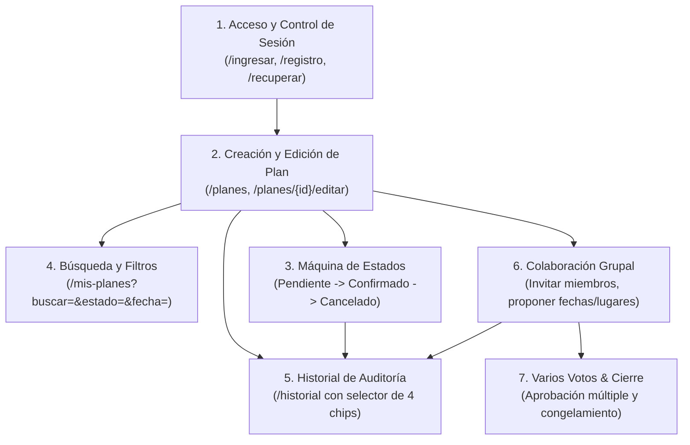

# Planazo — Proyecto 2 IHC

> Aplicación web desarrollada con **Laravel 12**, plantillas **Blade**, **Tailwind CSS 4** y **MySQL 8.0**. Diseñada para ejecutarse por defecto mediante **Docker**, con soporte completo para **ejecución manual local**.

---

## 🚀 Requisitos Previos

Elige según tu modalidad preferida:

- **Modo por defecto (Docker):**
  - [Docker Desktop](https://www.docker.com/products/docker-desktop) (con Docker Compose).
  - Git.
- **Modo manual (Host local):**
  - PHP 8.2 o superior (con extensiones `pdo_mysql`, `mbstring`, `openssl`).
  - Composer 2.x.
  - Servidor MySQL 8.0 en ejecución.
  - Node.js 18+ y npm.
  - Git.

---

## ⚡ Guía de Inicio Rápido

### Perfil 1: Docente / Evaluador

Si tu objetivo es probar y calificar la aplicación inmediatamente:

1. Clona el repositorio:

   ```bash
   git clone https://github.com/moises-cisneros/Proyecto2IHC.git
   cd Proyecto2IHC
   ```

2. Inicia el entorno con Docker (comando estándar para cualquier sistema operativo):

   ```bash
   docker compose up --build
   ```

   *(Para comprobar que todas las herramientas base estén instaladas antes de iniciar, podés ejecutar `node scripts/setup.mjs`, `pnpm run setup` o `powershell ./scripts/setup.ps1`).*
3. Abre tu navegador en [http://localhost:9300](http://localhost:9300).
4. Inicia sesión con cualquiera de los usuarios de prueba precargados (por ejemplo: `test@example.com` / `password`).

*(El script crea el `.env`, levanta MySQL, migra la base de datos, siembra los usuarios de prueba y arranca Laravel y Vite automáticamente).*

---

### Perfil 2: Desarrollador / Colaborador

Si vas a programar, refactorizar o añadir funcionalidades:

#### Opción A: Desarrollo con Docker (Por defecto)

- Iniciar entorno:

  ```bash
  docker compose up --build
  ```

- Correr migraciones adicionales:

  ```bash
  docker compose exec planazo_app php artisan migrate
  ```

- Ejecutar pruebas:

  ```bash
  docker compose exec planazo_app php artisan test
  ```

- Detener entorno:

  ```bash
  docker compose down
  ```

#### Opción B: Desarrollo Manual en Host Local

```bash
# 1. Instalar dependencias
composer install
pnpm install

# 2. Configurar variables de entorno y clave de cifrado
cp .env.example .env
php artisan key:generate

# 3. Configurar tus credenciales de base de datos en .env y migrar
php artisan migrate

# 4. Iniciar servidores (en terminales separadas)
php artisan serve    # Servidor HTTP en http://localhost:8000
pnpm dev             # Servidor Vite HMR en http://localhost:9373
```

#### Sincronización de Habilidades de IA (OpenSpec / Asistentes)

El repositorio incluye habilidades versionadas para evaluación heurística y diseño de interacción en `.agents/skills/`. Si utilizas editores con agentes de IA (Cursor, OpenCode, Claude Code, etc.), puedes sincronizarlas sin ensuciar el control de versiones ejecutando:

```bash
npx @fission-ai/openspec init
```

Las configuraciones locales de cada herramienta (`.agent/`, `.claude/`, `.cursor/`, etc.) están convenientemente excluidas en `.gitignore`.

---

## 🌐 Accesos y Servicios

| Servicio | URL / Host | Puerto Host | Descripción |
| :--- | :--- | :--- | :--- |
| **Aplicación Web** | [http://localhost:9300](http://localhost:9300) | `9300` | Laravel 12 (PHP 8.2) + Servidor HTTP |
| **Vite Dev Server (HMR)** | [http://localhost:9373](http://localhost:9373) | `9373` | Compilación de assets y recarga en caliente |
| **Base de Datos MySQL** | `127.0.0.1` | `9306` | MySQL 8.0 (BD: `proyecto2ihc`, user: `root`, pass: `root`) |

---

## 👤 Usuarios de Prueba Precargados (Seeders)

La base de datos se siembra automáticamente al iniciar Docker con tres cuentas listas para usar sin necesidad de registrarse:

| Usuario | Correo Electrónico | Contraseña | Datos de inicio |
| :--- | :--- | :--- | :--- |
| **Test User** | `test@example.com` | `password` | Cuenta 1 de prueba |
| **Test User 2** | `test2@example.com` | `password` | Cuenta 2 de prueba |
| **Usuario 1** | `usuario1@example.com` | `password123` | Cuenta 3 de prueba |

Para volver a sembrar los datos manualmente:

```bash
docker compose exec planazo_app php artisan db:seed
```

---

## 🗺️ App Map — Mapa de Flujos de la Aplicación



1. **Flujo 1 (Acceso y Autenticación):** Acceso seguro con cuentas sembradas, registro y recuperación de contraseña.
2. **Flujo 2 (Creación y Edición):** Registro de planes con organizador automático desde sesión y fecha límite.
3. **Flujo 3 (Máquina de Estados):** Transición controlada: `pendiente` $\to$ `confirmado` $\to$ `cancelado` (estado terminal inmutable).
4. **Flujo 4 (Búsqueda y Filtros):** Filtrado dinámico por texto, estado y fechas (próximos 7 días o vencidos).
5. **Flujo 5 (Historial de Auditoría):** Bitácora cronológica con las 4 dimensiones del evento (Qué, Quién, Cuándo, Resultado).
6. **Flujo 6 (Colaboración Grupal):** Invitación de amigos por correo, aceptación y propuestas de fechas o lugares.
7. **Flujo 7 (Varios Votos y Cierre):** Votación por aprobación múltiple, alternancia reactiva de votos y congelamiento ante confirmación o vencimiento.

---

## 🧠 Principios y Avances de Interacción Humano-Computador (IHC)

La aplicación sigue una disciplina estricta de usabilidad, ergonomía y accesibilidad:

- **Ley de Fitts ($T = a + b \log_2(2D/W)$):** Todo botón o control interactivo (votar, proponer, invitar, confirmar) garantiza un área táctil mínima de **44×44px** (`min-height: 44px`). Los controles antagónicos mantienen una separación preventiva de **12px (`gap-3`)**.
- **Ley de Hick ($T = b \log_2(n + 1)$):** Clasificación en $n=2$ pestañas en la sala de votación (*Fechas propuestas* vs *Lugares propuestos*) y $n=4$ chips temáticos en el historial (*Todos, Estados, Creaciones, Participación*).
- **Carga Cognitiva ($7 \pm 2$ chunks):** Tarjetas sintéticas con los 4 metadatos esenciales para evitar sobrecarga mental.
- **10 Heurísticas de Nielsen:**
  - *H1 (Visibilidad del estado):* Contadores de votos en vivo y badges semánticos con texto e ícono.
  - *H3 (Control y libertad):* Diálogo modal nativo `<dialog>` accesible para abandono de planes o retiro de votos.
  - *H4 (Consistencia y estándares):* Cero dependencias externas (sin SweetAlert2 ni NProgress), usando `<dialog>` y `<x-toast-alerta />` flotante nativo de 3 segundos.
  - *H5 (Prevención de errores):* Inhabilitación de controles y mensajes de sala cerrada para planes confirmados o vencidos.
  - *H6 (Reconocimiento antes que recuerdo):* Organizador cargado automáticamente desde la sesión activa (`auth()->user()->name`).

---

## 🎭 Pruebas E2E con Playwright (Modo Visible en Escritorio)

Siguiendo el estándar pedagógico de que **«una prueba es una tarea humana»**, cada test E2E narra el recorrido real de un usuario («Anita...», «Carlos...») utilizando localizadores semánticos accesibles (`getByRole`, `getByLabel`, `getByText`) sin clases CSS técnicas.

### Instalación y Configuración Inicial de Playwright

Para que Playwright pueda controlar y abrir la ventana del navegador en tu sistema operativo, es necesario descargar los binarios de Chromium (se ejecuta una única vez tras clonar el repositorio):

```bash
pnpm dlx playwright install chromium
```

### Ejecución Rápida

```bash
# Abre la ventana de Chromium en tu pantalla para ver la interacción en vivo:
pnpm run test:e2e:headed

# Abre el UI Runner interactivo paso a paso de Playwright:
pnpm run test:e2e:ui
```

*(Para ejecución de pruebas puntuales, filtrado por nombres y el protocolo detallado para crear nuevas pruebas E2E, consultá [AGENTS.md](AGENTS.md) y [CONTRIBUTING.md](CONTRIBUTING.md)).*

---

## 🛑 Detener y Reiniciar el Entorno

- **Detener la aplicación:**

  ```bash
  docker compose down
  ```

- **Reiniciar desde cero (Limpiar contenedores y base de datos):**

  ```bash
  docker compose down -v
  docker compose up --build
  ```

---

## 🧭 Rutas y Funcionalidades de la Aplicación

- **Acceso y Autenticación:**
  - `/` ➔ Redirección automática a `/ingresar`.
  - `/ingresar` ➔ Formulario de inicio de sesión (`login`).
  - `/registro` ➔ Creación de nueva cuenta de usuario.
  - `/recuperar` y `/restablecer/{token}` ➔ Recuperación de contraseña por correo.
- **Gestión de Planes y Colaboración (Zona Autenticada):**
  - `/mis-planes` ➔ Listado interactivo de planes personales con filtros por estado y fecha.
  - `/planes` (POST) ➔ Creación de un nuevo plan (descripción, fecha límite y organizador automático).
  - `/planes/{plan}` ➔ Sala colaborativa del plan: invitación a miembros, propuestas de fechas/lugares y votación grupal.
  - `/planes/{plan}/editar` y `PUT /planes/{plan}` ➔ Edición de plan existente (organizador inmutable).
  - `DELETE /planes/{plan}` ➔ Eliminación de plan con diálogo modal accesible.
  - `PUT /planes/{plan}/estado` ➔ Transición de estados del plan (`pendiente` ➔ `confirmado` ➔ `cancelado`).
  - `/historial` ➔ Bitácora cronológica e inmutable de eventos con selector de 4 categorías (Hick).

---

## 🧪 Pruebas Automatizadas

La suite de pruebas unitarias y de integración de Laravel se ejecuta mediante **PHPUnit**:

- **Dentro del contenedor Docker (Recomendado):**

  ```bash
  docker compose exec planazo_app php artisan test
  ```

- **Desde el host local (si se cuenta con PHP y Composer instalados):**

  ```bash
  php artisan test
  ```

---

## 📚 Documentación Técnica y Académica

- [AGENTS.md](AGENTS.md): Reglas operativas estrictas para agentes de IA, prohibición de atribución de IA, principios IHC (Fitts, Hick, Carga Cognitiva) y flujo de sub-issues.
- [ARCHITECTURE.md](ARCHITECTURE.md): Arquitectura de capas, modelos Eloquent, controladores y vistas Blade.
- [resources/DESIGN.md](resources/DESIGN.md): Guía oficial del sistema de diseño, tokens cromáticos y directrices visuales y ergonómicas (IHC).
- [CONTRIBUTING.md](CONTRIBUTING.md): Guía para colaboradores, ramas y convención de Conventional Commits.
- [docs/](docs/): Evidencias académicas, historial de tareas de clase y capturas del proyecto recibido.

---

## 📄 Licencia

Este proyecto está licenciado bajo la licencia MIT. Consulta el archivo [LICENSE](LICENSE) para más información.
