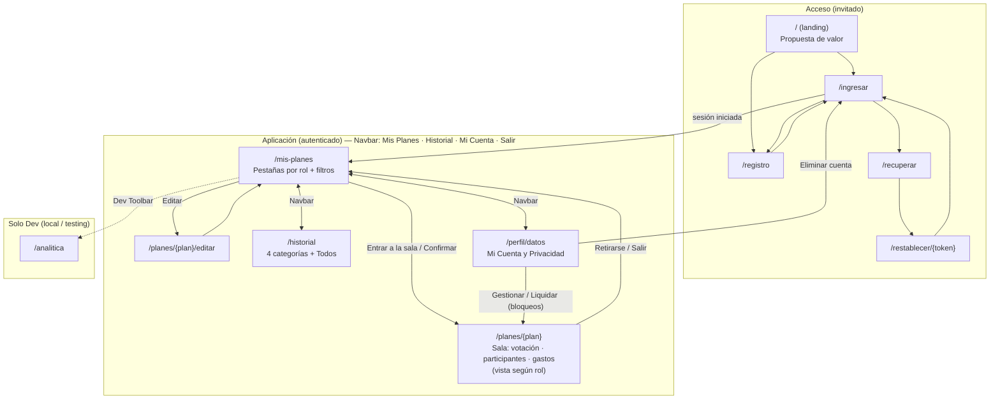

# Planazo — Proyecto 2 IHC

[](https://github.com/moises-cisneros/Proyecto2IHC/actions/workflows/pruebas.yml)

> Aplicación web desarrollada con **Laravel 12**, plantillas **Blade**, **Tailwind CSS 4** y **MySQL 8.0**. Diseñada para ejecutarse por defecto mediante **Docker**, con soporte completo para **ejecución manual local**.

- 🎬 **Video Demostrativo de la Aplicación:** [Ver recorrido completo en Google Drive](https://drive.google.com/file/d/1SmEQfaGl5yrJzHJ5I6UO3l_oWGjUDftO/view?usp=sharing)
- 🎨 **Prototipo y Sistema de Diseño en Figma:** [Ver Archivo en Figma](https://www.figma.com/design/wIJx272I0oFwfAaHs5s1AZ/2do-Proyecto-IHC---MC?node-id=176-351&t=zvDveuDqdkkvmNLh-1)

---

## 🚀 Requisitos Previos

Elige según tu modalidad preferida:

- **Modo por defecto (Docker):**
    - [Docker Desktop](https://www.docker.com/products/docker-desktop) (con Docker Compose).
    - Git.
- **Modo manual (Host local):**
    - PHP 8.2 o superior (con extensiones `pdo_mysql`, `mbstring`, `openssl`).
    - Composer 2.x.
    - Servidor MySQL 8.0 en ejecución.
    - Node.js 18+ y npm.
    - Git.

---

## ⚡ Guía de Inicio Rápido

### Perfil 1: Docente / Evaluador

Si tu objetivo es probar y calificar la aplicación inmediatamente:

1. Clona el repositorio:

    ```bash
    git clone https://github.com/moises-cisneros/Proyecto2IHC.git
    cd Proyecto2IHC
    ```

2. Inicia el entorno con Docker (comando estándar para cualquier sistema operativo):

    ```bash
    docker compose up --build
    ```

    _(Para comprobar que todas las herramientas base estén instaladas antes de iniciar, podés ejecutar `node scripts/setup.mjs`, `pnpm run setup` o `powershell ./scripts/setup.ps1`)._

3. Abre tu navegador en [http://localhost:9300](http://localhost:9300).
4. Inicia sesión con cualquiera de los usuarios de prueba precargados (por ejemplo: `test@example.com` / `password`).

_(El script crea el `.env`, levanta MySQL, migra la base de datos, siembra los usuarios de prueba y arranca Laravel y Vite automáticamente)._

---

### 💳 Conciliación Inteligente de Comprobantes (Modo Offline vs Modo IA)

El módulo de liquidación de gastos incluye un servicio de escaneo y validación de comprobantes bancarios diseñado mediante el patrón **Driver**:

- **Modo Offline / Evaluación por Defecto (`fake`):**
  No requiere **ninguna API key ni conexión a internet**. Viene configurado por defecto (`COMPROBANTE_SCANNER_DRIVER=fake` en `.env.example`). Interpreta comprobantes sintéticos de manera determinista, permitiendo probar la aplicación y ejecutar los tests E2E y unitarios de forma 100% aislada y sin costo.
- **Modo IA con Visión Multimodal (`gemini` - Opcional):**
  Si deseas habilitar la extracción real en vivo con IA para cualquier foto o comprobante bancario, basta con configurar tu clave en el archivo `.env`:

    ```env
    COMPROBANTE_SCANNER_DRIVER=gemini
    GEMINI_API_KEY=tu_api_key_de_google_ai_studio
    GEMINI_MODEL=gemini-2.5-flash
    ```

    _(Se puede generar una clave gratuita en [Google AI Studio](https://aistudio.google.com/))._

- **Generador de Comprobantes Sintéticos Limpios:**
  Para pruebas reproducibles sin exponer datos sensibles ni cuentas bancarias reales, el repositorio incluye un generador que sintetiza comprobantes móviles con estilo bancario boliviano (BNB, Banco Unión, Yape, Yastá):

    ```bash
    pnpm run fixtures:comprobantes
    ```

---

### Perfil 2: Desarrollador / Colaborador

Si vas a programar, refactorizar o añadir funcionalidades:

#### Opción A: Desarrollo con Docker (Por defecto)

- Iniciar entorno:

    ```bash
    docker compose up --build
    ```

- Correr migraciones adicionales:

    ```bash
    docker compose exec planazo_app php artisan migrate
    ```

- Ejecutar pruebas:

    ```bash
    docker compose exec planazo_app php artisan test
    ```

- Detener entorno:

    ```bash
    docker compose down
    ```

#### Opción B: Desarrollo Manual en Host Local

```bash
# 1. Instalar dependencias
composer install
pnpm install

# 2. Configurar variables de entorno y clave de cifrado
cp .env.example .env
php artisan key:generate

# 3. Configurar tus credenciales de base de datos en .env y migrar
php artisan migrate

# 4. Iniciar servidores (en terminales separadas)
php artisan serve    # Servidor HTTP en http://localhost:8000
pnpm dev             # Servidor Vite HMR en http://localhost:9373
```

#### Sincronización de Habilidades de IA (OpenSpec / Asistentes)

El repositorio incluye habilidades versionadas para evaluación heurística y diseño de interacción en `.agents/skills/`. Si utilizas editores con agentes de IA (Cursor, OpenCode, Claude Code, etc.), puedes sincronizarlas sin ensuciar el control de versiones ejecutando:

```bash
npx @fission-ai/openspec init
```

Las configuraciones locales de cada herramienta (`.agent/`, `.claude/`, `.cursor/`, etc.) están convenientemente excluidas en `.gitignore`.

---

## 🌐 Accesos y Servicios

| Servicio                     | URL / Host                                                         | Puerto Host | Descripción                                                                |
| :--------------------------- | :----------------------------------------------------------------- | :---------- | :------------------------------------------------------------------------- |
| **Aplicación Web**           | [http://localhost:9300](http://localhost:9300)                     | `9300`      | Laravel 12 (PHP 8.2) + Servidor HTTP                                       |
| **Vite Dev Server (HMR)**    | [http://localhost:9373](http://localhost:9373)                     | `9373`      | Compilación de assets y recarga en caliente                                |
| **Base de Datos MySQL**      | `127.0.0.1`                                                        | `9306`      | MySQL 8.0 (BD: `proyecto2ihc`, user: `root`, pass: `root`)                 |
| **Panel de Analítica (Dev)** | [http://localhost:9300/analitica](http://localhost:9300/analitica) | `9300`      | Telemetría interna de interacción y embudos (Solo entorno local / testing) |

---

## 👤 Usuarios de Prueba Precargados (Seeders)

La base de datos se siembra automáticamente al iniciar Docker con tres cuentas listas para usar sin necesidad de registrarse:

| Usuario         | Correo Electrónico     | Contraseña    | Datos de inicio    |
| :-------------- | :--------------------- | :------------ | :----------------- |
| **Test User**   | `test@example.com`     | `password`    | Cuenta 1 de prueba |
| **Test User 2** | `test2@example.com`    | `password`    | Cuenta 2 de prueba |
| **Usuario 1**   | `usuario1@example.com` | `password123` | Cuenta 3 de prueba |

Para volver a sembrar los datos manualmente:

```bash
docker compose exec planazo_app php artisan db:seed
```

---

## 🗺️ App Map — Pantallas y Navegación

> El App Map muestra **qué pantallas existen y cómo se llega a ellas**. Los pasos de cada tarea de usuario (con sus ramas por rol y estado) están en los [Task Flows](#-task-flows--tareas-de-usuario).
>
> **Detalle completo y fuente de verdad:** [`resources/FLOWS.md`](resources/FLOWS.md) (composición de cada pantalla, matriz de permisos, Task Flows, trazabilidad e inventario de rutas). Este apartado es un resumen.



**Navegación global (navbar):** `Mis Planes`, `Historial`, `Mi Cuenta` y `Salir`. La analítica solo se alcanza por la píldora flotante de desarrollo.

**Estados canónicos del plan:** `pendiente` → `confirmado` (inmutable) · `cancelado` (inmutable).

---

## 🧭 Task Flows — Tareas de Usuario

Cada flujo describe **una tarea** de principio a fin con sus ramas (el App Map de arriba, en cambio, muestra qué pantallas existen). En Figma, **cada Task Flow es un _Flow_ del prototipo** (`TF1 … TF8`, frame inicial y recorrido en [`FLOWS.md` §6](resources/FLOWS.md)). Convenciones: 👤 participante · 🧑‍💼 organizador · ✉️ invitado pendiente.

|  #  | Tarea                                    |   Rol    | Happy path y ramas principales                                                                                                                                                                                                                                                                                                          |
| :-: | :--------------------------------------- | :------: | :-------------------------------------------------------------------------------------------------------------------------------------------------------------------------------------------------------------------------------------------------------------------------------------------------------------------------------------- |
| TF1 | Acceso y recuperar la contraseña         | Invitado | `/` (landing) → `/ingresar` → `/mis-planes` (fin). Ramas: `/registro` (cuenta nueva → `mis-planes` vacío) · credenciales inválidas con mensaje genérico y límite de 5 intentos/min · `/recuperar` responde igual exista o no el correo → `/restablecer/{token}` (enlace vencido pide uno nuevo) → `/ingresar` → `/mis-planes`           |
| TF2 | Crear un plan y confirmarlo              |    🧑‍💼    | `+ Crear mi primer plan` (modal) → nombre + fecha límite vigente → plan `pendiente` → «Confirmar» lleva a la sala → «Cerrar votación y confirmar» → sala congelada. Ramas: nombre vacío o fecha pasada → error · **empate** con motivo ≥ 5 caracteres · sin propuestas conserva la fecha límite. **Única vía de confirmación: la sala** |
| TF3 | Invitar y responder una invitación       | 🧑‍💼 / ✉️  | Organizador invita por correo → (cambio de usuario) el invitado ve el plan en «Planes donde participo» → «Aceptar invitación» → pasa a participante. Ramas: «Rechazar invitación» (simétrico al aceptar) · correo inválido                                                                                                              |
| TF4 | Proponer y votar                         | 👤 / 🧑‍💼  | Proponer fecha o lugar → votar por aprobación (varios votos, se pueden retirar) → bloqueado cuando el plan se confirma o vence la fecha límite                                                                                                                                                                                          |
| TF5 | Registrar un gasto                       | 👤 / 🧑‍💼  | Plan no cancelado → «Registrar gasto» → concepto + monto + división (participantes elegidos conscientemente, ninguno preseleccionado) → saldos netos recalculados                                                                                                                                                                       |
| TF6 | Saldar una deuda con el perfil de pago   |    👤    | El deudor completa su perfil de pago (alias y QR) → «Registrar Pago» eligiendo modalidad (total o parcial, sin preselección) con comprobante opcional → pago `pendiente`. Ramas: el acreedor **confirma** o **rechaza con motivo obligatorio**                                                                                          |
| TF7 | Salir de un plan                         |    👤    | Participante sin deuda: `Retirarse` → se anulan sus votos → vuelve a Mis planes. Ramas: **con deuda** el diálogo explica el motivo y enlaza a liquidar · el organizador no se retira: **cancela** (diálogo destructivo) o **elimina** (Salida Honesta si está bloqueado)                                                                |
| TF8 | Eliminar mi cuenta o descargar mis datos |  Todos   | `Eliminar mi cuenta` sin bloqueos → contraseña actual → cuenta eliminada → `/ingresar`. Ramas: **con bloqueos** (planes abiertos o deudas) el diálogo lista cada causa con su acción · **descargar mis datos** (JSON o CSV) como alternativa                                                                                            |

Cada flujo muestra solo su happy path; las ramas se prueban en la página «App». Fuera de los flujos (siguen siendo pantallas): `/historial`, `/mis-planes` con búsqueda y filtros, `editar-plan`, ediciones de `/perfil/datos` y `/analitica` (Dev). El criterio está en [`FLOWS.md` §6](resources/FLOWS.md). En Figma, la página **«Flujos»** agrupa cada flujo con sus frames en fila para probarlo en Play y sacar capturas; se regenera desde «App» con [`scripts/figma/regenerar-flujos.js`](scripts/figma/regenerar-flujos.js) (ver [`FLOWS.md` §11.6](resources/FLOWS.md)).

### Detalle de los Flujos

1. **TF1 — Acceso y control de sesión:** rate-limiting (`throttle:5,1`), protección contra enumeración de credenciales y de correos, cuentas de prueba sembradas y regeneración del token CSRF al cerrar sesión.
2. **TF2 y `/mis-planes` — Dashboard:** dos pestañas por propósito/rol (_«Mis planes creados»_ y _«Planes donde participo»_), clasificación cronológica LATCH (_Hoy_, _Próximos_, _Vencidos_) y filtros acotados conforme a la Ley de Hick.
3. **TF2 a TF4 y TF7 — Sala colaborativa (`/planes/{plan}`):** una sola pantalla con vistas por rol gobernadas por `PlanPolicy`. La **única** forma de salir de un plan es `planes.retirarse`; la **única** forma de confirmar es `planes.confirmar`.
4. **TF5 y TF6 — Gastos y liquidación:** partes iguales ($Monto/N$) o cuotas personalizadas; matriz de saldos netos cruzados; ciclo de liquidación bilateral visible para ambas partes.
5. **Servicio transversal — Historial (`/historial`):** bitácora inmutable en 4 dimensiones (Qué, Quién, Cuándo, Resultado) con selector temático de 4 categorías más «Todos».
6. **Servicio de observabilidad — Analítica (`/analitica`):** solo entorno local y de pruebas; la navegación del usuario final queda libre de sobrecarga cognitiva.

---

## 🧠 Principios y Avances de Interacción Humano-Computador (IHC)

La aplicación sigue una disciplina estricta de usabilidad, ergonomía y accesibilidad:

- **Ley de Fitts:** $T = a + b \log_{2}(2D/W)$ — Todo botón o control interactivo (votar, proponer, invitar, confirmar) garantiza un área táctil mínima de **44×44px** (`min-height: 44px`). Los controles antagónicos mantienen una separación preventiva de **12px (`gap-3`)**.
- **Ley de Hick:** $T = b \log_{2}(n + 1)$ — Clasificación en $n = 2$ pestañas en la sala de votación (_Fechas propuestas_ vs _Lugares propuestos_) y $n = 5$ chips temáticos en el historial (_Todos, Estados, Creaciones, Participación, Gastos_).
- **Carga Cognitiva (7 ± 2 chunks):** Tarjetas sintéticas con los 4 metadatos esenciales para evitar sobrecarga mental.
- **10 Heurísticas de Nielsen:**
    - _H1 (Visibilidad del estado):_ Contadores de votos en vivo y badges semánticos con texto e ícono.
    - _H3 (Control y libertad):_ Diálogo modal nativo `<dialog>` accesible para abandono de planes o retiro de votos.
    - _H4 (Consistencia y estándares):_ Cero dependencias externas (sin SweetAlert2 ni NProgress), usando `<dialog>` y `<x-toast-alerta />` flotante nativo de 3 segundos.
    - _H5 (Prevención de errores):_ Inhabilitación de controles y mensajes de sala cerrada para planes confirmados o vencidos.
    - _H6 (Reconocimiento antes que recuerdo):_ Organizador cargado automáticamente desde la sesión activa (`auth()->user()->name`).

---

## 🎭 Pruebas E2E con Playwright (Modo Visible en Escritorio)

Siguiendo el estándar pedagógico de que **«una prueba es una tarea humana»**, cada test E2E narra el recorrido real de un usuario («Anita...», «Carlos...») utilizando localizadores semánticos accesibles (`getByRole`, `getByLabel`, `getByText`) sin clases CSS técnicas.

### Instalación y Configuración Inicial de Playwright

Para que Playwright pueda controlar y abrir la ventana del navegador en tu sistema operativo, es necesario descargar los binarios de Chromium (se ejecuta una única vez tras clonar el repositorio):

```bash
pnpm dlx playwright install chromium
```

### Ejecución Rápida

```bash
# Abre la ventana de Chromium en tu pantalla para ver la interacción en vivo:
pnpm run test:e2e:headed

# Abre el UI Runner interactivo paso a paso de Playwright:
pnpm run test:e2e:ui
```

_(Para ejecución de pruebas puntuales, filtrado por nombres y el protocolo detallado para crear nuevas pruebas E2E, consultá [AGENTS.md](AGENTS.md) y [CONTRIBUTING.md](CONTRIBUTING.md))._

---

## 🛑 Detener y Reiniciar el Entorno

- **Detener la aplicación:**

    ```bash
    docker compose down
    ```

- **Reiniciar desde cero (Limpiar contenedores y base de datos):**

    ```bash
    docker compose down -v
    docker compose up --build
    ```

---

## 🧭 Rutas y Funcionalidades de la Aplicación

- **Acceso y Autenticación:**
    - `/` ➔ Redirección automática a `/ingresar`.
    - `/ingresar` ➔ Formulario de inicio de sesión (`login`).
    - `/registro` ➔ Creación de nueva cuenta de usuario.
    - `/recuperar` y `/restablecer/{token}` ➔ Recuperación de contraseña por correo.
- **Gestión de Planes y Colaboración (Zona Autenticada):**
    - `/mis-planes` ➔ Listado interactivo de planes personales con filtros por estado y fecha.
    - `/planes` (POST) ➔ Creación de un nuevo plan (descripción, fecha límite y organizador automático).
    - `/planes/{plan}` ➔ Sala colaborativa del plan: invitación a miembros, propuestas de fechas/lugares y votación grupal.
    - `/planes/{plan}/editar` y `PUT /planes/{plan}` ➔ Edición de plan existente (organizador inmutable).
    - `DELETE /planes/{plan}` ➔ Eliminación de plan con diálogo modal accesible.
    - `PUT /planes/{plan}/estado` ➔ Transición de estados del plan (`pendiente` ➔ `confirmado` ➔ `cancelado`).
    - `/historial` ➔ Bitácora cronológica e inmutable de eventos con selector de 4 categorías (Hick).

---

## 🧪 Pruebas Automatizadas y Calidad Continua (CI)

### Pruebas Unitarias y de Integración (PHPUnit)

La suite de pruebas de Laravel valida la lógica de negocio, políticas de autorización y contratos:

- **Ejecución básica:**

    ```bash
    # En Docker:
    docker compose exec planazo_app php artisan test

    # En Host local:
    php artisan test
    ```

- **Ejecución con reporte de Cobertura de Código (`--coverage`):**

    ```bash
    php artisan test --coverage
    ```

- **Reporte de Cobertura de Líneas Agregadas en el Fork (`diff-cover`):**

    Para auditar la cobertura estricta sobre el código nuevo añadido en el fork:

    ```bash
    # Requiere diff-cover (pip install diff-cover)
    diff-cover docs/entregables/pruebas/reportes/coverage/clover.xml --compare-branch 731fb8d
    ```

    Los reportes completos generados (HTML interactivo y Markdown) se encuentran en [`docs/entregables/pruebas/`](docs/entregables/pruebas/).

### Pruebas E2E (Playwright)

Automatización de tareas humanas accesibles en el navegador Chromium:

```bash
pnpm run test:e2e          # Modo headless (predeterminado)
pnpm run test:e2e:headed   # Modo visible en escritorio
pnpm run test:e2e:ui       # Consola interactiva de Playwright
```

### Integración Continua en GitHub Actions (`.github/workflows/pruebas.yml`)

El repositorio cuenta con un pipeline de CI obligatorio que se dispara en cada `push` y `pull_request` sobre `main` y `master`:

1. **Paso visible PHPUnit + Cobertura:** Ejecución de las 280+ pruebas backend con reporte detallado.
2. **Paso visible Playwright E2E:** Ejecución secuencial de las pruebas end-to-end (13 specs, 30 casos) con Chromium.
3. **Subida de Artefactos (`actions/upload-artifact@v4`):** Guarda automáticamente los reportes `playwright-report` y `coverage` (`if: always()`).
4. **Política de Cero Tolerancia:** Si una prueba falla en Actions, se repara inmediatamente; está terminantemente prohibido omitirla o borrarla.

---

## 📚 Documentación Técnica y Académica

- [AGENTS.md](AGENTS.md): Reglas operativas estrictas para agentes de IA, prohibición de atribución de IA, principios IHC (Fitts, Hick, Carga Cognitiva) y flujo de sub-issues.
- [ARCHITECTURE.md](ARCHITECTURE.md): Arquitectura de capas, modelos Eloquent, controladores y vistas Blade.
- [resources/DESIGN.md](resources/DESIGN.md): Guía oficial del sistema de diseño, arquitectura de tokens semánticos y componentes canónicos para Figma y código.
- [resources/FLOWS.md](resources/FLOWS.md): Contrato interactivo con App Map (11 pantallas), Task Flows (TF1–TF8) e inventario de 37 rutas.
- [CONTRIBUTING.md](CONTRIBUTING.md): Guía para colaboradores, ramas y convención de Conventional Commits.
- [docs/entregables/](docs/entregables/README.md): Carpeta oficial de entregables de la entrega final y defensa oral (informe, diapositivas, DS, accesibilidad, video y credenciales).
- [Video Demostrativo](https://drive.google.com/file/d/1SmEQfaGl5yrJzHJ5I6UO3l_oWGjUDftO/view?usp=sharing): Recorrido en video de los flujos principales de la aplicación funcionando.
- [Sistema en Figma](https://www.figma.com/design/wIJx272I0oFwfAaHs5s1AZ/2do-Proyecto-IHC---MC?node-id=176-351&t=zvDveuDqdkkvmNLh-1): Prototipo interactivo y sistema de diseño con componentes y tokens.
- [docs/internal/Tareas.md](docs/internal/Tareas.md): Bitácora de clases, hitos de entrega y flujos detallados de la aplicación.
- [docs/](docs/): Evidencias académicas e historial de tareas previas.

---

## 📄 Licencia

Este proyecto está licenciado bajo la licencia MIT. Consulta el archivo [LICENSE](LICENSE) para más información.
