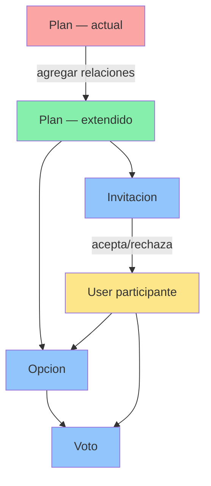

# Análisis de Proyecto Recibido — Clase 17

---

## 1. Proyecto Recibido

**Nombre del proyecto:** Planazo  
**Repositorio:** `planazoPhp / Proyecto2IHC`  
**Stack:** Laravel 12 · PHP 8.2 · MySQL 8 · Tailwind CSS 4 · Vite  
**Grupo anterior:** Grupo que desarrolló la funcionalidad de autenticación, gestión de planes y cambio de estados (pendiente → confirmado → cancelado).

El proyecto implementa un gestor de planes personales con autenticación completa (registro, login, recuperación de contraseña por correo), y un CRUD de planes con filtros por nombre, estado y fecha.

---

## 2. Ejecución

### Comando utilizado

El proyecto fue dockerizado, por lo que el levantamiento completo se realiza con un único comando desde la carpeta raíz del proyecto:

```bash
npm run docker:dev
```

Este comando ejecuta internamente `docker compose up --build`, que levanta tres servicios:

| Servicio | Descripción | Puerto |
|---|---|---|
| `planazo_app` | Laravel (PHP 8.2) con `php artisan serve` | 8000 |
| `planazo_mysql` | MySQL 8.0 con BD `proyecto2ihc` | 9306 |
| `planazo_vite` | Node 24 con Vite + Tailwind HMR | 5173 |

El script de arranque (`docker/entrypoint.sh`) también crea el `.env`, genera el `APP_KEY` y ejecuta las migraciones automáticamente.

### Consola corriendo


### Proyecto iniciado en el navegador


### Consola después de los cambios de Docker


---

## 3. Recorrido del Proyecto

### 3.1 Pantalla de Carga / Login

**Pantalla:** `/ingresar`  
**Acción:** El usuario escribe su correo y contraseña para acceder al sistema.  
**Regla de negocio:** Se valida que el correo exista y que la contraseña coincida con el hash almacenado. Si falla, se muestra un mensaje de error sin revelar cuál campo fue incorrecto (seguridad).  
**Archivos reales:**
- Ruta: [`routes/web.php`](../routes/web.php) — líneas 11–12
- Controlador: [`AutentificacionController::ingresar()`](../app/Http/Controllers/AutentificacionController.php)
- Vista: [`resources/views/acceso/ingresar.blade.php`](../resources/views/acceso/ingresar.blade.php)


---

### 3.2 Registro de Usuario

**Pantalla:** `/registro`  
**Acción:** El usuario ingresa nombre, correo y contraseña (con confirmación) para crear su cuenta.  
**Regla de negocio:** El correo debe ser único en la BD. La contraseña mínima es 8 caracteres y se almacena como hash bcrypt. Al registrarse, el usuario queda logueado automáticamente.  
**Archivos reales:**
- Ruta: [`routes/web.php`](../routes/web.php) — líneas 14–15
- Controlador: [`AutentificacionController::registrar()`](../app/Http/Controllers/AutentificacionController.php)
- Migración: [`database/migrations/0001_01_01_000000_create_users_table.php`](../database/migrations/0001_01_01_000000_create_users_table.php)


---

### 3.3 Pantalla de Inicio (Mis Planes)

**Pantalla:** `/mis-planes`  
**Acción:** Muestra todos los planes del usuario autenticado, con filtros por nombre, estado y fecha (próximos 7 días / vencidos).  
**Regla de negocio:** Solo se muestran los planes del usuario logueado (`user_id = auth()->id()`). La ruta está protegida por el middleware `auth`.  
**Archivos reales:**
- Ruta: [`routes/web.php`](../routes/web.php) — línea 28
- Controlador: [`PlanesController::listar()`](../app/Http/Controllers/PlanesController.php)
- Modelo / Scope: [`Plan::scopeFiltrar()`](../app/Models/Plan.php)
- Vista: [`resources/views/planes/listar.blade.php`](../resources/views/planes/listar.blade.php)


---

### 3.4 Crear Plan

**Pantalla:** Formulario en `/mis-planes` (modal o sección inline)  
**Acción:** El usuario completa nombre, organizador y fecha límite para crear un nuevo plan.  
**Regla de negocio:** Los tres campos son obligatorios. El plan se crea con estado `pendiente` por defecto y se asocia al `user_id` del usuario logueado.  
**Archivos reales:**
- Ruta: [`routes/web.php`](../routes/web.php) — línea 29
- Controlador: [`PlanesController::guardar()`](../app/Http/Controllers/PlanesController.php)
- Migración tabla planes: [`database/migrations/2026_10_02_013531_create_planes_table.php`](../database/migrations/2026_10_02_013531_create_planes_table.php)


---

### 3.5 Confirmación de Plan

**Pantalla:** `/mis-planes` (acción sobre tarjeta de plan)  
**Acción:** El usuario cambia el estado del plan de `pendiente` a `confirmado`.  
**Regla de negocio:** Un plan `cancelado` **no puede** volver a `confirmado`. La transición válida es: `pendiente → confirmado` o `pendiente → cancelado`.  
**Archivos reales:**
- Ruta: [`routes/web.php`](../routes/web.php) — línea 33
- Controlador: [`PlanesController::cambiarEstado()`](../app/Http/Controllers/PlanesController.php)
- Migración estado: [`database/migrations/2026_10_08_174248_agregar_estado_a_planes_table.php`](../database/migrations/2026_10_08_174248_agregar_estado_a_planes_table.php)


---

### 3.6 Cancelación de Plan

**Pantalla:** `/mis-planes` (acción sobre tarjeta de plan)  
**Acción:** El usuario cambia el estado del plan a `cancelado`.  
**Regla de negocio:** Un plan en estado `confirmado` puede cancelarse. Una vez `cancelado`, no puede volver a `confirmado` (estado final irreversible parcialmente).  
**Archivos reales:**
- Controlador: [`PlanesController::cambiarEstado()`](../app/Http/Controllers/PlanesController.php) — líneas 127–144


---

### 3.7 Eliminación de Plan

**Pantalla:** `/mis-planes` (botón eliminar en tarjeta)  
**Acción:** El usuario elimina un plan de la lista.  
**Regla de negocio:** Un plan con estado `confirmado` **no puede eliminarse**. Primero debe cancelarse. Solo planes `pendiente` o `cancelado` pueden borrarse.  
**Archivos reales:**
- Ruta: [`routes/web.php`](../routes/web.php) — línea 32
- Controlador: [`PlanesController::eliminar()`](../app/Http/Controllers/PlanesController.php) — líneas 108–119


---

## 4. Impacto — Qué debe cambiar para implementar la Tarea 5

> **Tarea 5:** Invitar participantes · Proponer fechas o lugares · Votar por una opción

### 4.1 Diagnóstico del estado actual

El modelo `Plan` es completamente **unipersonal**: tiene un solo `user_id` (el creador), no existe concepto de participantes ni de votaciones. El sistema no tiene ninguna capa de colaboración.

```
planes
  id | nombre | organizador | fecha_limite | estado | user_id
```

### 4.2 Nuevas tablas necesarias (migraciones)

```
invitaciones
  id | plan_id (FK) | user_id (FK) | estado (pendiente/aceptada/rechazada) | token

opciones
  id | plan_id (FK) | tipo (fecha/lugar) | valor | created_by (FK user_id)

votos
  id | opcion_id (FK) | user_id (FK)
  UNIQUE (opcion_id, user_id)  ← un usuario, un voto por opción
```

### 4.3 Nuevos modelos

| Modelo | Archivo nuevo |
|---|---|
| `Invitacion` | [`app/Models/Invitacion.php`](../app/Models/Invitacion.php) |
| `Opcion` | [`app/Models/Opcion.php`](../app/Models/Opcion.php) |
| `Voto` | [`app/Models/Voto.php`](../app/Models/Voto.php) |

El modelo `Plan` debe recibir nuevas relaciones en [`app/Models/Plan.php`](../app/Models/Plan.php):

```php
// Agregar en Plan.php:
public function invitaciones() { return $this->hasMany(Invitacion::class); }
public function participantes() { return $this->belongsToMany(User::class, 'invitaciones')->wherePivot('estado', 'aceptada'); }
public function opciones()      { return $this->hasMany(Opcion::class); }
```

### 4.4 Nuevos controladores

| Controlador nuevo | Responsabilidad |
|---|---|
| [`InvitacionesController`](../app/Http/Controllers/InvitacionesController.php) | Enviar invitación por correo, aceptar/rechazar vía token |
| [`OpcionesController`](../app/Http/Controllers/OpcionesController.php) | Proponer fecha o lugar a un plan |
| [`VotosController`](../app/Http/Controllers/VotosController.php) | Registrar/quitar voto de un participante |

### 4.5 Rutas nuevas

En [`routes/web.php`](../routes/web.php) — dentro del middleware `auth`:

```php
Route::post('/planes/{plan}/invitar',         [InvitacionesController::class, 'invitar']);
Route::get( '/invitacion/{token}/aceptar',    [InvitacionesController::class, 'aceptar']);
Route::get( '/invitacion/{token}/rechazar',   [InvitacionesController::class, 'rechazar']);

Route::post('/planes/{plan}/opciones',        [OpcionesController::class, 'proponer']);
Route::delete('/opciones/{opcion}',           [OpcionesController::class, 'eliminar']);

Route::post('/opciones/{opcion}/votar',       [VotosController::class, 'votar']);
Route::delete('/opciones/{opcion}/votar',     [VotosController::class, 'quitar']);
```

### 4.6 Vistas nuevas / modificadas

| Vista | Cambio |
|---|---|
| [`planes/listar.blade.php`](../resources/views/planes/listar.blade.php) | Agregar botón "Invitar" y contador de participantes por plan |
| [`planes/detalle.blade.php`](../resources/views/planes/detalle.blade.php) | **Nueva** — panel de opciones (fechas/lugares) con botones de voto |
| [`acceso/invitacion.blade.php`](../resources/views/acceso/invitacion.blade.php) | **Nueva** — página de aceptar/rechazar invitación (acceso sin login) |

### 4.7 Reglas de negocio nuevas

- Solo el **creador** del plan puede invitar y proponer opciones.
- Los **participantes aceptados** pueden proponer opciones y votar.
- Solo **un voto por usuario por opción** (restricción en BD y en controller).
- Un plan `cancelado` no acepta nuevas invitaciones ni votos.
- El correo de invitación se envía via el sistema de Mail de Laravel (ya configurado con Gmail SMTP en [`.env`](../.env.example)).

### 4.8 Resumen visual del impacto



| Capa | Archivos actuales afectados | Archivos nuevos |
|---|---|---|
| **BD** | — | 3 migraciones nuevas |
| **Modelos** | [`Plan.php`](../app/Models/Plan.php) (+ relaciones) | `Invitacion.php`, `Opcion.php`, `Voto.php` |
| **Controladores** | — | `InvitacionesController`, `OpcionesController`, `VotosController` |
| **Rutas** | [`routes/web.php`](../routes/web.php) (+ 7 rutas) | — |
| **Vistas** | [`planes/listar.blade.php`](../resources/views/planes/listar.blade.php) | `planes/detalle.blade.php`, `acceso/invitacion.blade.php` |
| **Correo** | [`.env.example`](../.env.example) (ya configurado) | `resources/views/emails/invitacion.blade.php` |
