# Análisis de Proyecto Recibido — Clase 17

---

## 1. Proyecto Recibido

**Nombre del proyecto:** Planazo  
**Repositorio anterior:** [https://github.com/diego199D/Proyecto2IHC](https://github.com/diego199D/Proyecto2IHC)  
**Grupo anterior / Autor:** Toledo (`diego199D`)  
**Stack:** Laravel 12 · PHP 8.2 · MySQL 8 · Tailwind CSS 4 · Vite  
**Alcance recibido:** El grupo anterior desarrolló la funcionalidad básica de autenticación (registro, login, recuperación de contraseña por correo) y gestión unipersonal de planes con cambio de estados (`pendiente` → `confirmado` → `cancelado`).

---

## 2. Ejecución

### Comando utilizado

El proyecto fue dockerizado, por lo que el levantamiento completo se realiza con un único comando desde la carpeta raíz del proyecto:

```bash
npm run docker:dev
```

Este comando ejecuta internamente `docker compose up --build`, que levanta tres servicios:

| Servicio | Descripción | Puerto |
| --- | --- | --- |
| `planazo_app` | Laravel (PHP 8.2) con `php artisan serve` | 8000 |
| `planazo_mysql` | MySQL 8.0 con BD `proyecto2ihc` | 9306 |
| `planazo_vite` | Node 24 con Vite + Tailwind HMR | 5173 |

El script de arranque (`docker/entrypoint.sh`) también crea el `.env`, genera el `APP_KEY` y ejecuta las migraciones automáticamente.

### Consola corriendo

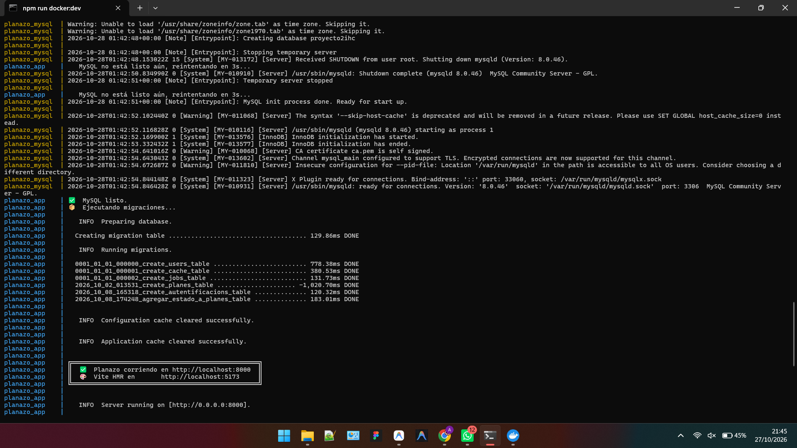

### Proyecto iniciado en el navegador

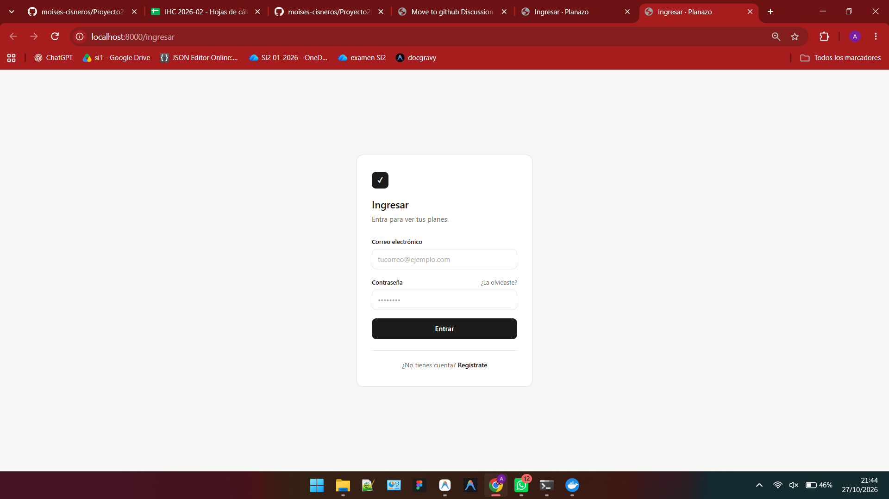

### Consola después de los cambios de Docker

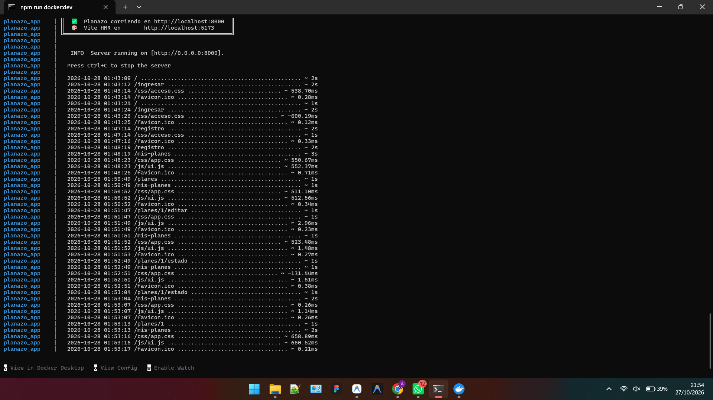

---

## 3. Recorrido del Proyecto

### 3.1 Pantalla de Carga / Login

**Pantalla:** `/ingresar`  
**Acción:** El usuario escribe su correo y contraseña para acceder al sistema.  
**Regla de negocio:** Se valida que el correo exista y que la contraseña coincida con el hash almacenado. Si falla, se muestra un mensaje de error sin revelar cuál campo fue incorrecto (seguridad).  
**Archivos reales:**

- Ruta: [`routes/web.php`](../routes/web.php) — líneas 11–12
- Controlador: [`AutentificacionController::ingresar()`](../app/Http/Controllers/AutentificacionController.php)
- Vista: [`resources/views/acceso/ingresar.blade.php`](../resources/views/acceso/ingresar.blade.php)

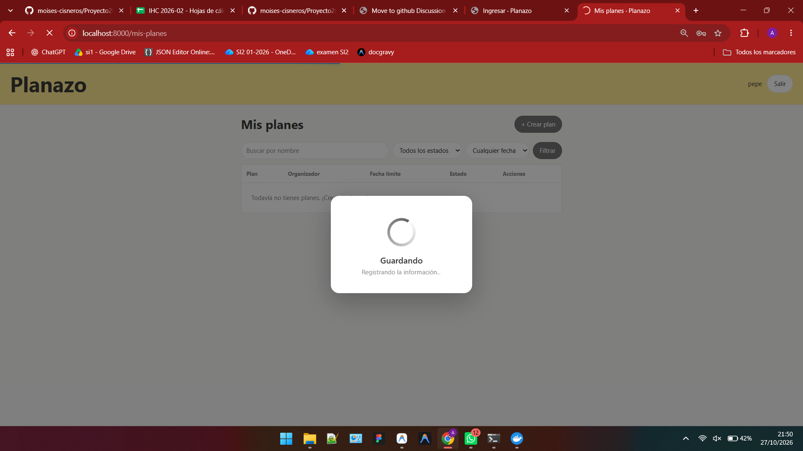

---

### 3.2 Registro de Usuario

**Pantalla:** `/registro`  
**Acción:** El usuario ingresa nombre, correo y contraseña (con confirmación) para crear su cuenta.  
**Regla de negocio:** El correo debe ser único en la BD. La contraseña mínima es 8 caracteres y se almacena como hash bcrypt. Al registrarse, el usuario queda logueado automáticamente.  
**Archivos reales:**

- Ruta: [`routes/web.php`](../routes/web.php) — líneas 14–15
- Controlador: [`AutentificacionController::registrar()`](../app/Http/Controllers/AutentificacionController.php)
- Migración: [`database/migrations/0001_01_01_000000_create_users_table.php`](../database/migrations/0001_01_01_000000_create_users_table.php)

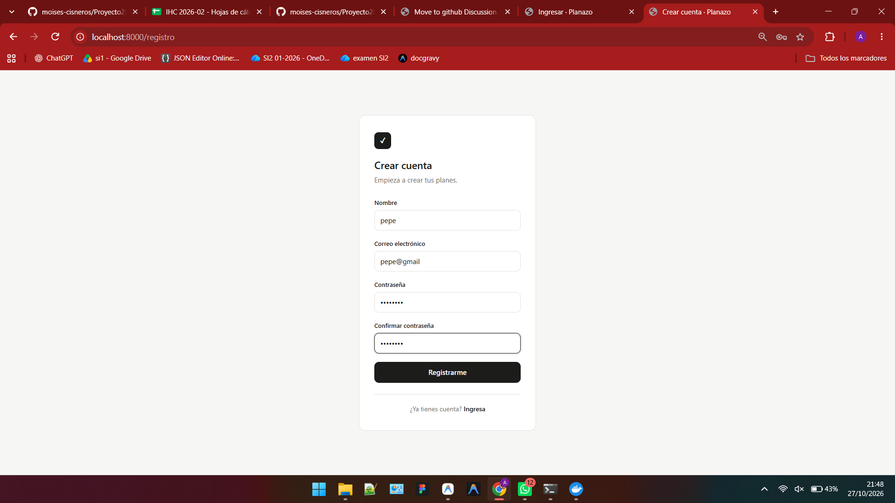

---

### 3.3 Pantalla de Inicio (Mis Planes)

**Pantalla:** `/mis-planes`  
**Acción:** Muestra todos los planes del usuario autenticado, con filtros por nombre, estado y fecha (próximos 7 días / vencidos).  
**Regla de negocio:** Solo se muestran los planes del usuario logueado (`user_id = auth()->id()`). La ruta está protegida por el middleware `auth`.  
**Archivos reales:**

- Ruta: [`routes/web.php`](../routes/web.php) — línea 28
- Controlador: [`PlanesController::listar()`](../app/Http/Controllers/PlanesController.php)
- Modelo / Scope: [`Plan::scopeFiltrar()`](../app/Models/Plan.php)
- Vista: [`resources/views/planes/listar.blade.php`](../resources/views/planes/listar.blade.php)

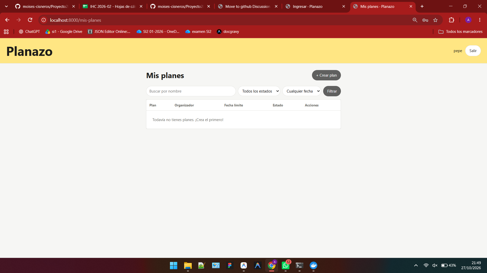

---

### 3.4 Crear Plan

**Pantalla:** Formulario en `/mis-planes` (modal o sección inline)  
**Acción:** El usuario completa nombre, organizador y fecha límite para crear un nuevo plan.  
**Regla de negocio:** Los tres campos son obligatorios. El plan se crea con estado `pendiente` por defecto y se asocia al `user_id` del usuario logueado.  
**Archivos reales:**

- Ruta: [`routes/web.php`](../routes/web.php) — línea 29
- Controlador: [`PlanesController::guardar()`](../app/Http/Controllers/PlanesController.php)
- Migración tabla planes: [`database/migrations/2026_10_02_013531_create_planes_table.php`](../database/migrations/2026_10_02_013531_create_planes_table.php)

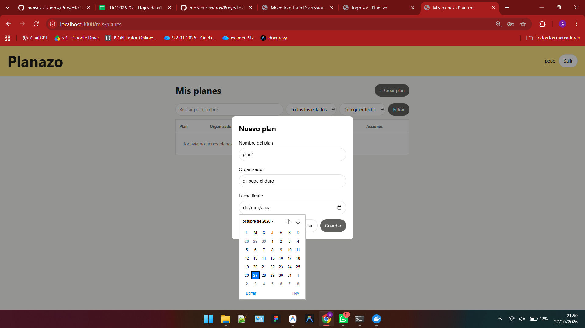

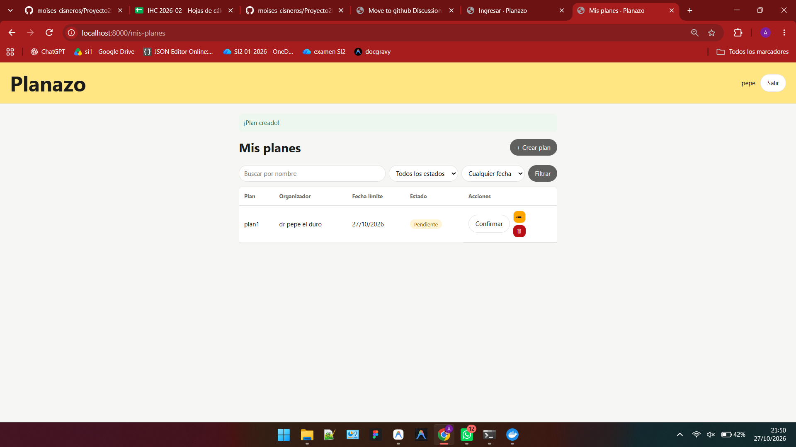

---

### 3.5 Confirmación de Plan

**Pantalla:** `/mis-planes` (acción sobre tarjeta de plan)  
**Acción:** El usuario cambia el estado del plan de `pendiente` a `confirmado`.  
**Regla de negocio:** Un plan `cancelado` **no puede** volver a `confirmado`. La transición válida es: `pendiente → confirmado` o `pendiente → cancelado`.  
**Archivos reales:**

- Ruta: [`routes/web.php`](../routes/web.php) — línea 33
- Controlador: [`PlanesController::cambiarEstado()`](../app/Http/Controllers/PlanesController.php)
- Migración estado: [`database/migrations/2026_10_08_174248_agregar_estado_a_planes_table.php`](../database/migrations/2026_10_08_174248_agregar_estado_a_planes_table.php)

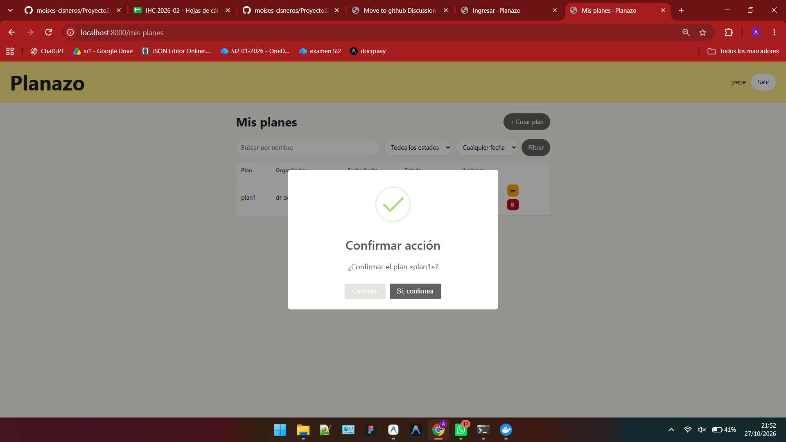

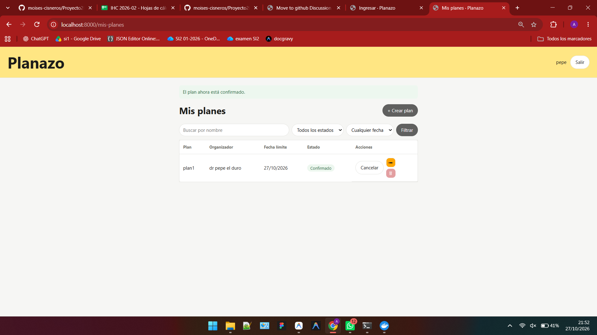

---

### 3.6 Cancelación de Plan

**Pantalla:** `/mis-planes` (acción sobre tarjeta de plan)  
**Acción:** El usuario cambia el estado del plan a `cancelado`.  
**Regla de negocio:** Un plan en estado `confirmado` puede cancelarse. Una vez `cancelado`, no puede volver a `confirmado` (estado final irreversible parcialmente).  
**Archivos reales:**

- Controlador: [`PlanesController::cambiarEstado()`](../app/Http/Controllers/PlanesController.php) — líneas 127–144

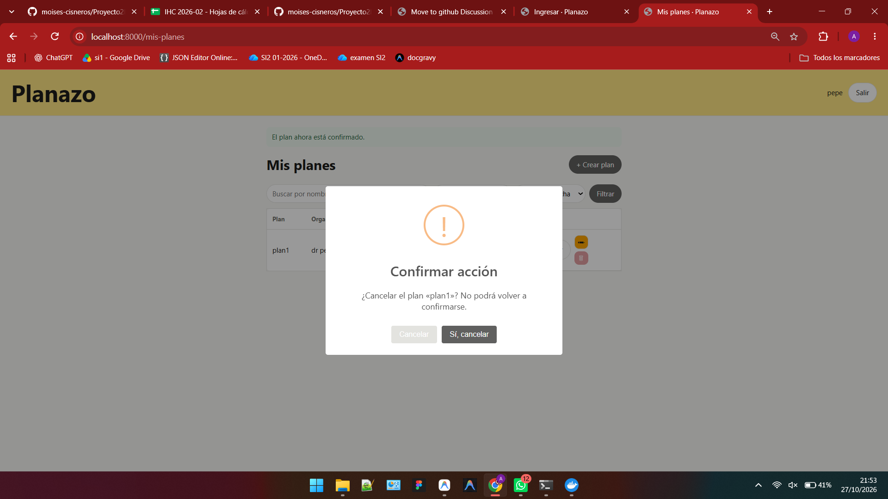

---

### 3.7 Eliminación de Plan

**Pantalla:** `/mis-planes` (botón eliminar en tarjeta)  
**Acción:** El usuario elimina un plan de la lista.  
**Regla de negocio:** Un plan con estado `confirmado` **no puede eliminarse**. Primero debe cancelarse. Solo planes `pendiente` o `cancelado` pueden borrarse.  
**Archivos reales:**

- Ruta: [`routes/web.php`](../routes/web.php) — línea 32
- Controlador: [`PlanesController::eliminar()`](../app/Http/Controllers/PlanesController.php) — líneas 108–119

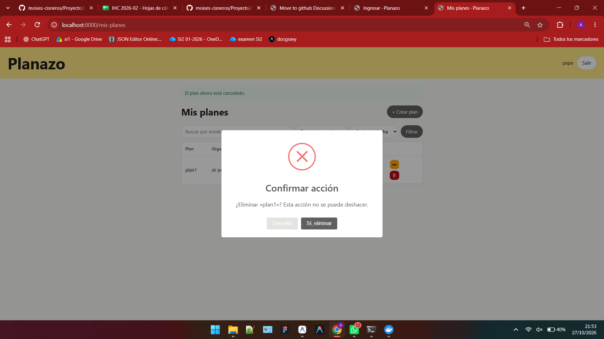

---

## 4. Impacto — Qué debe cambiar para implementar la Tarea 5

> **Tarea 5:** Invitar participantes · Proponer fechas o lugares · Votar por una opción

### 4.1 Diagnóstico del estado actual

Al analizar el código recibido se identifican las siguientes limitaciones estructurales:

1. **Modelo unipersonal:** `planes` solo cuenta con `user_id` (el creador). No existe el concepto de participantes, invitaciones, opciones ni votaciones.
2. **Carencia de autorización (vulnerabilidad):** `PlanesController` no valida la propiedad del plan en `editar`, `actualizar`, `eliminar` ni `cambiarEstado`, permitiendo que cualquier usuario autenticado modifique recursos ajenos.
3. **Modelos incompletos:** `Plan.php` no tiene relaciones Eloquent hacia `User` y `User.php` no tiene relación hacia sus planes.
4. **Fricción de interfaz (Nielsen H6 y H8):** El formulario de creación solicita tipear manualmente el campo "Organizador" a pesar de que el usuario ya está autenticado con su cuenta (`auth()->user()->name`).
5. **Dependencias externas y retrasos artificiales:** La aplicación inyecta SweetAlert2 y NProgress desde CDNs externos e impone un delay artificial de 1 segundo en cada formulario en `public/js/ui.js`.
6. **Ausencia de pruebas de dominio:** El proyecto vino sin tests automatizados para validar planes ni flujos de acceso.

---

### 4.2 Nuevas tablas necesarias (migraciones)

```
invitaciones
  id | plan_id (FK) | user_id (FK nullable) | email | estado (pendiente/aceptada/rechazada) | token | timestamps

opciones
  id | plan_id (FK) | tipo (fecha/lugar) | valor | user_id (FK proponente) | timestamps

votos
  id | opcion_id (FK) | user_id (FK) | timestamps
  UNIQUE (opcion_id, user_id)  ← integridad a nivel de BD: un usuario solo puede votar una vez por opción
```

---

### 4.3 Nuevos modelos y relaciones Eloquent

| Modelo | Archivo | Relaciones principales |
| --- | --- | --- |
| `Invitacion` | [`app/Models/Invitacion.php`](../app/Models/Invitacion.php) | `belongsTo(Plan::class)`, `belongsTo(User::class)` |
| `Opcion` | [`app/Models/Opcion.php`](../app/Models/Opcion.php) | `belongsTo(Plan::class)`, `belongsTo(User::class, 'user_id')`, `hasMany(Voto::class)` |
| `Voto` | [`app/Models/Voto.php`](../app/Models/Voto.php) | `belongsTo(Opcion::class)`, `belongsTo(User::class)` |

Relaciones a incorporar en los modelos base:

```php
// En app/Models/Plan.php:
public function organizador()   { return $this->belongsTo(User::class, 'user_id'); }
public function invitaciones()  { return $this->hasMany(Invitacion::class); }
public function participantes() { return $this->belongsToMany(User::class, 'invitaciones')->wherePivot('estado', 'aceptada'); }
public function opciones()      { return $this->hasMany(Opcion::class); }

// En app/Models/User.php:
public function planes()        { return $this->hasMany(Plan::class); }
public function votos()         { return $this->hasMany(Voto::class); }
```

---

### 4.4 Capa de Autorización y Seguridad (`app/Policies/`)

Se incorpora una política formal de acceso [`app/Policies/PlanPolicy.php`](../app/Policies/PlanPolicy.php) para resolver la vulnerabilidad heredada y gobernar el flujo colaborativo:
- **Organizador / Creador:** Puede editar, cancelar, eliminar el plan, enviar invitaciones y cerrar votaciones.
- **Participante Aceptado:** Puede ver la sala, proponer opciones (fechas/lugares), votar y abandonar el plan. **No puede borrar ni cancelar el plan**.
- **Invitado Pendiente:** Acceso restringido en modo lectura hasta aceptar o rechazar la invitación.

---

### 4.5 Nuevos controladores y validación desacoplada

| Controlador nuevo | Responsabilidad |
| --- | --- |
| [`InvitacionesController`](../app/Http/Controllers/InvitacionesController.php) | Enviar invitaciones por correo y gestionar aceptación/rechazo vía token |
| [`OpcionesController`](../app/Http/Controllers/OpcionesController.php) | Proponer y retirar fechas o lugares en planes activos |
| [`VotosController`](../app/Http/Controllers/VotosController.php) | Emitir y retirar votos de forma atómica con `DB::transaction` |

Validaciones extraídas a Form Requests dedicados:
- `GuardarPlanRequest`: Valida datos del plan y automatiza la asignación del organizador.
- `ProponerOpcionRequest`: Valida tipo (`fecha` o `lugar`) y longitud del valor propuesto.

---

### 4.6 Rutas nuevas

En [`routes/web.php`](../routes/web.php) — dentro del grupo protegido `Route::middleware('auth')`:

```php
// Sala de detalle colaborativo
Route::get('/planes/{plan}',                 [PlanesController::class, 'mostrar'])->name('planes.mostrar');

// Invitaciones
Route::post('/planes/{plan}/invitar',        [InvitacionesController::class, 'invitar'])->name('planes.invitar');
Route::get('/invitacion/{token}/aceptar',     [InvitacionesController::class, 'aceptar'])->name('invitacion.aceptar');
Route::get('/invitacion/{token}/rechazar',    [InvitacionesController::class, 'rechazar'])->name('invitacion.rechazar');
Route::post('/planes/{plan}/abandonar',       [InvitacionesController::class, 'abandonar'])->name('planes.abandonar');

// Opciones de fecha y lugar
Route::post('/planes/{plan}/opciones',       [OpcionesController::class, 'proponer'])->name('opciones.proponer');
Route::delete('/opciones/{opcion}',          [OpcionesController::class, 'eliminar'])->name('opciones.eliminar');

// Votación
Route::post('/opciones/{opcion}/votar',      [VotosController::class, 'votar'])->name('votos.votar');
Route::delete('/opciones/{opcion}/votar',    [VotosController::class, 'quitar'])->name('votos.quitar');
```

---

### 4.7 Reestructuración de Vistas y Decisiones Ergonómicas (IHC)

1. **Estandarización con `<dialog>` Nativo:** Se retiran SweetAlert2 y NProgress de los layouts, sustituyéndolos por el componente reutilizable `resources/views/components/dialog-confirm.blade.php`. Elimina dependencias de CDNs externos y el retraso artificial de 1 segundo.
2. **Modularización de "Mis Planes" ([`planes/listar.blade.php`](../resources/views/planes/listar.blade.php)):** Descompuesta en parciales (`_filtros.blade.php`, `_tabla.blade.php`, `_modal_crear.blade.php`).
3. **Refactorización del Organizador (H6 y H8):** En `_modal_crear.blade.php`, se retira el campo editable de organizador y se muestra un badge informativo de solo lectura: *«Organizador: {{ auth()->user()->name }}»*.
4. **Nueva Pantalla de Sala Colaborativa ([`planes/detalle.blade.php`](../resources/views/planes/detalle.blade.php)):**
   - **Cabecera (`_cabecera.blade.php`):** Título, estado y fecha límite.
   - **Panel de Participantes (`_participantes.blade.php`):** Lista de miembros con roles (`Organizador` vs `Participante`) y botón accesible "Invitar participante" ($\ge 44$px de target táctil, Ley de Fitts).
   - **Sala de Votación (`_sala_votacion.blade.php`):** Pestañas semánticas para separar "Fechas" y "Lugares" (Ley de Hick, $n \le 4$), tarjetas de opción autónomas con recuento de votos y separación antagónica de 12px (`gap-3`) entre botones de votar y eliminar opción.
5. **Salida de Emergencia (Nielsen H3):** Botón visible «Abandonar plan» con diálogo de confirmación para participantes invitados.

---

### 4.8 Matriz de Pruebas Automatizadas Requeridas (PHPUnit)

Para cumplir con la directiva de calidad (mínimo 4 casos por suite):
- `tests/Feature/AutentificacionTest.php`: Verifica que el middleware `auth` devuelva redirect 302 a usuarios no logueados, login con credenciales válidas/inválidas y registro de usuarios.
- `tests/Unit/ColaboracionModelosTest.php`: Verifica relaciones `opciones()`, `participantes()`, pertenencia de votos y rechazo de votos duplicados por constraint único de BD.
- `tests/Feature/ColaboracionEndpointsTest.php`: Verifica invitación con token, propuesta de opciones, autorización 403 con `PlanPolicy` y restricción de borrado para invitados.
- `tests/Feature/AbandonoPlanTest.php`: Verifica abandono exitoso de participante (H3), rechazo de abandono para creadores y consistencia de votos tras salir.

---

### 4.9 Resumen visual de la arquitectura extendida

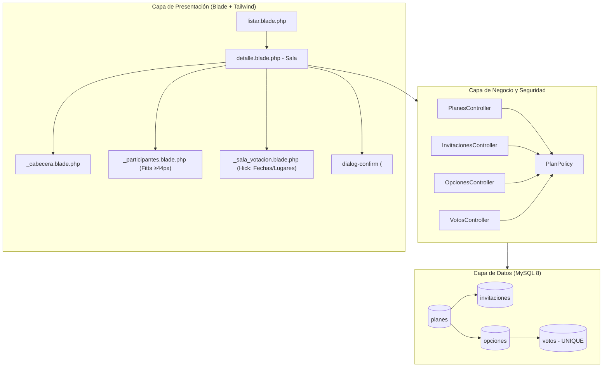

| Capa | Archivos modificados / refactorizados | Archivos nuevos |
| --- | --- | --- |
| **BD (Migraciones)** | — | 3 migraciones (`invitaciones`, `opciones`, `votos`) |
| **Modelos** | [`Plan.php`](../app/Models/Plan.php), [`User.php`](../app/Models/User.php) | `Invitacion.php`, `Opcion.php`, `Voto.php` |
| **Seguridad** | — | [`PlanPolicy.php`](../app/Policies/PlanPolicy.php) |
| **Controladores** | [`PlanesController.php`](../app/Http/Controllers/PlanesController.php) | `InvitacionesController.php`, `OpcionesController.php`, `VotosController.php` |
| **Validación** | — | `GuardarPlanRequest.php`, `ProponerOpcionRequest.php` |
| **Rutas** | [`routes/web.php`](../routes/web.php) | — |
| **Vistas** | `layouts/app.blade.php`, `planes/listar.blade.php` | `components/dialog-confirm.blade.php`, `planes/detalle.blade.php` (+ parciales) |
| **Pruebas** | — | 4 suites de tests PHPUnit en `tests/Feature/` y `tests/Unit/` |
