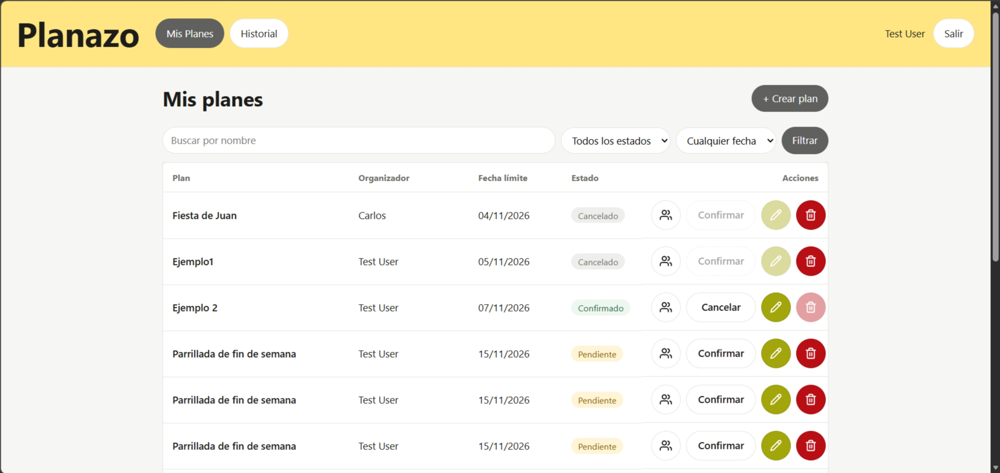
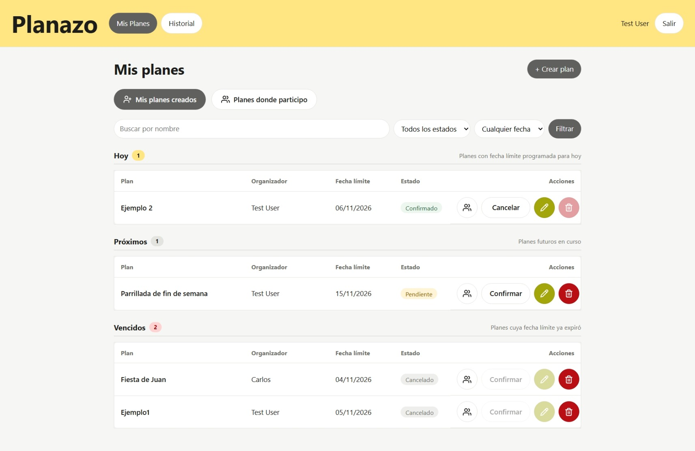

# Evidencias — Clase 20: Arquitectura de Información

Entrega formal del trabajo en clase con nota sobre **Arquitectura de Información** (jueves 05/11/2026), desarrollada bajo los lineamientos de `AGENTS.md`, `ARCHITECTURE.md` y `resources/DESIGN.md`.

---

## 👥 Integrantes del Equipo

* **Moises Cisneros**
* **Erick Teran Tabera**

---

## 📌 1. Problema Concreto Identificado

En la pantalla principal de listado de planes (`/planes`), todos los registros se encontraban mezclados en una única tabla continua y desestructurada:

* Los planes creados por el usuario (rol organizador) y los planes a los que fue invitado (rol participante) compartían el mismo espacio visual sin distinción jerárquica.
* Las fechas límite no contaban con separación por urgencia, obligando al usuario a calcular mentalmente cuáles planes correspondían al día de hoy, cuáles eran futuros y cuáles ya habían vencido.
* **Sobrecarga Cognitiva:** Para responder una pregunta cotidiana (*«¿a qué planes me invitaron?»* o *«¿qué tengo que atender hoy?»*), el usuario debía escanear fila por fila examinando la columna de organizador y las fechas una por una.

### Tarea de Evaluación Elegida para la Prueba
>
> **«Consulta cuáles son los planes donde te invitaron a participar y qué planes tienes programados para hoy».**

---

## 📐 2. Dibujo de la Propuesta (Estructura y Mockup)

Se aplicó la reestructuración en dos niveles complementarios:

1. **Nivel 1 — Pestañas por Propósito y Rol:** Separación en la navegación entre `[Mis planes creados]` y `[Planes donde participo]`.
2. **Nivel 2 — Agrupación Cronológica por Urgencia:** Dentro de la pestaña activa, la lista se divide en tres bloques temporales claramente etiquetados con contadores (`Hoy · N`, `Próximos · N`, `Vencidos · N`).

### Mockup Estructural («Después»)

```text
+---------------------------------------------------------------------------------------+
|  PLANAZO                     [Mis Planes]  [Historial]               Moises [ Salir ] |
+---------------------------------------------------------------------------------------+
|                                                                                       |
|  Mis planes                                                          [ + Crear plan ] |
|                                                                                       |
|  +-----------------------------------+-------------------------------------+          |
|  | [x] Mis planes creados (3)        | [ ] Planes donde participo (2)      |          |
|  +-----------------------------------+-------------------------------------+          |
|                                                                                       |
|  [ Buscar por nombre... ] [ Todos los estados v ] [ Filtrar ]                         |
|                                                                                       |
|  -----------------------------------------------------------------------------------  |
|  HOY · 1 plan                                                                         |
|  -----------------------------------------------------------------------------------  |
|  | Plan              | Organizador | Fecha límite | Estado    | Acciones            | |
|  | Cena con amigos   | Tú          | Hoy, 21:00   | Pendiente | [Sala] [Editar] [x] | |
|                                                                                       |
|  -----------------------------------------------------------------------------------  |
|  PRÓXIMOS · 2 planes                                                                  |
|  -----------------------------------------------------------------------------------  |
|  | Plan              | Organizador | Fecha límite | Estado    | Acciones            | |
|  | Viaje fin de año  | Tú          | 15/12/2026   | Pendiente | [Sala] [Editar] [x] | |
|  | Asado de egreso   | Tú          | 20/12/2026   | Confirmado| [Sala] [Editar] [x] | |
|                                                                                       |
|  -----------------------------------------------------------------------------------  |
|  VENCIDOS · 0 planes                                                                  |
|  -----------------------------------------------------------------------------------  |
|  (No tienes planes vencidos en esta sección)                                          |
+---------------------------------------------------------------------------------------+
```

---

## 💡 3. Motivo de las Decisiones de Diseño (Fundamento Ergonómico e IHC)

Siguiendo las tres preguntas directrices de la Clase 20:

1. **¿Qué busca el usuario?**  
   El usuario busca resolver tareas inmediatas con el menor esfuerzo mental: saber qué invitaciones tiene pendientes y qué eventos vencen hoy. La separación en pestañas aísla su rol activo de su rol como colaborador.
2. **¿Cómo lo llama?**  
   Se reemplazaron títulos genéricos o ambiguos (como «Gestionar» o «Todos») por etiquetas explícitas que anticipan el contenido: **«Mis planes creados»** y **«Planes donde participo»**, evitando dudas de navegación.
3. **¿Dónde lo espera?**  
   Se distinguió formalmente la navegación estructural de secciones (pestañas superiores fijas) de los filtros analíticos dentro de la lista (formulario de búsqueda por nombre y estado). El formulario además retiene el parámetro `?seccion=` para preservar el contexto al filtrar o limpiar.
4. **Ley de Hick:** $T = b \log_{2}(n + 1)$ —  
   Al segmentar las opciones en bloques cronológicos cerrados (`Hoy`, `Próximos`, `Vencidos`), el tiempo de decisión se reduce drásticamente porque el usuario no busca en un universo indiferenciado, sino que focaliza su atención en el bloque urgente.
5. **Ley de Fitts:**  
   Pestañas con touch targets amplios (≥ 44 × 44 px), contraste visual accesible para el estado activo (`role="tab"`, `aria-selected`) y separación clara de acciones.
6. **Nielsen H1 (Visibilidad del estado) y H5 (Prevención de errores):**  
   Cada bloque cuenta con un badge numérico visible con el conteo exacto de planes. En caso de que un bloque temporal esté vacío, se despliega un mensaje orientador para no generar incertidumbre sobre si hubo un fallo de carga.

---

## 📸 4. Capturas de Evidencia (Antes vs Después)

### Antes (Línea Base — Lista mezclada sin jerarquía)

Todos los planes en una única tabla continua sin distinción de rol ni orden de urgencia:



### Después (Implementación — Pestañas por rol y bloques cronológicos)

Planes segmentados por pestañas semánticas (`Mis planes creados` vs `Planes donde participo`) y organizados en bloques de urgencia (`Hoy`, `Próximos`, `Vencidos`):



---

## 🧪 5. Prueba de Usabilidad Externa (Evaluación Ciega sin Indicaciones)

Se solicitó a un compañero de otro grupo resolver la tarea sin darle instrucciones previas sobre qué menús o pestañas abrir:

* **Consigna entregada al evaluador:** *«Consulta cuáles son los planes donde te invitaron a participar y qué planes tienes programados para hoy»*.
* **Resultado de la prueba:** **Sin ayuda (Resuelta exitosamente).**
* **Observaciones y tiempos:**
  * El evaluador hizo clic inmediatamente en la pestaña *«Planes donde participo»* guiado por el texto explícito de la pestaña.
  * Localizó el plan programado para hoy en el bloque *«Hoy · 1»* sin necesidad de escanear el resto de la página.
  * *¿Dónde dudó?* No dudó en la navegación; consultó si el badge numérico se actualizaba al filtrar, lo cual se confirmó funcional.
* **Ajuste posterior implementado:**  
  Se agregó persistencia del parámetro `seccion` en el botón «Limpiar» y en los chips de filtros activos para asegurar que al remover un filtro el usuario permanezca en su pestaña seleccionada.

---

## 🔗 6. Enlaces a Commits y Sub-issues

* **Issue Madre:** [Issue #56 — `[Requisito] — Clase 20: Arquitectura de Información`](https://github.com/moises-cisneros/Proyecto2IHC/issues/56)
* **Sub-issue 1 (Backend / Segmentación y Agrupación):** [Sub-issue #57](https://github.com/moises-cisneros/Proyecto2IHC/issues/57)
  * Commit Backend: [`5618319`](https://github.com/moises-cisneros/Proyecto2IHC/commit/5618319ed195da897914820a0f3e7bf053674a63) — `feat(controlador): segmentacion de planes por rol y agrupacion temporal (Refs #57, Refs #56)`
* **Sub-issue 2 (Interfaz / Blade, Pestañas y Evidencias):** [Sub-issue #58](https://github.com/moises-cisneros/Proyecto2IHC/issues/58)
  * Pull Request: [PR #60 — Pestañas de navegación por rol, bloques cronológicos y matriz de evidencias](https://github.com/moises-cisneros/Proyecto2IHC/pull/60)
