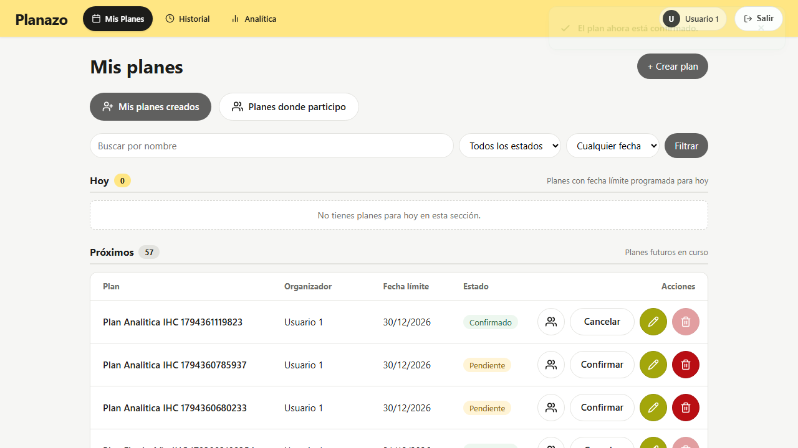
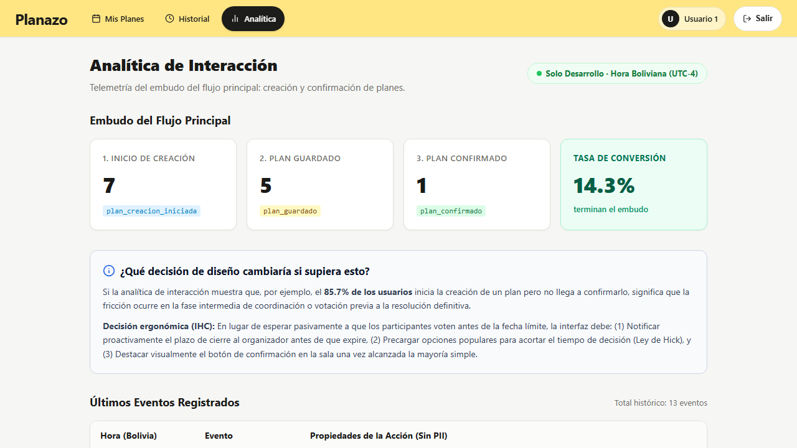

# Evidencias — Clase 21: Analítica de Interacción

Entrega formal del trabajo en clase con nota sobre **Analítica de Interacción** (martes 10/11/2026), desarrollada bajo los lineamientos de `AGENTS.md`, `ARCHITECTURE.md` y `resources/DESIGN.md`.

---

## 👥 Integrantes del Equipo

* **Moises Cisneros**
* **Erick Teran Tabera**

---

## 📌 1. Consigna Docente y Principios Rectores

> **«Dos eventos, un panel, una decisión.»**  
> *«En su fork, con su modalidad (con IA o sin IA). Midan cuántos empiezan y cuántos terminan el flujo principal de su app.»*

### Principios Fundamentales Aplicados:

1. **Intención vs. Gesto Físico:**  
   *«No registren clics, registren intentos de lograr algo».*  
   Un clic es un evento de hardware (ratón o pantalla táctil) susceptible a falsos positivos, rebotes o errores motrices. La analítica de interacción modela **Domain Events y Metas de Usuario**, capturando cuando el usuario realmente inicia el proceso de confección de un plan o concluye el acuerdo colectivo.

2. **Acción sobre Persona (Privacidad y Cero PII):**  
   *«Registren la acción, no a la persona».*  
   Los eventos almacenan atributos de contexto de la tarea (ej. si el plan contiene fecha límite o número de opciones), descartando nombres, correos o identificadores personales directos en la telemetría.

3. **Zona Horaria Boliviana:**  
   Todas las marcas de tiempo se registran y formatean bajo la hora oficial de Bolivia (`America/La_Paz`, UTC-4).

---

## 📐 2. Definición de los Eventos del Embudo (Planazo)

Se instrumentaron 3 eventos clave que recorren el embudo completo del flujo principal:

| # | Evento | Momento de Disparo | Propiedades Mínimas (Payload JSON) |
| :--- | :--- | :--- | :--- |
| **1** | `plan_creacion_iniciada` | Al abrir el modal interactivo de confección de un nuevo plan desde la interfaz (`listar.blade.php`). | `{"desde_seccion": "creados", "tiene_planes_previos": true}` |
| **2** | `plan_guardado` | Al persistir exitosamente el borrador del plan en base de datos (`PlanesController@guardar`). | `{"longitud_nombre": 18, "tiene_fecha_limite": true}` |
| **3** | `plan_confirmado` | Al formalizar el plan final y concluir la votación (`Plan::updated` / `PlanesController@confirmar` o `cambiarEstado`). | `{"con_desempate": false, "tiene_propuesta_fecha": true, "tiene_fecha_limite": true}` |

---

## 📊 3. Panel de Analítica (`/analitica`)

Ruta protegida y habilitada en entorno de desarrollo (`app.env === 'local'`) que calcula en tiempo real las métricas agrupadas y el ratio de conversión:

* **Tarjetas de Embudo:** Conteo de `plan_creacion_iniciada`, `plan_guardado` y `plan_confirmado`.
* **Tasa de Conversión (% que termina):** Porcentaje calculado mediante:
  $$\text{Tasa de Conversión} = \frac{\text{Planes Confirmados}}{\text{Inicios de Creación}} \times 100$$
* **Tabla de Últimos Eventos:** Registro cronológico en orden descendente con la fecha y hora oficial boliviana (`HH:MM:SS`) y sus propiedades de contexto.

---

## 💡 4. Decisión de Diseño Basada en Datos (HCI)

> **Pregunta Central:** *«¿Qué decisión de diseño cambiaría si supiera esto?»*

### Diagnóstico de Interacción:

Si la analítica muestra, por ejemplo, que de cada 100 inicios de creación de planes (`plan_creacion_iniciada`), 70 se guardan (`plan_guardado`) pero solo 30 se confirman (`plan_confirmado`), existe una **fricción crítica de abandono del 57%** durante la etapa de coordinación y votación grupal. El problema no reside en la dificultad del formulario inicial, sino en la inercia de los colaboradores previa al cierre.

### Decisiones Ergonómicas Propuestas:

1. **Notificación Preventiva de Vencimiento:** La interfaz debe alertar visualmente al organizador 48 horas antes de expirar la fecha límite para incentivar la confirmación oportuna.
2. **Reducción de Sobrecarga de Elección (Ley de Hick):** Precargar propuestas horarias sugeridas según la disponibilidad histórica del grupo para acortar el tiempo de deliberación:
   $$T = b \cdot \log_{2}(n + 1)$$
3. **Cierre Antagónico Prominente (Ley de Fitts):** Una vez que una propuesta alcance mayoría simple de votos, la sala colaborativa debe resaltar el botón de confirmación con mayor peso visual y un touch target de al menos $48 \times 48\text{px}$.

---

## 🖼️ 5. Evidencias Visuales

### 5.1 Plan Confirmado en la Aplicación

### 5.2 Panel de Analítica de Interacción en Desarrollo

---

## 🧪 6. Pruebas Automatizadas

### Pruebas de Backend y Vistas (PHPUnit)

Se desarrollaron dos suites específicas con 14 casos de prueba automatizados:

* `tests/Feature/AnaliticaBackendTest.php`:
  1. `test_usuario_no_autenticado_es_redirigido_al_intentar_registrar_evento` (Seguridad 401).
  2. `test_se_puede_registrar_evento_plan_creacion_iniciada_con_props`.
  3. `test_se_puede_registrar_evento_plan_guardado_con_props`.
  4. `test_se_puede_registrar_evento_plan_confirmado_con_props`.
  5. `test_confirmar_plan_desde_cambio_de_estado_registra_evento_plan_confirmado`.
  6. `test_guardar_plan_desde_controlador_registra_evento_plan_guardado`.
  7. `test_confirmar_plan_desde_controlador_registra_evento_plan_confirmado`.
  8. `test_fechas_de_eventos_se_formatean_en_zona_horaria_boliviana`.
  9. `test_endpoint_eventos_rechaza_payload_invalido_con_422`.
  10. `test_modelo_evento_calcula_metricas_del_embudo_correctamente`.
* `tests/Feature/AnaliticaVistaTest.php`:
  1. `test_usuario_no_autenticado_es_redirigido_al_intentar_ver_analitica` (Seguridad 302).
  2. `test_usuario_autenticado_puede_ver_panel_de_analitica_en_entorno_local`.
  3. `test_panel_renderiza_contadores_y_eventos_recientes_con_hora_boliviana`.
  4. `test_barra_navegacion_incluye_enlace_a_analitica_en_entorno_desarrollo`.

### Prueba End-to-End (Playwright)

* `e2e/clase-21-analitica.spec.ts`:
  * Simula el recorrido de un usuario real desde el login, inicio de creación (`plan_creacion_iniciada`), guardado (`plan_guardado`), confirmación en tabla (`plan_confirmado`), hasta la verificación de los contadores y las marcas temporales en `/analitica`.
  * **Resultado:** `1 passed (7.6s)`.
