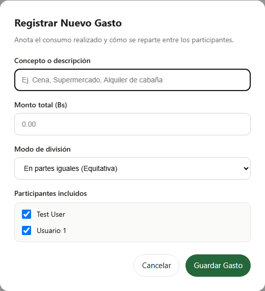
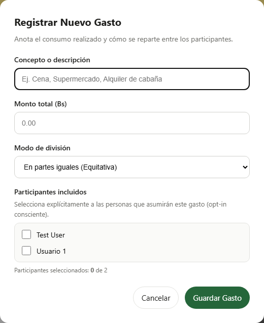
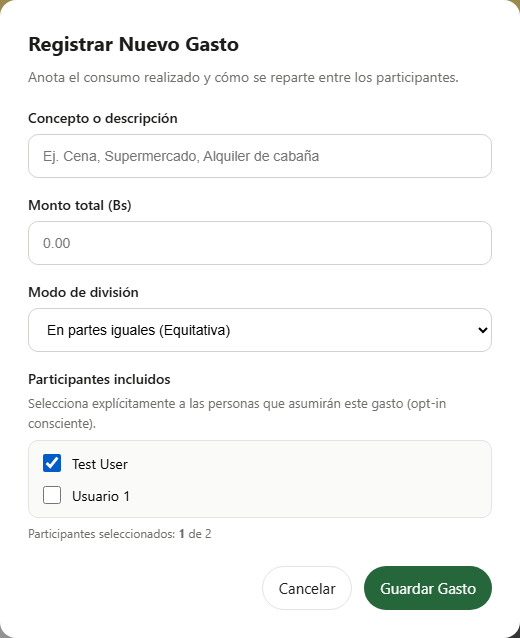

# Clase 22 · Patrones oscuros

**Integrantes:** Moises Cisneros, Erick Teran Tabera  
**Modalidad:** con IA

---

## 1. Patrón encontrado

- **Tipo (de los seis):** Preselección por defecto (*Pre-ticked box / Default opt-in*).
- **Dónde:** Pantalla de Gastos y Liquidación del Plan · Modal *"Registrar Nuevo Gasto"* · [resources/views/planes/_gastos_liquidacion.blade.php](file:///d:/Proyectos/Proyectos-Moises/Proyecto2IHC/resources/views/planes/_gastos_liquidacion.blade.php#L480-L495).
- **Por qué es un patrón oscuro (a quién beneficia y qué no ve el usuario):**
  - **A quién beneficia:** Beneficia a quien registra el gasto en el plan, ya que por inercia o descuido reparte el total del consumo entre la totalidad de los miembros sin tomarse el trabajo de seleccionar a quiénes corresponde.
  - **Qué no ve el usuario:** Los demás participantes del plan no ven ni consienten de forma explícita que se les impute una obligación económica. Si el usuario que anota el consumo olvida desmarcar a quienes no asistieron o no consumieron, el sistema les adjudica automáticamente una deuda monetaria.
  - **Agravante ético en Planazo:** De acuerdo a las reglas de negocio del sistema, **ningún participante puede retirarse de un plan si mantiene saldos deudores pendientes** (`modal-retirarse`). En consecuencia, la preselección por omisión al registrar un gasto termina encadenando de manera involuntaria a los usuarios en un patrón de **Obstrucción / Roach Motel** (no pueden salir del plan por una deuda que jamás aceptaron contraer).

---

## 2. Antes

### Captura visual


### Fragmento de código (`_gastos_liquidacion.blade.php`)
```html
<label style="display: flex; align-items: center; gap: 8px; font-size: 14px; cursor: pointer;">
    <input type="checkbox"
           name="participantes[]"
           value="{{ $p->id }}"
           checked
           class="check-participante"
           onchange="recalcularDivision()"
           style="width: 18px; height: 18px;">
    <span>{{ $p->name }}</span>
</label>
```
*Observación:* El atributo `checked` hardcodeado en la plantilla forzaba que todos los colaboradores del plan vinieran preseleccionados de forma automática, sin requerir una decisión deliberada del usuario.

---

## 3. Después

### Capturas visuales



### Fragmento de código corregido (`_gastos_liquidacion.blade.php`)
```html
<label style="display: block; font-size: 14px; font-weight: 600; color: #1c1c1a; margin-bottom: 4px;">
    Participantes incluidos
</label>
<p style="margin: 0 0 8px 0; font-size: 13px; color: #6f6f6a;">
    Selecciona explícitamente a las personas que asumirán este gasto (opt-in consciente).
</p>
<div style="display: flex; flex-direction: column; gap: 8px; max-height: 180px; overflow-y: auto; padding: 10px; border: 1px solid #e3e3df; border-radius: 10px; background: #fafaf8;">
    @foreach ($participantesPlan as $p)
        <div style="display: flex; justify-content: space-between; align-items: center; gap: 8px;">
            <label style="display: flex; align-items: center; gap: 8px; font-size: 14px; cursor: pointer;">
                <input type="checkbox"
                       name="participantes[]"
                       value="{{ $p->id }}"
                       class="check-participante"
                       onchange="recalcularDivision()"
                       style="width: 18px; height: 18px;">
                <span>{{ $p->name }}</span>
            </label>
            ...
        </div>
    @endforeach
</div>
<div id="indicador-participantes-seleccionados" style="margin-top: 6px; font-size: 12px; color: #6f6f6a;">
    Participantes seleccionados: <strong id="contador-seleccionados">0</strong> de {{ count($participantesPlan) }}
</div>
```

**Commit:** `fix(etica): eliminar preseleccion por defecto de participantes en gastos compartidos` (`22f8ccd`)

---

## 4. Principio aplicado

1. **Nielsen #5 (Prevención de errores):**
   Un buen diseño elimina condiciones propensas a errores antes de que ocurran. Al no premarcar a los participantes, se previene que por inercia o descuido motor/cognitivo se cargue una deuda financiera a personas ausentes o no involucradas.
2. **Consentimiento Explícito y Privacidad/Ética por Defecto (*Privacy & Ethics by Design*):**
   Las acciones que implican obligaciones legales, monetarias o de retención deben requerir un consentimiento afirmativo (*opt-in* deliberado). Ninguna casilla que genere consecuencias adversas para un tercero debe venir activada por defecto.
3. **Simetría y Prevención del Roach Motel:**
   Al no forzar la deuda sobre participantes inocentes, se preserva el derecho y la libertad de los miembros de abandonar el plan cuando lo deseen (Nielsen #3: Control y libertad del usuario), evitando bloqueos colaterales en el retiro.

---

## 5. Prueba

- **Archivo de prueba automatizada:** [tests/Feature/EticaGastosPatronOscuroTest.php](file:///d:/Proyectos/Proyectos-Moises/Proyecto2IHC/tests/Feature/EticaGastosPatronOscuroTest.php)
- **Prueba End-to-End en navegador:** [e2e/clase-22-patron-oscuro.spec.ts](file:///d:/Proyectos/Proyectos-Moises/Proyecto2IHC/e2e/clase-22-patron-oscuro.spec.ts)
- **Nombres de los tests y resultado:**
  1. `test_modal_crear_gasto_no_incluye_casillas_de_participantes_premarcadas_por_defecto`
     - **Antes:** Fallaba porque la etiqueta `<input>` contenía la directiva `checked` por omisión.
     - **Después:** **PASA (VERDE)**: constata que todas las casillas de participantes vienen desmarcadas y que el texto informativo es visible.
  2. `test_registro_de_gasto_requiere_seleccion_consciente_de_al_menos_un_participante`
     - **Resultado:** **PASA (VERDE)**: verifica que intentar guardar un gasto sin participantes seleccionados genera un error de validación descriptivo (Nielsen H5/H9).
  3. `test_gasto_se_divide_exclusivamente_entre_los_participantes_seleccionados_voluntariamente`
     - **Resultado:** **PASA (VERDE)**: en un plan con tres colaboradores, al registrar un gasto seleccionando solo a dos, comprueba que el tercero no recibe ninguna cuota de deuda asignada ($0.00).
  4. Suite E2E Playwright:
     - `e2e/clase-22-patron-oscuro.spec.ts`: **PASA (VERDE)** verificando en Chromium headless que `isChecked() === false` en todas las casillas y actualizando el contador reactivo a 1 al seleccionar conscientemente.

---

## 6. Otros que encontramos (opcional)

1. **Obstrucción / Falta de salida en Invitaciones de Colaboración:**
   - *Pantalla:* Detalle del plan y listado de planes pendientes.
   - *Patrón:* El usuario invitado solo dispone del botón *"Aceptar invitación"*. No existe la opción simétrica *"Rechazar invitación"* o *"Declinar"*. Esto obliga al usuario a aceptar pertenecer al plan o resignarse a tener la invitación pendiente fija en su interfaz de por vida.
2. **Preselección en Modalidad de Liquidación de Deuda:**
   - *Pantalla:* Modal de *"Registrar Pago"* en Gastos y Liquidación.
   - *Patrón:* El selector de modalidad viene con el radio button *"Pagar totalidad"* preseleccionado (`checked`), induciendo al usuario al pago íntegro por defecto frente a la alternativa de pago parcial, bloqueando además la edición manual del campo de importe hasta que el usuario activa expresamente la opción secundaria.
