# Clase 23 · Inventario y tokens

**Integrantes:** Moises Cisneros, Erick Teran Tabera  
**Modalidad:** con IA

---

## 1. Inventario: captura de los botones y las diferencias que encontraron

### Captura comparativa de botones (uno al lado del otro)

Conforme a la consigna de la clase, se extrajeron y colocaron los botones principales de las diferentes pantallas de la aplicación uno al lado del otro, evidenciando las discrepancias existentes antes de la consolidación de un sistema de tokens único:

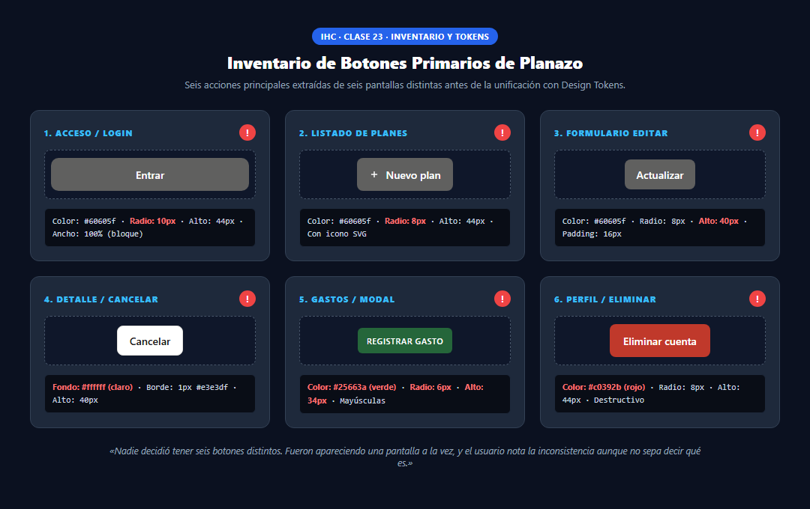

---

### Capturas de las pantallas reales de la aplicación (Playwright)

A continuación se presentan las capturas directas tomadas con Playwright sobre la aplicación en ejecución (`http://127.0.0.1:9300`), donde habitan estos botones:

| Pantalla                                                | Captura de Pantalla Real                               | Botón Extraído                                                                                                                     |
| :------------------------------------------------------ | :----------------------------------------------------- | :--------------------------------------------------------------------------------------------------------------------------------- |
| **1. Acceso / Login** (`/ingresar`)                     | 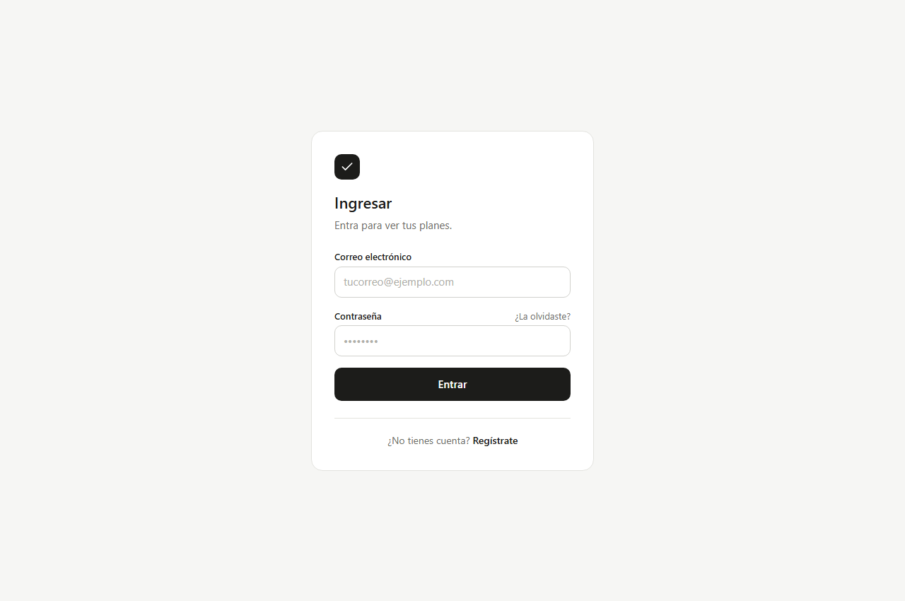               |  `#60605f` · radio 10px · alto 44px · bloque 100%                                   |
| **2. Registro** (`/registro`)                           | 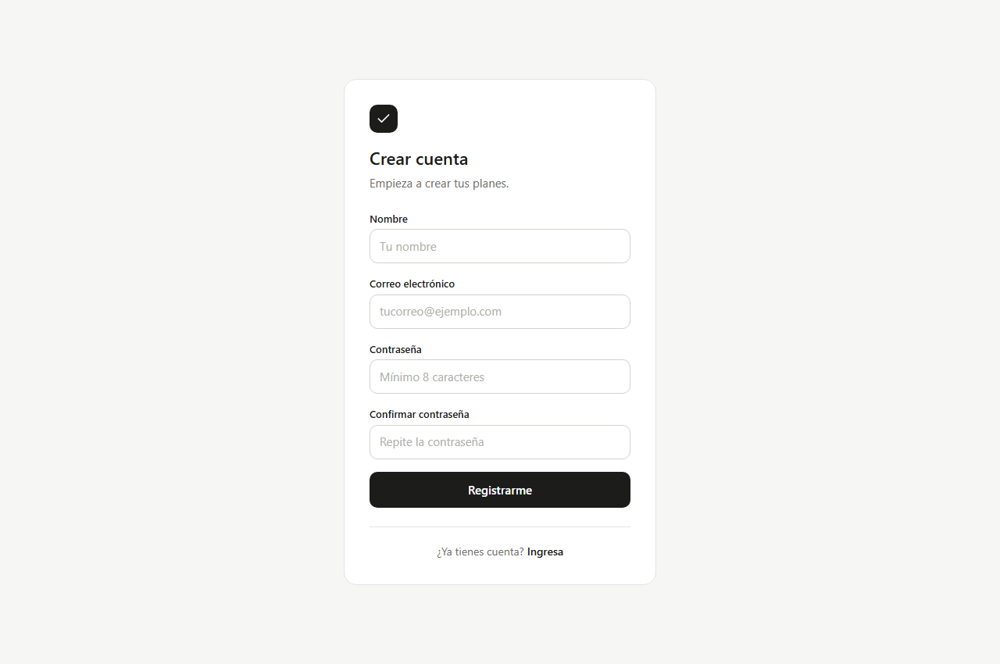         |  `#60605f` · radio 10px · alto 44px · bloque 100%                           |
| **3. Mis Planes** (`/mis-planes`)                       | 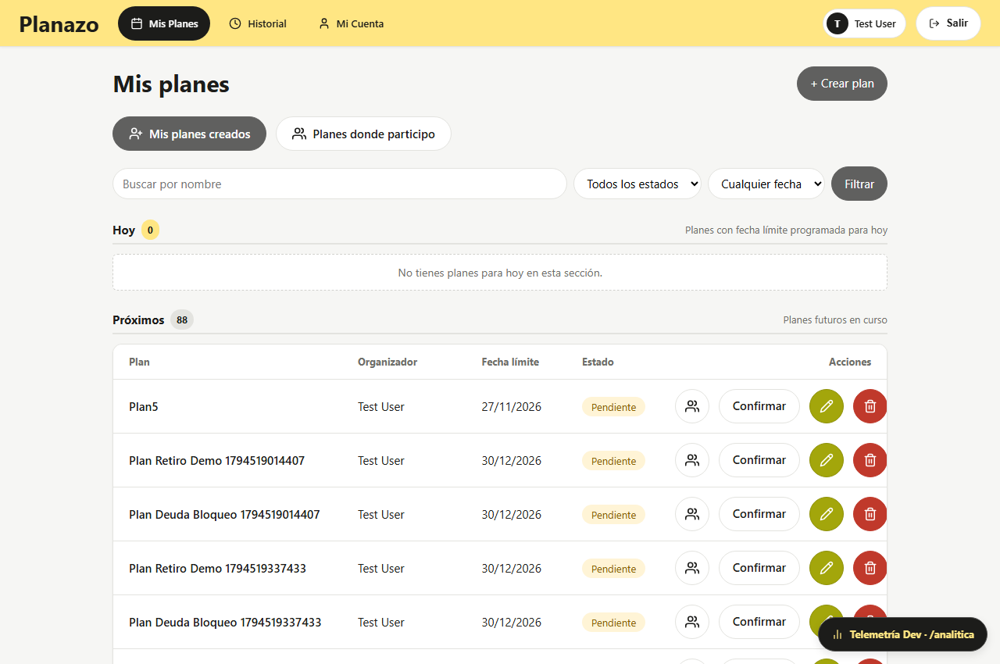     | 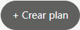 `#60605f` · radio 8px · alto 44px · con icono SVG                         |
| **4. Detalle y Sala** (`/planes/{id}`)                  | 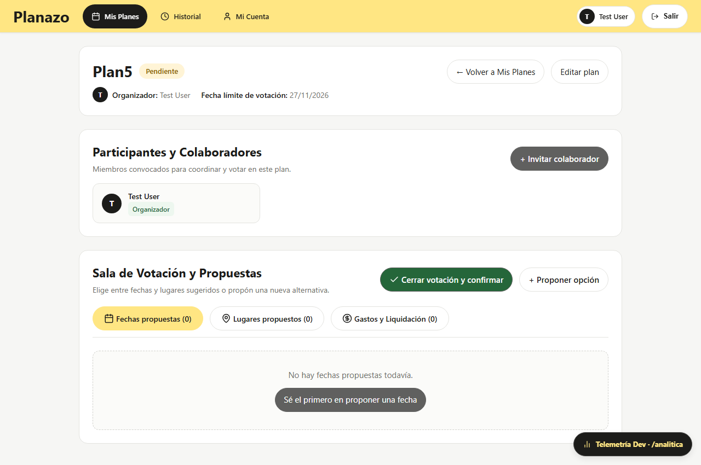 | 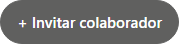 Acción de sala: "+ Invitar colaborador" (`.boton`)                          |
| **5. Gastos y Liquidación** (`/planes/{id}?tab=gastos`) | 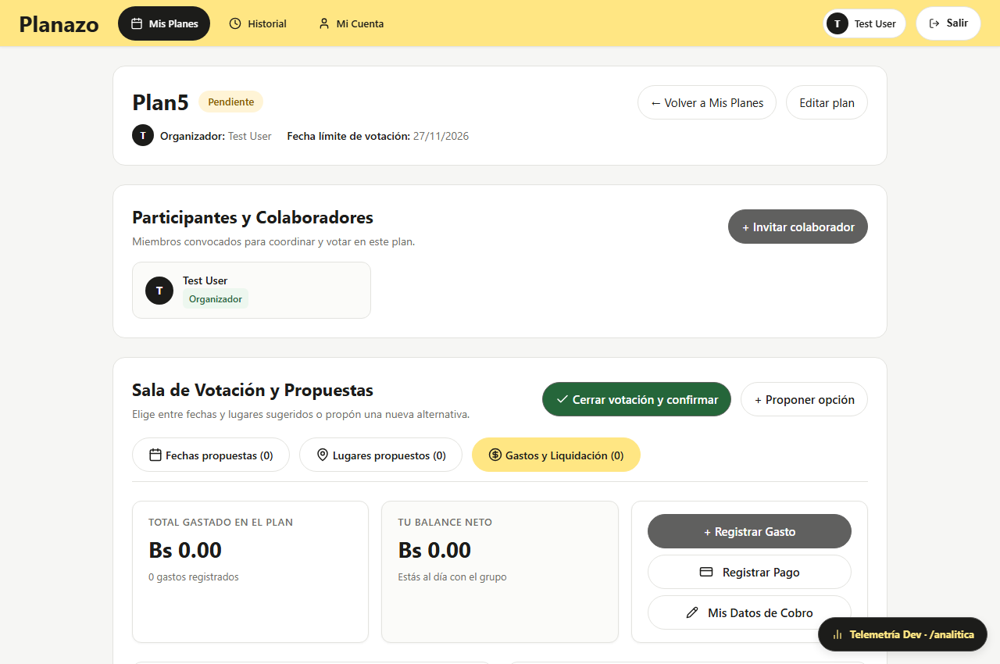             |  `#25663a` (verde crudo) · radio 6px · alto 34px · mayúsculas             |
| **6. Edición de Plan** (`/planes/{id}/editar`)          | 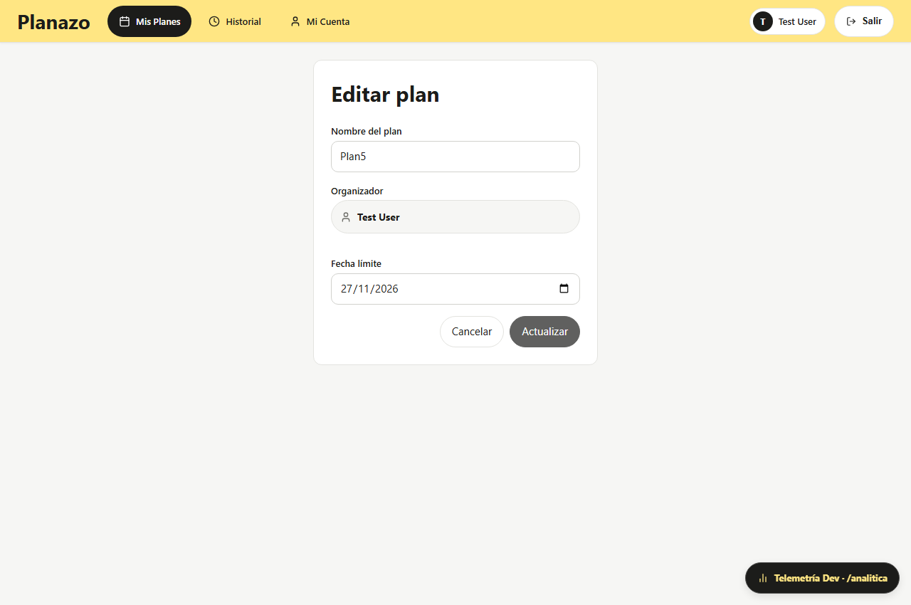             | 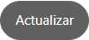 `#60605f` · radio 8px · alto 40px                                         |
| **7. Mi Cuenta / Perfil** (`/perfil/datos`)             | 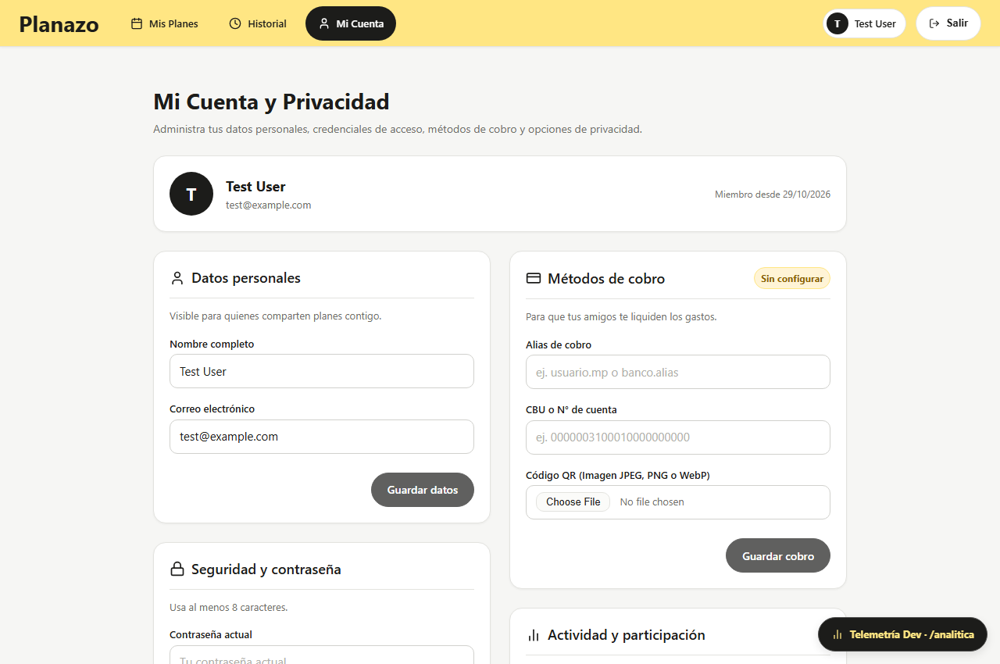             |  Botón destructivo: "Eliminar mi cuenta" (`.boton-rojo` · radio 8px · alto 44px) |

---

### Diferencias marcadas encontradas en la auditoría

1. **Diferencias de radio de curvatura (`border-radius`):**
    - El botón de **Acceso/Login** y **Registro** utilizaba `border-radius: 10px`.
    - Los botones de **Mis Planes** y **Editar Plan** empleaban `border-radius: 8px`.
    - El botón en el **Modal de Gastos** utilizaba `border-radius: 6px`.
    - _Diagnóstico:_ Disparidad geométrica sin justificación funcional; los elementos no comparten un radio de control unificado.

2. **Diferencias de altura y área táctil (Ley de Fitts):**
    - Los botones de **Login**, **Registro** y **Nuevo Plan** cumplen con la altura mínima ergonómica de `44px` recomendada para interfaces táctiles.
    - El botón de **Actualizar** en el formulario de edición bajaba a `40px`.
    - El botón de **Registrar Gasto** se reducía a `34px` de altura física.
    - _Diagnóstico:_ Fricción motriz al interactuar entre distintas secciones; el usuario debe reajustar la precisión de puntero.

3. **Inconsistencia de tonos, colores crudos y mayúsculas:**
    - En lugar de una variable centralizada, la pantalla de gastos introdujo estilos inline con un tono verde duro (`#25663a`) y tipografía en mayúsculas (`text-transform: uppercase`) en tamaño `11px`.
    - En contraste, los botones primarios del resto del sitio usan tonos neutros (`#60605f`), texto en minúsculas naturales y tamaño `14px` a `15px`.

4. **Estados incompletos o faltantes:**
    - En las pantallas de edición y modales secundarios los botones carecían de pseudo-clases explícitas para `:focus-visible` accesible y estilos contrastantes para `:disabled`, provocando retroalimentación nula cuando una acción estaba inhabilitada.

---

## 2. Tokens: tabla (token · claro · oscuro · dónde se usa)

Tabla con 5 tokens nombrados estrictamente por **uso y rol funcional** (no por apariencia física o nombres de color como "verde" o "gris"):

| Token Semántico         | Valor Claro | Valor Oscuro | Dónde se usa                                                                                                                             |
| :---------------------- | :---------- | :----------- | :--------------------------------------------------------------------------------------------------------------------------------------- |
| `color-accion`          | `#60605f`   | `#ffffff`    | Botón de acción principal (CTA), submit de formularios y confirmaciones (`.boton`, `.boton-acceso`, botón "Entrar", botón "Nuevo plan"). |
| `color-superficie`      | `#ffffff`   | `#1e1e1d`    | Fondo de contenedores estructurales: tarjetas de planes, tablas, modales y formularios (`.tarjeta`, `dialog`, `.modal`).                 |
| `color-texto-principal` | `#1c1c1a`   | `#f6f6f4`    | Tipografía de lectura principal de alto contraste: títulos (`h1`, `h2`), etiquetas de campos (`label`) y celdas de datos.                |
| `color-alerta-error`    | `#c0392b`   | `#e74c3c`    | Acciones irreversibles o destructivas (`.boton-rojo`), alertas críticas y mensajes de validación fallida (`.campo-error`).               |
| `radio-control`         | `8px`       | `8px`        | Radio de curvatura estándar para todos los controles interactivos: botones, campos de entrada (`input`, `select`) y cajas de diálogo.    |

---

## 3. Colores fijos: pantalla revisada, qué buscaron y cuántos encontraron

- **Pantalla revisada:** Pantalla de Gastos y Liquidación del Plan (`resources/views/planes/_gastos_liquidacion.blade.php`).
- **Qué se buscó:** Búsqueda en el código fuente de colores escritos a mano mediante expresiones regulares para códigos hexadecimales (`#[0-9a-fA-F]{3,6}`) y llamadas de color funcional (`rgb(...)`, `rgba(...)`) incrustadas en atributos `style="..."`.
- **Cuántos se encontraron:** **208 ocurrencias** de colores fijos escritos a mano en esa única plantilla.
    - _Valores crudos detectados:_ `#ffffff` (fondos de tarjetas), `#e3e3df` (bordes estructurales), `#6f6f6a` (texto secundario), `#1c1c1a` (texto principal), `#edf7ef` y `#c2e2c8` (superficies de saldos positivos), `#25663a` (verde de aprobación), `#fdf2f2` y `#fecaca` (superficies de deudas), `#991b1b` y `#c0392b` (rojos de advertencia).
- **Diagnóstico técnico:** Contar con 208 colores escritos a mano en una sola pantalla demuestra la deuda técnica de la interfaz: cualquier cambio de identidad o adaptación a modo oscuro requería modificar cientos de líneas dispersas en el código, justificando la migración centralizada a `tokens.css`.
