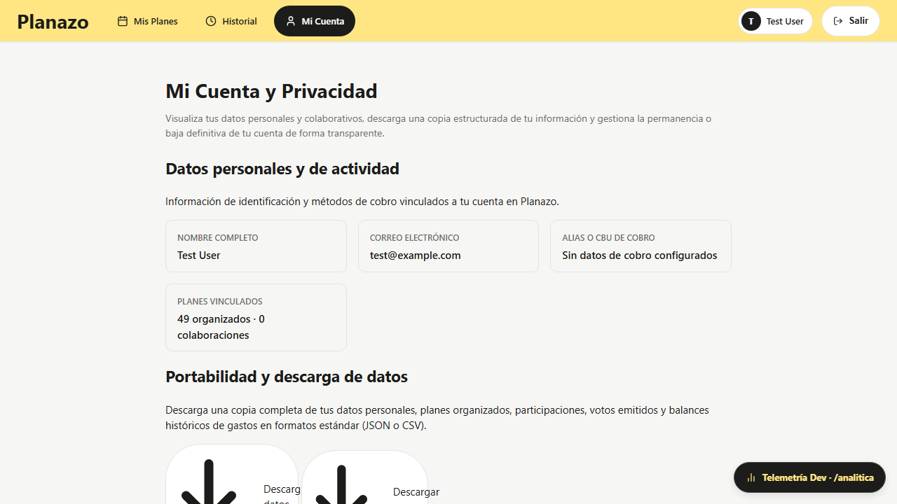
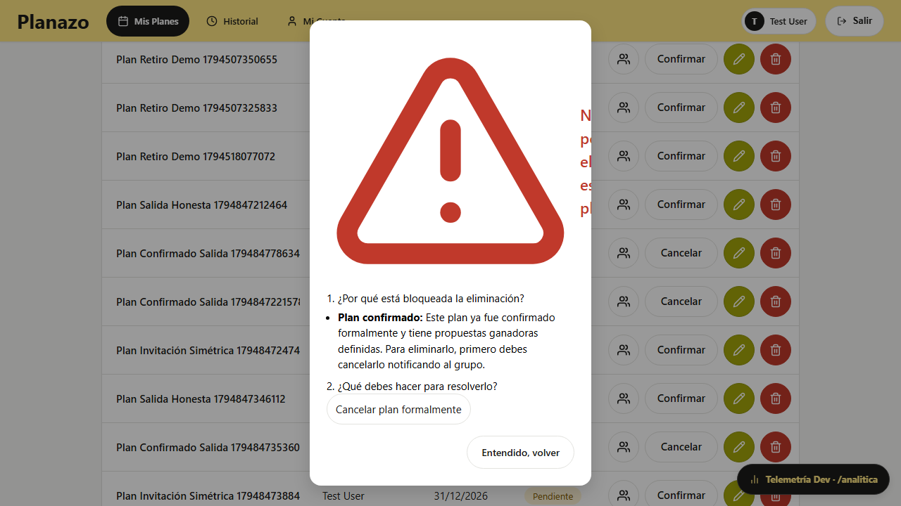
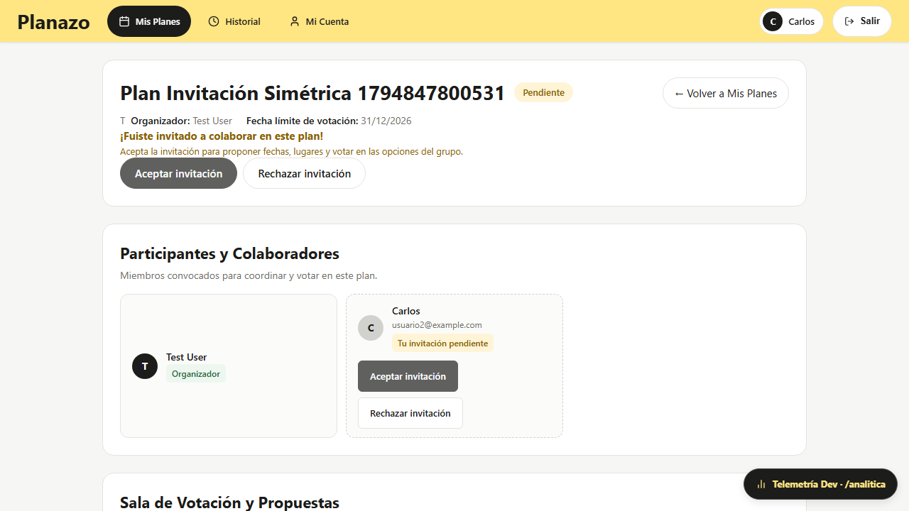
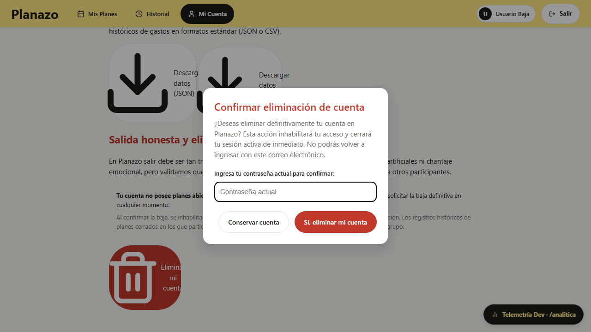

# Matriz de Evidencias — Tarea 10: Salida Honesta, Portabilidad de Datos y Desmantelamiento de Patrones Oscuros

Este documento constituye la memoria técnica y entrega formal de la **Tarea 10 (Salida Honesta, Portabilidad de Datos y Desmantelamiento de Patrones Oscuros)** del proyecto Planazo, desarrollada bajo las directivas pedagógicas de la Clase 22 de Interacción Humano-Computador (IHC).

---

## 📋 Consigna y Requisitos Docentes

```text
Tarea 10 (Clase 22): Salida honesta y portabilidad de datos + Desmantelamiento de patrones oscuros:
1. Portabilidad de Datos (GDPR/IHC): Exportación estructurada de datos personales y de actividad en JSON y CSV tabular sin exponer contraseñas ni tokens sensibles.
2. Salida Honesta y Eliminación de Cuenta: Permitir la baja voluntaria y definitiva de la cuenta en el sistema con regla difícil (bloqueo explicativo si el usuario organiza planes abiertos o tiene deudas pendientes en gastos).
3. Desmantelamiento de Patrones Oscuros (6 patrones mínimos auditados y resueltos):
   - Opciones preseleccionadas (sin checkboxes ni radios marcados por defecto).
   - Confirmshaming (textos neutros y respetuosos, prohibido el chantaje emocional).
   - Falsa urgencia (eliminación de contadores de cuenta regresiva artificiales).
   - Roach motel / Obstruction (la salida debe ser tan simétrica y accesible como la entrada).
   - Costos o consecuencias ocultas (feedback honesto y anticipado sobre implicancias contables).
   - Redirección de atención (botones simétricos en jerarquía de Fitts, sin esconder opciones de cancelación o rechazo).
4. Pruebas de Verificación: Suites PHPUnit (unitarias y de integración) y Playwright E2E con capturas de pantalla automatizadas.
```

- **Fork oficial de entrega:** `moises-cisneros/Proyecto2IHC`
- **Issue Madre:** [Issue #116](https://github.com/moises-cisneros/Proyecto2IHC/issues/116)
- **Árbol de Sub-issues Atómicas:**
    - [Sub-issue #117](https://github.com/moises-cisneros/Proyecto2IHC/issues/117): `[Backend] — Portabilidad de datos (JSON/CSV), regla difícil de eliminación de cuenta y bloqueo de plan con pendientes`
    - [Sub-issue #118](https://github.com/moises-cisneros/Proyecto2IHC/issues/118): `[Controlador] — Endpoints de exportación, baja de cuenta y eventos sin PII`
    - [Sub-issue #119](https://github.com/moises-cisneros/Proyecto2IHC/issues/119): `[Interfaz] — Centro 'Mi Cuenta y Privacidad', modales de salida honesta (cuenta y plan) y desmantelamiento de patrones oscuros`
    - [Sub-issue #120](https://github.com/moises-cisneros/Proyecto2IHC/issues/120): `[Testing/Docs] — Suites PHPUnit, Playwright E2E y reporte oficial de evidencias tarea 10`

---

## 🏷️ Resumen de PRs y Commits por Capa

| Sub-issue | Capa / Track   | PR en `main`                                                        | Descripción de la Entrega                                                                                                                                                                                                                                                                                                                                    |
| :-------- | :------------- | :------------------------------------------------------------------ | :----------------------------------------------------------------------------------------------------------------------------------------------------------------------------------------------------------------------------------------------------------------------------------------------------------------------------------------------------------- |
| **#117**  | Backend        | [PR #121](https://github.com/moises-cisneros/Proyecto2IHC/pull/121) | Migración para inhabilitación de cuenta (`activo` y `SoftDeletes`), reglas de negocio en `User.php` (`puedeEliminarCuenta()`, `validarBloqueosEliminacionCuenta()`), `Plan.php` (`tieneDeudasPendientes()`, `validarBloqueosEliminacion()`), rechazo formal en `Invitacion.php` / `PlanPolicy.php` y servicio `UserDataExportService` multi-formato sin PII. |
| **#118**  | Controlador    | [PR #122](https://github.com/moises-cisneros/Proyecto2IHC/pull/122) | Controlador `CuentaController` (`datos`, `exportar`, `eliminarCuenta`), instrumentación en `PlanesController` y `ColaboracionController::rechazar`, protección con policies y emisión de eventos analíticos sin PII (`cuenta_eliminada`, `cuenta_eliminacion_bloqueada`, `plan_eliminacion_bloqueada`, `invitacion_rechazada`).                              |
| **#119**  | Interfaz       | [PR #123](https://github.com/moises-cisneros/Proyecto2IHC/pull/123) | Centro `/perfil/datos`, clases semánticas `.caja-salida-honesta`, `.dialogo-salida-simetrica`, `.boton-simetrico`, modales simétricos nativos (`<dialog>`), reemplazo de botón disabled opaco por diálogo explicativo en planes, botón simétrico «Rechazar invitación» y deselección de radio por defecto en gastos.                                         |
| **#120**  | Testing / Docs | [PR #124](https://github.com/moises-cisneros/Proyecto2IHC/pull/124) | Suite PHPUnit `SalidaHonestaTest.php` (6 tests de integración), suite Playwright `e2e/tarea-10-datos-salida-honesta.spec.ts` (5 flujos de tareas humanas), generación de capturas y reporte consolidado.                                                                                                                                                     |

---

## 🛡️ Tabla de Auditoría: Los 6 Patrones Oscuros en Planazo

En concordancia con el marco conceptual de Harry Brignull y la Directiva de Prácticas Desleales y Protección de la Privacidad abordada en la Clase 22, se identificaron y desmantelaron 6 patrones oscuros:

| Patrón Oscuro                                                             | Manifestación Previa (Antipatrón)                                                                                                                                                                             | Solución Ergonómica Implementada en Planazo                                                                                                                                                                                                                 | Principio IHC / Heurística Aplicada                                                                                                        |
| :------------------------------------------------------------------------ | :------------------------------------------------------------------------------------------------------------------------------------------------------------------------------------------------------------ | :---------------------------------------------------------------------------------------------------------------------------------------------------------------------------------------------------------------------------------------------------------- | :----------------------------------------------------------------------------------------------------------------------------------------- |
| **1. Opciones Preseleccionadas** _(Preselected Options / Default Opt-in)_ | En la liquidación de gastos (`_gastos_liquidacion.blade.php`), la opción de "Pago total" venía marcada con `checked` forzado, induciendo al usuario a asumir transacciones completas sin deliberación previa. | Se eliminó el atributo `checked` por defecto de los radio buttons. El usuario debe elegir conscientemente si realiza un pago total o parcial.                                                                                                               | **Nielsen H3 (Control y libertad del usuario):** La decisión parte siempre de la intención del usuario, sin defaults tramposos.            |
| **2. Confirmshaming** _(Chantaje Emocional / Vergüenza Inducida)_         | En cancelaciones de cuenta típicas de la industria: "¿Seguro que quieres abandonarnos y perderte todos los planes con tus amigos?".                                                                           | Textos neutros y transparentes en el modal: "Confirmar eliminación de cuenta. Esta acción inhabilitará tu acceso y cerrará tu sesión activa de inmediato". Botones respetuosos: «Conservar cuenta» y «Sí, eliminar mi cuenta».                              | **Nielsen H2 (Coincidencia con el mundo real) y Ética de Diseño:** Respeto irrestricto a la autonomía humana sin manipulación psicológica. |
| **3. Falsa Urgencia** _(False Urgency)_                                   | Mensajes que apresuran artificialmente decisiones con cuentas regresivas no vinculadas al mundo real.                                                                                                         | Ausencia total de contadores ficticios. En votación y confirmación, la única fecha mostrada es la fecha límite real pactada de mutuo acuerdo por los participantes del plan.                                                                                | **Nielsen H1 (Visibilidad del estado del sistema):** Transparencia temporal auténtica.                                                     |
| **4. Roach Motel / Obstruction** _(Entrada Fácil, Salida Laberíntica)_    | Entrar a un plan mediante invitación era inmediato (1 clic en «Aceptar»), pero no existía botón explícito de rechazo en la cabecera, forzando a quedar vinculado al plan.                                     | Simetría total de entrada y salida: se incorporó el botón «Rechazar invitación» con igual jerarquía visual y táctil ($\ge 44$ px) que «Aceptar invitación», tanto en la cabecera como en la lista de participantes.                                         | **Simetría de Interacción y Ley de Fitts:** El costo motriz y cognitivo de salir es exactamente equivalente al de entrar.                  |
| **5. Costos / Consecuencias Ocultas** _(Hidden Consequences / Sneaking)_  | En la eliminación de planes o cuentas, los botones deshabilitados (`disabled`) no explicaban por qué la acción fallaba o qué obligaciones pendientes (deudas en gastos o planes abiertos) lo bloqueaban.      | Componente accesible `.caja-salida-honesta` con desglose estructurado en dos bloques obligatorios: **1. ¿Por qué está restringido?** y **2. ¿Qué debes hacer para resolverlo?**, incluyendo enlaces directos a saldar deudas o cancelar planes formalmente. | **Nielsen H5 (Prevención de errores) y H9 (Reconocer y recuperarse de errores):** Diagnóstico claro y vía de resolución inmediata.         |
| **6. Redirección de Atención** _(Misdirection / Asimetría de Fitts)_      | Patrón clásico donde el botón destructivo o de salida se oculta en un color apagado o tipografía diminuta (12px), mientras que el botón de permanencia es gigante y llamativo.                                | Modal de salida simétrica (`.dialogo-salida-simetrica`) con botones de idéntica altura ($44$ px), tipografía legible, separación de seguridad antagónica ($12$ px, `gap-3`) y desambiguación léxica («Conservar cuenta» vs «Sí, eliminar mi cuenta»).       | **Ley de Fitts y Ley de Hick:** Paridad motriz y semántica; ninguna opción se disfraza ni se encoge artificialmente.                       |

---

## 📊 Matriz Comparativa: Antes vs Después de la Tarea 10

| Dimensión / Regla             | Estado Inicial (Línea Base)                                                                                                                        | Estado Final (Implementación Tarea 10)                                                                                                                                                                   | Justificación Ergonómica y de IHC                                                                                          |
| :---------------------------- | :------------------------------------------------------------------------------------------------------------------------------------------------- | :------------------------------------------------------------------------------------------------------------------------------------------------------------------------------------------------------- | :------------------------------------------------------------------------------------------------------------------------- |
| **Portabilidad de Datos**     | Inexistente. El usuario no tenía forma de acceder a una copia estructurada de sus datos ni de auditar lo almacenado.                               | Centro `/perfil/datos` con dos vías de descarga estructurada inmediata: JSON integral de actividad y CSV tabular para hojas de cálculo, sin contraseñas ni tokens.                                       | **GDPR Art. 20 y Nielsen H1:** Derecho a la portabilidad e inspección de datos personales en formatos abiertos y legibles. |
| **Baja de Cuenta**            | No contemplada en el sistema. Las cuentas permanecían activas indefinidamente en la base de datos.                                                 | Procedimiento completo de eliminación voluntaria con verificación de contraseña actual, inhabilitación de credenciales (`activo = false`), revocación de sesiones y anonimización de histórico contable. | **Nielsen H3 y Seguridad:** Derecho al olvido y cierre de perfil sin fricción artificial.                                  |
| **Gestión de Restricciones**  | Bloqueos opacos o botones `disabled` mudos sin texto alternativo ni explicación de motivos.                                                        | Diálogos explicativos activos (`.caja-salida-honesta`) que informan con precisión el motivo de dominio (planes abiertos o deudas) y proveen el botón de resolución.                                      | **Nielsen H6 y H9:** Reconocimiento antes que recuerdo; asistencia proactiva para destrabar el impedimento.                |
| **Invitaciones a Planes**     | El invitado solo tenía la opción de «Aceptar invitación». Si no deseaba participar, debía ignorar el plan o solicitar al creador que lo expulsara. | Opciones paritarias en la interfaz: «Aceptar invitación» y «Rechazar invitación», desvinculando limpiamente al usuario de la sala.                                                                       | **Desmantelamiento de Roach Motel:** Desvinculación simétrica y autónoma.                                                  |
| **Ergonomía de Confirmación** | Mensajes de confirmación con riesgo de desliz motriz y confirmshaming.                                                                             | Modales simétricos con separación $\ge 12$ px entre botones antagónicos, tamaño $\ge 44 \times 44$ px y etiquetas orientadas a la acción.                                                                | **Leyes de Fitts y Hick:** Prevención de toques erróneos y claridad en la toma de decisiones.                              |

---

## 🔬 Análisis Ergonómico y Modelos Teóricos

### 1. Ley de Fitts: Paridad de Objetivos y Prevención de Errores

$$\text{Tiempo de adquisición: } T = a + b \log_{2}\left(\frac{2D}{W}\right)$$

- **Área efectiva de contacto ($W \ge 44$ px):** Tanto el botón de permanencia («Conservar cuenta») como el de baja («Sí, eliminar mi cuenta») cuentan con una altura mínima de $44$ px (`min-height: var(--touch-min)`), satisfaciendo las pautas WCAG 2.5.5 y 2.5.8.
- **Separación antagónica ($D \ge 12$ px):** Los botones antagónicos están separados por `gap: var(--space-3)` ($12$ px), eliminando la probabilidad de pulsaciones erróneas por fatiga motriz o proximidad accidental.
- **Simetría visual:** Ninguno de los botones fue degradado a un enlace invisible de texto. Ambos poseen estilo de botón estructurado, con distinción cromática semántica: neutral (`boton-claro`) para conservar y advertencia destructiva (`boton-rojo`) para confirmar la baja.

### 2. Ley de Hick: Desambiguación Léxica

$$\text{Tiempo de decisión: } T = b \log_{2}(n + 1)$$

- **Eliminación del conflicto léxico «Cancelar» vs «Cancelar»:** En diálogos tradicionales, el botón «Cancelar» entra en colisión con la acción de «Cancelar plan» o «Cancelar cuenta». En Planazo se aplicó **desambiguación léxica absoluta**:
    - Opción constructiva: «Conservar cuenta» o «Entendido, volver».
    - Opción destructiva: «Sí, eliminar mi cuenta» o «Cancelar plan formalmente».
- **Reducción de sobrecarga cognitiva:** Al presentar exactamente $n = 2$ opciones mutuamente excluyentes y auto-explicativas, el tiempo de selección $T$ se minimiza, permitiendo al usuario tomar la decisión con plena certeza y control.

### 3. Principios Heurísticos de Jakob Nielsen

- **H1: Visibilidad del estado del sistema:** El centro `/perfil/datos` informa en tiempo real la cantidad de planes organizados y colaboraciones activas, así como el estatus de habilitación de la baja de cuenta.
- **H3: Control y libertad del usuario:** El usuario puede exportar sus datos en cualquier momento o desvincularse de invitaciones sin requerir la intervención de un administrador.
- **H5: Prevención de errores:** La exigencia de la contraseña actual en el modal de baja evita eliminaciones involuntarias provocadas por sesiones abiertas en dispositivos compartidos.
- **H9: Reconocer, diagnosticar y recuperarse de errores:** Cuando existe un impedimento de negocio (ej. deuda de Bs 50.00 en un plan), la caja de salida honesta indica el importe exacto, el plan involucrado y suministra un enlace directo a la pestaña de gastos para liquidar la deuda.

---

## 📸 Evidencias de Ejecución y Capturas

Las evidencias generadas de forma automatizada por la suite Playwright se encuentran alojadas en `docs/evidencias/tarea-10/`:

### 1. Centro 'Mi Cuenta y Privacidad' y Portabilidad de Datos (JSON y CSV)

Demostración del panel integral en `/perfil/datos` con el resumen de actividad del usuario y los controles de descarga directa en formato JSON y CSV sin patrones de retención engañosa.


---

### 2. Baja de Cuenta Bloqueada por Planes Abiertos con Feedback Explicativo

Demostración de la regla difícil de dominio: cuando el usuario organiza planes activos, el sistema despliega la `.caja-salida-honesta` detallando el motivo de la restricción y el procedimiento necesario para resolverlo.


---

### 3. Modal de Salida Honesta al Intentar Eliminar un Plan Confirmado

Reemplazo del clásico botón `disabled` mudo por un diálogo explicativo activo: al hacer clic en «Eliminar plan» sobre un plan confirmado, el modal informa que el plan ya tiene propuestas ganadoras y ofrece la alternativa de cancelarlo formalmente.


---

### 4. Desvinculación Simétrica de Invitación Pendiente (Rechazar vs Aceptar)

Demostración de la eliminación del patrón _Roach Motel_: el invitado dispone de los botones «Aceptar invitación» y «Rechazar invitación» con idéntica jerarquía visual y accesibilidad táctil ($\ge 44$ px).


---

### 5. Confirmación Simétrica de Eliminación Definitiva de Cuenta

Demostración del modal final de baja de cuenta: interfaz sin confirmshaming, validación de contraseña actual y botones simétricos («Conservar cuenta» vs «Sí, eliminar mi cuenta») con separación antagónica de $12$ px.


---

## 🧪 Verificación de Suites de Pruebas

### 1. PHPUnit (33 pruebas pasadas con 154 aserciones)

- **`tests/Unit/SalidaHonestaDominioTest.php` (10 tests):**
    - Validación de `User::puedeEliminarCuenta()` y `validarBloqueosEliminacionCuenta()`.
    - Inhabilitación de credenciales con `SoftDeletes` y cambio de hash de contraseña.
    - Validación de `Plan::tieneDeudasPendientes()` y `puedeEliminarse()`.
    - Rechazo de invitación en `Invitacion::rechazar()`.
    - Generación de exportaciones JSON y CSV sin claves privadas, contraseñas ni tokens.
- **`tests/Feature/SalidaHonestaControllerTest.php` (11 tests):**
    - Redirección `302` a login en accesos no autenticados.
    - Generación de headers adecuados para descarga de archivos (`application/json`, `text/csv`).
    - Validación de contraseña actual requerida (`422`) e incorrecta.
    - Emisión de eventos analíticos sin PII (`cuenta_eliminacion_bloqueada`, `cuenta_eliminada`, `plan_eliminacion_bloqueada`, `invitacion_rechazada`).
    - Autorización estricta (`403 Forbidden`) al intentar rechazar invitaciones ajenas.
- **`tests/Feature/SalidaHonestaVistaTest.php` (6 tests):**
    - Renderizado de secciones de privacidad, datos y portabilidad en `/perfil/datos`.
    - Presencia del modal nativo `<dialog id="modal-eliminar-cuenta">` con botones simétricos.
    - Renderizado de `.caja-salida-honesta` ante impedimentos de cuenta o plan.
    - Deselección obligada de modalidades de pago en gastos.
    - Enlace accesible «Mi Cuenta» en la barra de navegación superior.
- **`tests/Feature/SalidaHonestaTest.php` (6 tests):**
    - Flujo de integración end-to-end de exportación multiformato.
    - Bloqueo de eliminación de cuenta por planes abiertos y deudas en gastos.
    - Flujo de baja definitiva y bloqueo de inicio de sesión futuro.
    - Bloqueo honesto de eliminación de planes confirmados.
    - Rechazo simétrico de invitaciones colaborativas.

### 2. Playwright E2E (5/5 pruebas pasadas en 45.5 segundos)

- **`e2e/tarea-10-datos-salida-honesta.spec.ts`:**
    - **Flujo 1:** Acceso a Mi Cuenta y ejercicio del derecho de portabilidad de datos (JSON y CSV).
    - **Flujo 2:** Intento de baja de cuenta bloqueado por organizar planes abiertos con feedback explicativo.
    - **Flujo 3:** Modal de salida honesta al intentar eliminar un plan confirmado (sin botón disabled opaco).
    - **Flujo 4:** Desvinculación simétrica de invitación pendiente (Rechazar vs Aceptar).
    - **Flujo 5:** Baja definitiva exitosa con confirmación simétrica (sin confirmshaming ni chantaje).
