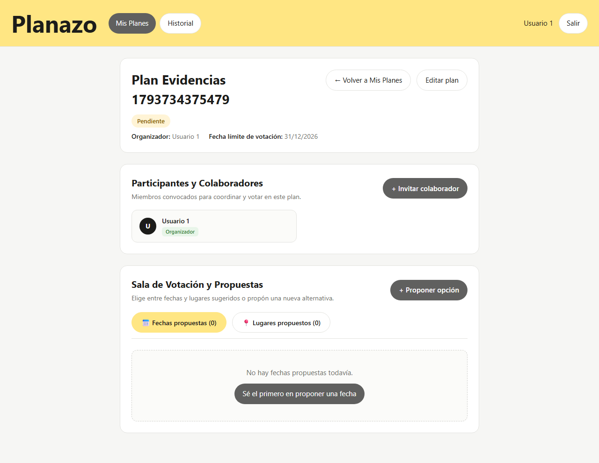
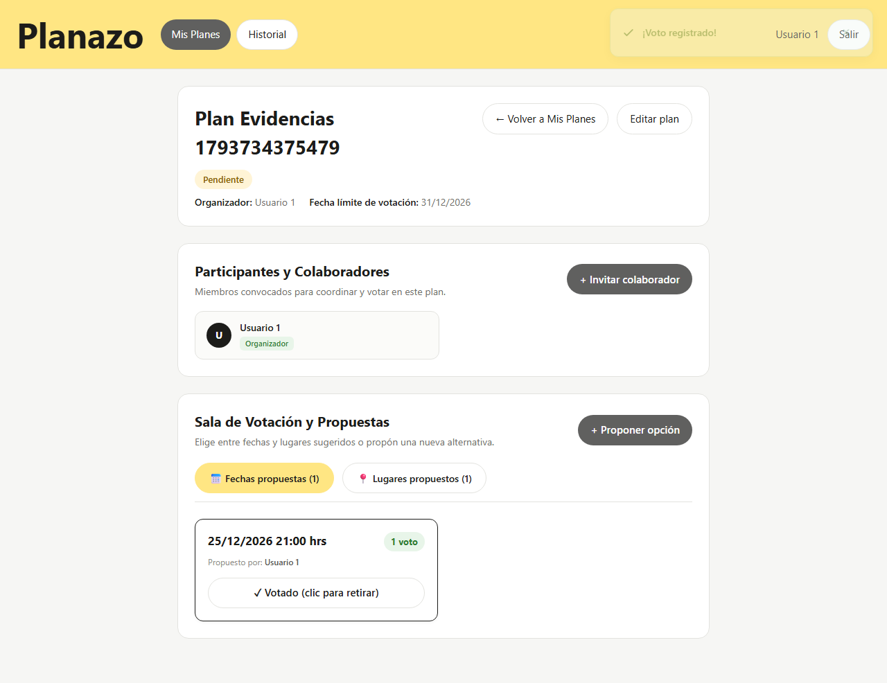
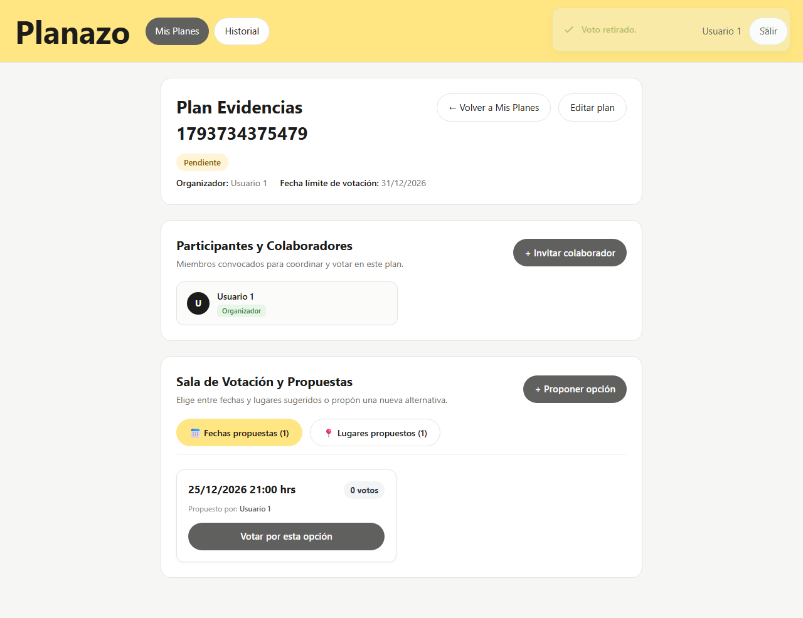
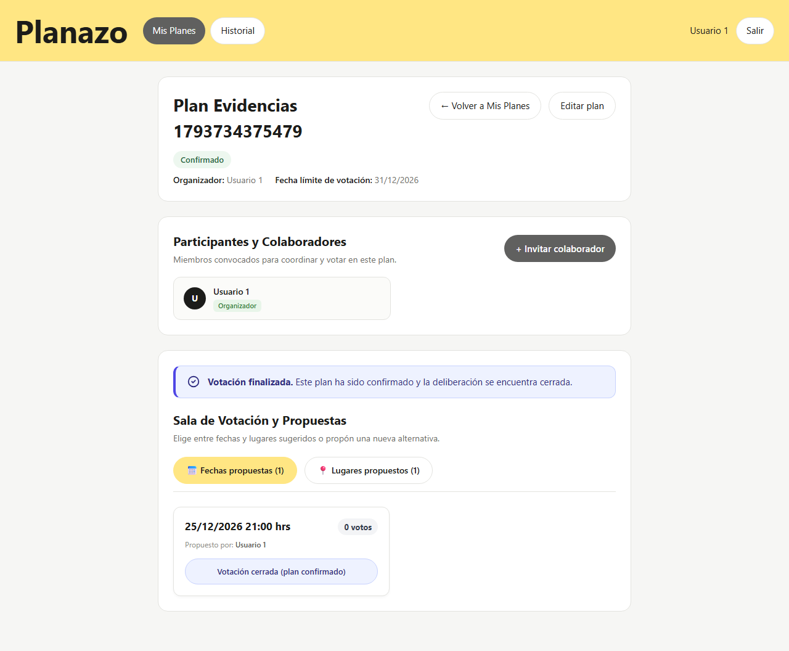

# Matriz de Evidencias — Tarea 6: Varios Votos y Congelamiento al Cierre

Este documento constituye la entrega formal y memoria técnica de la **Tarea 6 (Feature: Varios Votos)** del proyecto Planazo, en estricto cumplimiento de los requisitos docentes y las directivas de `AGENTS.md`, `ARCHITECTURE.md` y `resources/DESIGN.md`.

---

## 📋 Consigna y Requisitos Docentes

```text
Feature: Varios votos
Reglas: Votar por varias opciones, cambiar o quitar el voto antes del cierre. 
Prueba E2E: El conteo cambia y, cerrado no puede cambiar.

A. Todos los flujos + Alternativos + Visual + Accesibilidad + Semilla.

Todo subido en su fork: Antes de las 5pm del martes 03/11, suite de antes y después de la feature, matriz en "evidencias/tarea-6.md".
```

- **Fork oficial:** `moises-cisneros/Proyecto2IHC`
- **Issue Padre:** [Issue #33](https://github.com/moises-cisneros/Proyecto2IHC/issues/33)
- **Sub-issues Atómicas:**
  - [Sub-issue #34](https://github.com/moises-cisneros/Proyecto2IHC/issues/34): Backend y Regla de Negocio
  - [Sub-issue #35](https://github.com/moises-cisneros/Proyecto2IHC/issues/35): Interfaz Blade, Prevención de Errores (@can, H5) y Estética
  - [Sub-issue #36](https://github.com/moises-cisneros/Proyecto2IHC/issues/36): Suite E2E Playwright de Flujo Humano
  - [Sub-issue #37](https://github.com/moises-cisneros/Proyecto2IHC/issues/37): Capturas antes/después, accesibilidad y matriz de evidencias

---

## 📊 Matriz Comparativa: Antes vs Después de la Feature

| Dimensión / Regla | Estado Inicial (Antes de la Feature) | Estado Final (Después de la Feature) | Justificación IHC / Regla Técnica |
| :--- | :--- | :--- | :--- |
| **Votación por múltiples opciones** | Cada usuario solo podía emitir o registrar un único voto global; un nuevo voto sobrescribía o impedía votar por otras fechas o lugares. | Un participante puede votar por **varias opciones simultáneamente** (múltiples fechas y lugares). Cada opción mantiene un contador y lista de votantes independiente. | **Aprobación democrática (Approval Voting):** Reduce la fragmentación y el bloqueo por empate en la coordinación social. |
| **Cambio o retiro reactivo de voto (Toggle)** | Si el usuario pulsaba una opción ya votada, la acción recargaba la página sin alternancia o arrojaba error de duplicado. | Pulsar una opción previamente votada **retira el voto de inmediato** y decrementa el conteo en tiempo real. | **Nielsen H3 (Control y libertad del usuario):** Salida de emergencia clara y capacidad de corregir decisiones sin fricción. |
| **Congelamiento de sala cerrada** | Un plan confirmado, cancelado o con fecha expirada seguía mostrando botones de votación y propuesta activos. | La sala cerrada muestra un **banner preventivo** («Votación finalizada»), **botones inhabilitados (`disabled`)** y rechaza cualquier POST con **`403 Forbidden`**. El conteo queda inmutable. | **Nielsen H5 (Prevención de errores) y Seguridad:** Menor privilegio, protección de estado terminal e inmutabilidad garantizada. |
| **Input Estructurado (H5)** | La sugerencia de fecha requería tipear texto libre (ej: «Sábado a las 8»), generando dispersión y errores de formato. | Modal estructurado con alternancia automática: selector de tipo que despliega `<input type="datetime-local">` para fechas e `<input type="text">` para lugares. | **Nielsen H5 (Prevención de errores tipográficos):** Evita inconsistencias de calendario y fragmentación semántica. |
| **Botonera de Acciones en Listado** | Botones de edición y eliminación dispuestos en columna vertical apretada (`.botones-columna`), con ancho de solo 30px y solapamiento. | Acciones organizadas en fila horizontal con **separación de 8px (`gap: 8px`)**, formato píldora y dimensiones táctiles **≥ 44 × 44 px** (`.boton-claro`, `.boton-editar`, `.boton-rojo`). | **Ley de Fitts:** $T = a + b \log_{2}(2D/W)$ — Amplitud óptima de clic, separación preventiva y consistencia con `DESIGN.md`. |
| **Autorización Desacoplada (@can)** | Comprobaciones manuales en Blade tipo `@if ($plan->user_id === auth()->id())` dispersas en vistas y tablas. | Desacoplamiento total con directivas `@can('cambiarEstado')`, `@can('update')`, `@can('delete')`, `@can('proponer')` y `@can('invitar')`. | **Principio de Menor Privilegio:** Seguridad consistente basada en Policies de dominio centralizadas. |
| **Ergonomía Cognitiva (Ley de Hick)** | Opciones de fecha y lugar mezcladas en una sola lista vertical continua sin categorización semántica. | División en **$n = 2$ pestañas semánticas** («Fechas propuestas» vs «Lugares propuestos») con navegación por tabs estilo píldora y resaltado cálido `#ffe683`. | **Ley de Hick:** $T = b \log_{2}(n + 1)$ — Reduce la carga cognitiva al clasificar las opciones en 2 bloques independientes equiprobables. |
| **Accesibilidad (a11y)** | Falta de contraste suficiente en badges y ausencia de estados `role="status"` o roles semánticos en botones de votación. | Contraste conforme WCAG AA (> 4.5:1), estados `aria-label` descriptivos, `disabled` nativo y **0 violaciones críticas en `@axe-core/playwright`**. | **WCAG 2.1 AA:** Accesibilidad universal para navegación por teclado y lectores de pantalla. |
| **Pruebas E2E Automatizadas** | Pruebas técnicas con selectores CSS frágiles e IDs (`#boton-voto`), sin contemplar el flujo humano completo. | Suite Playwright en **modo visible (`--headed` / `--ui`)** narrando la tarea real de «Anita» con localizadores semánticos (`getByRole`, `getByText`, `getByLabel`). | **Flujo Humano:** «Una prueba es una tarea humana». |

---

## 🖼️ Registro de Evidencias Gráficas

### 1. Estado Inicial (Antes de la Feature)

- **Sala de votación inicial abierta:**


---

### 2. Estado Final (Después de la Feature)

- **Múltiples votos activos simultáneamente (Fecha + Lugar):**


- **Retiro de voto reactivo (Toggle con decremento a 0 votos):**


- **Sala cerrada con deliberación finalizada (Banner H5 + Botones inhabilitados + Conteo congelado):**


---

## 🧪 Tareas y Cobertura de la Suite E2E («Anita...»)

La suite implementada en `e2e/tarea-6-varios-votos.spec.ts` cubre:

1. **Test 1 — Acceso Humano con Semilla:**
   - *Anita* inicia sesión con la cuenta sembrada `usuario1@example.com` / `password123`.
   - *Anita* navega sin fricción al panel de `Mis planes` sin errores de credenciales.

2. **Test 2 — Happy Path (Múltiples votos independientes):**
   - *Anita* ingresa a la sala colaborativa de un plan abierto (`pendiente`).
   - *Anita* propone una fecha mediante el selector estructurado y un lugar.
   - *Anita* vota por el lugar $\to$ El conteo incrementa de 0 a 1.
   - *Anita* vota por la fecha $\to$ El conteo de la fecha incrementa a 1 **sin perder el voto del lugar**.
   - Ambos votos coexisten simultáneamente en tiempo real.

3. **Test 3 — Alternancia y Retiro de Voto (Toggle):**
   - *Anita* emite su voto sobre una opción (1 voto).
   - *Anita* pulsa el botón «✓ Votado (clic para retirar)».
   - El contador decrementa inmediatamente de 1 a 0 y el botón se restaura a «Votar por esta opción».

4. **Test 4 — Sala Cerrada (Congelamiento estricto y Menor Privilegio):**
   - *Anita* ingresa a un plan en estado `confirmado`.
   - *Anita* observa el banner accesible («Votación finalizada. Este plan ha sido confirmado y la deliberación se encuentra cerrada.»).
   - El botón «+ Proponer opción» no se renderiza en pantalla.
   - Los controles de voto están inhabilitados y el conteo no puede cambiar.
   - Cualquier intento de mutación devuelve código HTTP `403 Forbidden`.

5. **Test 5 — Auditoría Automatizada de Accesibilidad:**
   - Ejecución con `@axe-core/playwright` sobre la sala colaborativa completa.
   - Verificación de **0 violaciones críticas** de accesibilidad WCAG 2.1 AA.
