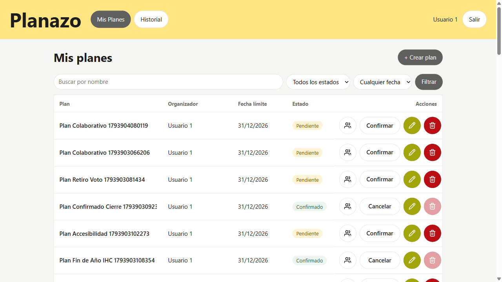
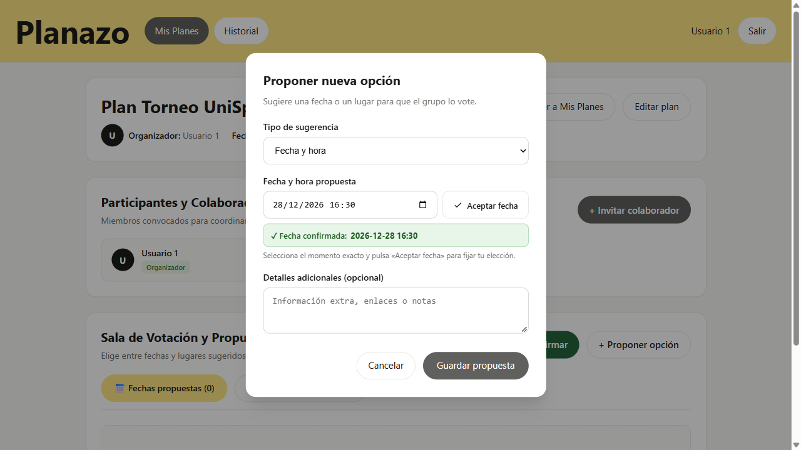
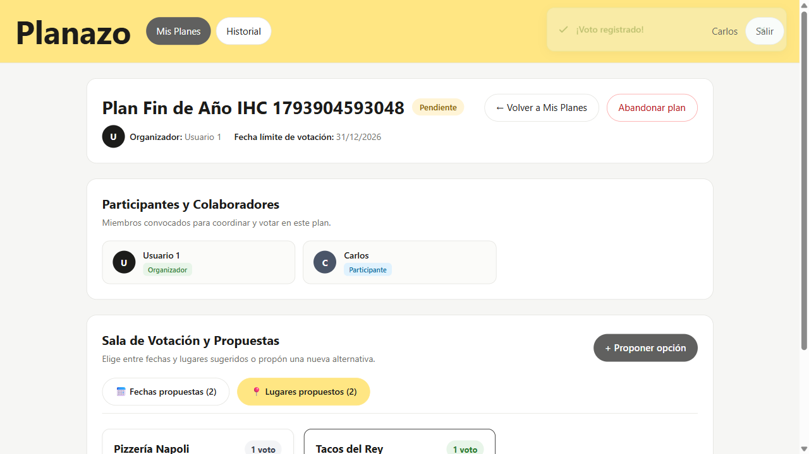
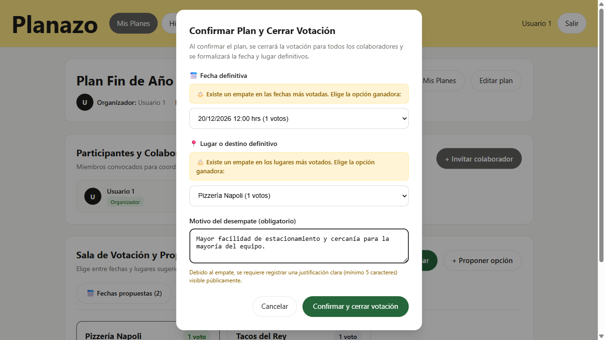
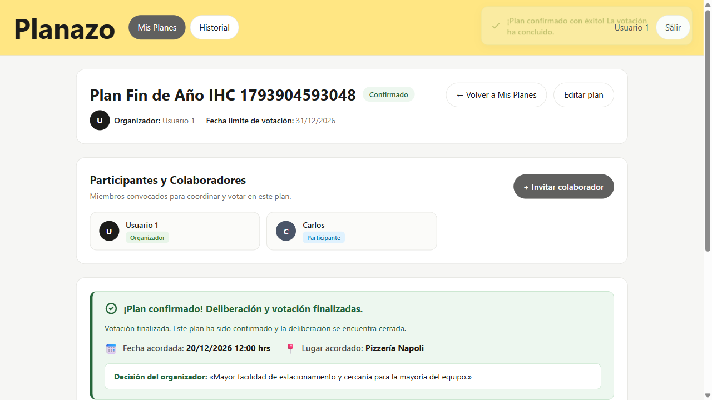
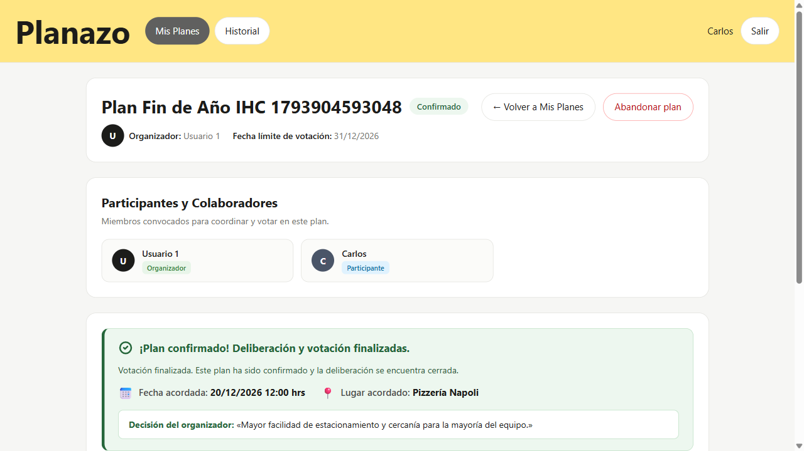

# Matriz de Evidencias — Tarea 7: Confirmar Plan a partir de Votación, Resolución de Empates y Mejora por Feedback

Este documento constituye la memoria técnica y entrega formal de la **Tarea 7 (Confirmar Plan a partir de Votación y Resolución de Empates con Mejora por Feedback)** del proyecto Planazo, desarrollada bajo las directivas de la Clase 19.

---

## 📋 Consigna y Requisitos Docentes

```text
Confirmar plan a partir de votación:
1. Se confirma la opción ganadora de la votación (o el organizador desempata eligiendo una con motivo obligatorio).
2. Mejora por feedback: resuelve un problema real reportado en el feedback de la clase anterior con un commit tipo fix: y luego tu feature con un commit tipo feat:.
```

- **Fork oficial de entrega:** `moises-cisneros/Proyecto2IHC`
- **Issue Padre:** [Issue #45](https://github.com/moises-cisneros/Proyecto2IHC/issues/45)
- **Árbol de Sub-issues Atómicas:**
  - [Sub-issue #46](https://github.com/moises-cisneros/Proyecto2IHC/issues/46): `[Feedback IHC] — Validación de fechas pasadas y confirmación explícita en selector de fechas`
  - [Sub-issue #47](https://github.com/moises-cisneros/Proyecto2IHC/issues/47): `[Backend / Persistencia] — Migración, campos de opción ganadora, motivo de desempate y estado confirmado`
  - [Sub-issue #50](https://github.com/moises-cisneros/Proyecto2IHC/issues/50): `[Controlador / Lógica] — Endpoint de cierre, resolución de empate con motivo y autorización estricta`
  - [Sub-issue #48](https://github.com/moises-cisneros/Proyecto2IHC/issues/48): `[Interfaz / Blade] — Modal de desempate con motivo, banner de veredicto público y controles protegidos`
  - [Sub-issue #49](https://github.com/moises-cisneros/Proyecto2IHC/issues/49): `[Pruebas y Evidencias] — Suite Playwright para escenario de desempate y documentación en evidencias/tarea-7.md`

---

## 🔗 Enlaces a Feedbacks Recibidos (Clase 19)

1. **Feedback 1 — UniSport (Laura Céspedes / Juan Carlos):**
   - [Feedback en repositorio UniSport](https://github.com/alvaroSG34/Segundo-Proyecto-IHC/blob/main/docs/clase-19-feedback-a-otro-proyecto/Laura%20Cespedes/feeback.md)
   - *Hallazgo:* Fricción cognitiva al seleccionar fecha/hora; ausencia de confirmación visible al interactuar con el selector, lo que ocasionaba pérdidas accidentales de la fecha elegida al cambiar de contexto.
2. **Feedback 2 — Mascota al Día (Choque Benavides):**
   - [Feedback en repositorio Mascota al Día](https://github.com/AlexTiclla/segundoProyectoIHC/blob/main/clase-19-feedback-a-otro-proyecto/choque-Benavides/feedback.md)
   - *Hallazgo:* Ausencia de validación preventiva de fechas anteriores a la actual en la creación y edición de planes, permitiendo crear planes vencidos sin retroalimentación de error.

---

## 🏷️ Commits Clave Requeridos (Fix vs Feat)

| Tipo de Commit | Hash Corto | Mensaje Convencional del Commit | Alcance y Solución |
| :--- | :--- | :--- | :--- |
| **Commit 1 (`fix`)** | `b7d63f7` | `fix: validar fechas pasadas y confirmacion explicita en selector de fechas (Refs #46)` | Resuelve los hallazgos de feedback: restricción `min` y regla `after_or_equal:today` en `StorePlanRequest`/`UpdatePlanRequest`, más botón «Aceptar fecha» con badge interactivo `✓ Fecha confirmada`. |
| **Commit 2 (`feat`)** | `a75ef86` | `feat: migracion, campos de opcion ganadora, motivo y deteccion de desempate (Refs #47)` | Estructura de base de datos con campos `propuesta_fecha_ganadora_id`, `propuesta_lugar_ganadora_id`, `motivo_desempate`, relaciones Eloquent y métodos de detección de empates en `Plan.php`. |

*(Integrados a `main` complementariamente mediante PRs #53 y #54 con endpoints de confirmación, modal accesible, veredicto público y ergonomía Fitts).*

---

## 📊 Matriz Comparativa: Antes vs Después de la Tarea 7

| Dimensión / Regla | Estado Inicial (Línea Base) | Estado Final (Implementación Tarea 7) | Justificación IHC / Regla Técnica |
| :--- | :--- | :--- | :--- |
| **Confirmación de Plan a partir de Votos** | El plan pasaba a confirmado mediante un botón genérico en el listado sin asociar la fecha ni el lugar más votado por los participantes. | El organizador pulsa «Cerrar votación y confirmar». El sistema consolida automáticamente la opción ganadora de fecha y lugar indiscutidos en la base de datos. | **Coordinación democrática:** Refleja formalmente la voluntad del grupo sin pasos manuales redundantes. |
| **Resolución de Empates** | No existía detección de empates; en caso de paridad de votos no había mecanismo formal ni registro de por qué se eligió una opción sobre otra. | Si hay empate en fecha o lugar, el modal despliega un selector delimitado exclusivamente al subconjunto de opciones empatadas (Ley de Hick) y exige un **motivo de desempate obligatorio ($\ge 5$ caracteres)**. | **Transparencia y Ley de Hick ($T = b \log_2(n+1)$):** Reduce opciones superfluas y documenta públicamente el criterio organizador. |
| **Veredicto Público en Sala** | La sala confirmada solo mostraba una alerta genérica sin indicar qué opciones resultaron acordadas. | Se despliega un **banner cálido de veredicto público** con la fecha y lugar acordados, y la justificación: *«Decisión del organizador: [Motivo registrado]»*. | **Nielsen H1 (Visibilidad del estado del sistema):** Comunicación inmediata y sin ambigüedades a participantes e invitados. |
| **Congelamiento e Inmutabilidad** | En planes confirmados se podía seguir interactuando con formularios de propuesta de opciones. | Botones de votación inhabilitados con texto explicativo («Votación cerrada»), botón de sugerir opciones oculto (`@can('proponer')`), y rechazo `403 Forbidden` en backend. | **Nielsen H5 (Prevención de errores) y Principio de Menor Privilegio.** |
| **Validación de Fechas Pasadas (Feedback)** | Se permitía seleccionar y guardar fechas pasadas en formularios de creación y edición. | Restricción HTML `min="{{ now()->format('Y-m-d') }}"` y validación estricta en Form Requests (`after_or_equal:today`) con mensaje claro. | **Nielsen H5 y H9:** Prevención en cliente y recuperación orientadora ante errores. |
| **Confirmación de Fecha en Propuestas (Feedback)** | La fecha se enviaba directamente sin confirmación visual intermedia, provocando errores en móviles o teclados táctiles. | Botón «Aceptar fecha» que retiene la selección y despliega un aviso `✓ Fecha confirmada: [Fecha]` antes de pulsar «Guardar propuesta». | **Nielsen H3 y H5:** Confirmación de dos pasos para acciones de precisión temporal. |
| **Acceso a Sala en Listado** | El organizador requería hacer clic en el nombre del plan para entrar a la sala, sin affordance directo en la botonera de acciones. | Botón compacto de acceso con ícono semántico ($\ge 44\times 44\text{px}$) sin romper la tabla ni exceder los 800px de layout. | **Ley de Fitts ($T = a + b \log_2(2D/W)$):** Amplitud táctil óptima sin sobrecarga espacial. |
| **Avatar en Cabecera** | Elementos visuales del organizador competían jerárquicamente con el título principal del plan. | Avatar acotado estándar ($\le 48\times 48\text{px}$, 36px) alineado horizontalmente con su nombre. | **Carga Cognitiva:** Proporcionalidad visual limpia y legible. |

---

## 🖼️ Galería de Evidencias Gráficas

### 1. Bloqueo de Fechas Pasadas (Feedback Mascota al Día)

Restricción en interfaz y rechazo en backend con mensaje descriptivo de error al intentar guardar un plan con fecha anterior a la actual.


---

### 2. Selector de Fecha con Confirmación Explícita (Feedback UniSport)

Uso del botón «Aceptar fecha» y feedback verde inmediato de fecha retenida (`✓ Fecha confirmada: 2026-12-28 16:30`) antes de enviar la propuesta.


---

### 3. Votación que Culmina en Empate

Sala colaborativa abierta con opciones de fechas y lugares líderes igualadas a 1 voto cada una tras la votación de Anita y Carlos.


---

### 4. Modal de Desempate con Motivo Obligatorio

El organizador abre el modal `<dialog>`, selecciona entre las opciones en paridad (Ley de Hick) y redacta la justificación obligatoria ($\ge 5$ caracteres).


---

### 5. Sala Confirmada con Veredicto Público (Vista Organizador)

Banner público cálido desplegando la fecha y lugar acordados junto a la justificación del organizador y botones de votación inhabilitados.


---

### 6. Vista del Participante Inmutable

El participante accede a la sala confirmada: visualiza el veredicto y el motivo, los botones de votar están inhabilitados y el botón de sugerir opciones está oculto.


---

## 🧪 Cobertura de Pruebas Automatizadas

### A. Pruebas Backend (PHPUnit)

Ejecución de suites en `tests/Unit/` y `tests/Feature/`:

- `tests/Unit/ValidacionFechasPlanTest.php`: 4 pruebas de validación de fechas pasadas y presentes en Form Requests.
- `tests/Unit/PersistenciaDesempateTest.php`: 4 pruebas unitarias de persistencia, campos de desempate y métodos `tieneEmpateFechas()`, `tieneEmpateLugares()`.
- `tests/Feature/ConfirmarPlanTest.php`: 6 pruebas de integración HTTP (ganador indiscutido, desempate con motivo, validación sin motivo, rechazo 403 para participantes, redirección 302 a login y bloqueo de planes no pendientes).
- `tests/Feature/VistasConfirmacionDesempateTest.php`: 4 pruebas de renderizado Blade (visibilidad para creador, protección para invitados, acceso en listado y renderizado de veredicto público).

### B. Pruebas E2E (Playwright)

- `e2e/feedback-1-selector-fechas.spec.ts`: Flujo humano de propuesta de fecha con confirmación explícita y retención de valor.

- `e2e/feedback-2-fechas-pasadas.spec.ts`: Flujo de intento de evasión de fechas pasadas con verificación de rechazo del backend.
- `e2e/tarea-7-confirmacion-desempate.spec.ts`: Ciclo completo multiusuario de votación en empate, desempate con motivo obligatorio y verificación de inmutabilidad.
