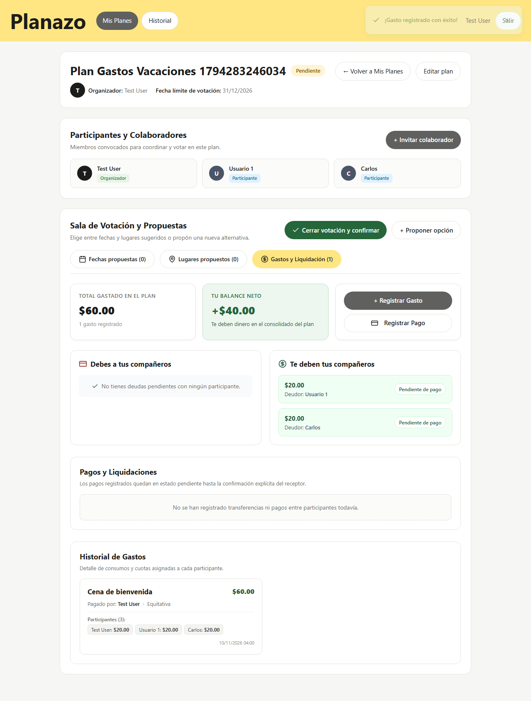
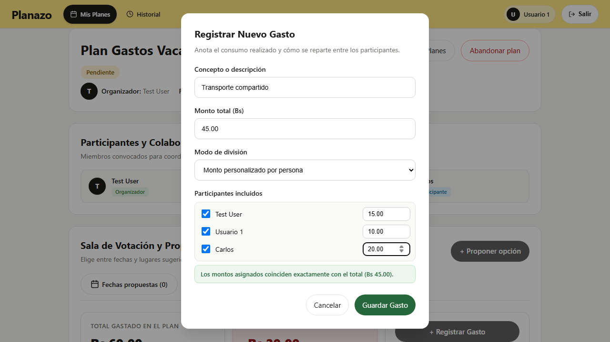
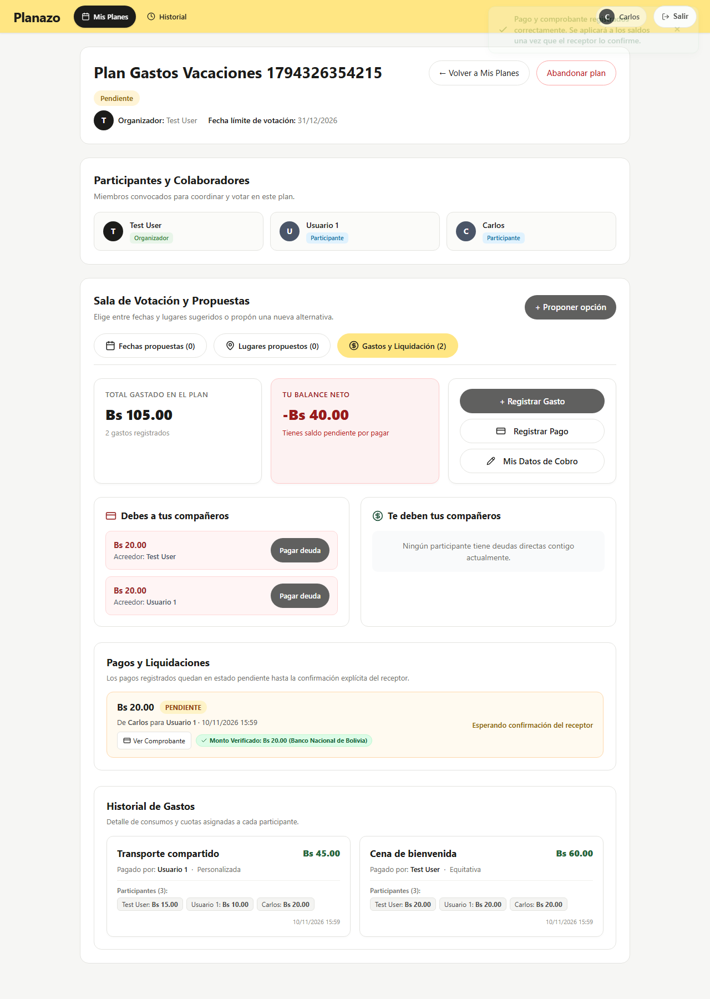
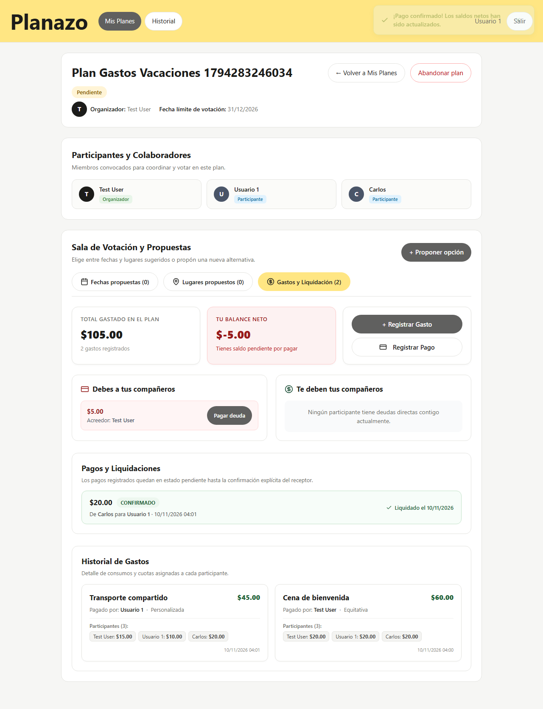
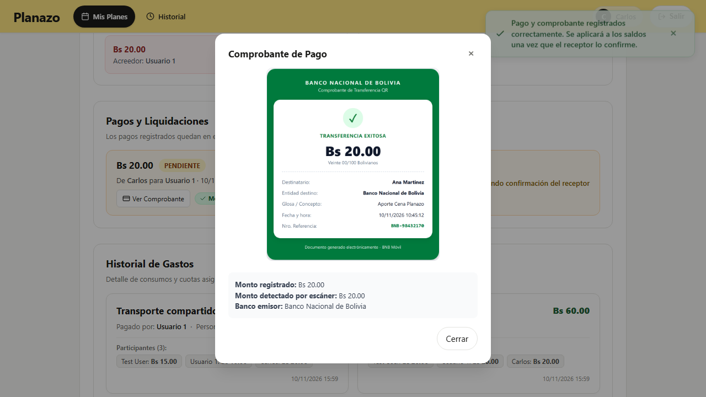

# Matriz de Evidencias — Tarea 8: Proceso de Gastos y Liquidación con Estados y Consecuencias

Este documento constituye la memoria técnica y entrega formal de la **Tarea 8 (Proceso de Gastos y Liquidación con Estados y Consecuencias)** del proyecto Planazo, desarrollada bajo las directivas de la Clase 20.

---

## 📋 Consigna y Requisitos Docentes

```text
Proceso de Gastos y Liquidación con Estados y Consecuencias:
1. División de gastos: Registro de gastos con división en partes iguales o personalizada (suma exacta al centavo).
2. Cálculo reactivo de saldos netos entre participantes (quién debe a quién y cuánto).
3. Registro de pagos con consecuencia de estado (pendiente -> confirmado / rechazado con motivo).
4. Inmutabilidad y autorización: El deudor no puede auto-confirmarse su pago; solo el receptor puede confirmarlo o rechazarlo.
```

- **Fork oficial de entrega:** `moises-cisneros/Proyecto2IHC`
- **Issue Padre:** [Issue #65](https://github.com/moises-cisneros/Proyecto2IHC/issues/65)
- **Árbol de Sub-issues Atómicas:**
    - [Sub-issue #66](https://github.com/moises-cisneros/Proyecto2IHC/issues/66): `[Backend] — Migraciones, modelos Gasto, GastoDivision, Pago, relaciones Eloquent y cálculo de saldos`
    - [Sub-issue #67](https://github.com/moises-cisneros/Proyecto2IHC/issues/67): `[Controlador] — Endpoints de gastos y pagos, validaciones Form Request, transiciones de estado e idempotencia`
    - [Sub-issue #68](https://github.com/moises-cisneros/Proyecto2IHC/issues/68): `[Interfaz] — Pestaña de Gastos en sala, modal de registro con división dinámica y panel de liquidación`
    - [Sub-issue #69](https://github.com/moises-cisneros/Proyecto2IHC/issues/69): `[Testing] — Suite Playwright para escenario docente de 3 participantes, 2 gastos, división personalizada y pago confirmado`

---

## 🏷️ Resumen de PRs y Commits por Capa

| Sub-issue | Capa                     | PR en `main`                                                      | Descripción de la Entrega                                                                                                                                                                                    |
| :-------- | :----------------------- | :---------------------------------------------------------------- | :----------------------------------------------------------------------------------------------------------------------------------------------------------------------------------------------------------- |
| **#66**   | Backend / Persistencia   | [PR #73](https://github.com/moises-cisneros/Proyecto2IHC/pull/73) | Migraciones `gastos`, `gasto_divisiones`, `pagos`, modelos Eloquent con casts y método de dominio `Plan::calcularSaldosNetos(): array` para resolución de deudas cruzadas.                                   |
| **#67**   | Controlador / Seguridad  | [PR #74](https://github.com/moises-cisneros/Proyecto2IHC/pull/74) | `GastosController`, `GastoPolicy`, `PagoPolicy`, `StoreGastoRequest` (validación de sumas y anti-IDOR), `StorePagoRequest` y `RechazarPagoRequest`.                                                          |
| **#68**   | Interfaz / Blade / IHC   | [PR #75](https://github.com/moises-cisneros/Proyecto2IHC/pull/75) | Pestaña «Gastos y Liquidación» en la sala del plan, parcial `_gastos_liquidacion.blade.php`, tarjetas de posición neta («Debes» vs «Te deben»), modales `<dialog>` dinámicos y ergonomía Fitts ($\ge 44$px). |
| **#69**   | Testing E2E / Evidencias | [PR #76](https://github.com/moises-cisneros/Proyecto2IHC/pull/76) | Suite Playwright `e2e/tarea-8-gastos-liquidacion.spec.ts` con 3 participantes, división personalizada, pago pendiente y confirmado con actualización de balances.                                            |

---

## 📊 Matriz Comparativa: Antes vs Después de la Tarea 8

| Dimensión / Regla         | Estado Inicial (Línea Base)                                                                       | Estado Final (Implementación Tarea 8)                                                                                     | Justificación Ergonómica / Seguridad                                                                                                                       |
| :------------------------ | :------------------------------------------------------------------------------------------------ | :------------------------------------------------------------------------------------------------------------------------ | :--------------------------------------------------------------------------------------------------------------------------------------------------------- |
| **Gestión Financiera**    | Inexistente; los participantes solo acordaban fechas y lugares sin control de gastos compartidos. | Pestaña integrada «Gastos y Liquidación» en la sala del plan con cálculo consolidado de deudas bilaterales netas.         | **Nielsen H6 (Reconocer antes que recordar):** Reduce la carga cognitiva al mostrar directamente «Le debes a X: $Y» sin forzar cálculos manuales externos. |
| **División de Gastos**    | No disponible.                                                                                    | Selector simple de modo (Equitativa vs Personalizada) con validación interactiva en tiempo real y en backend al centavo.  | **Ley de Hick ($n \le 4$):** Opciones directas; inputs personalizados se revelan por divulgación progresiva.                                               |
| **Liquidación de Deudas** | Sin registro.                                                                                     | Flujo con consecuencia de estados: `pendiente` $\to$ `confirmado` / `rechazado`.                                          | **Integridad y Menor Privilegio:** Un deudor no puede extinguir su deuda sin la aprobación explícita del acreedor (403 Forbidden).                         |
| **Rechazo de Pagos**      | No disponible.                                                                                    | Modal accesible que exige `motivo_rechazo` ($\ge 5$ caracteres) y mantiene intacta la deuda.                              | **Nielsen H9 (Ayuda en errores):** Explicación transparente de por qué no se acreditó una transferencia.                                                   |
| **Controles de Acción**   | N/A                                                                                               | Botones táctiles mínimos de $44 \times 44\text{px}$ y separación antagónica $\ge 12\text{px}$ entre Confirmar y Rechazar. | **Ley de Fitts:** Mitiga toques accidentales y optimiza el uso en dispositivos móviles y de escritorio.                                                    |

---

## 📸 Evidencias de Ejecución y Capturas

Las capturas generadas por la suite E2E se almacenan en `docs/evidencias/tarea-8/`:

### 1. Registro de Gasto Equitativo

Registro de gasto equitativo por parte del organizador (`Lucas`).


---

### 2. Formulario de División Personalizada

Formulario interactivo con división personalizada calculada al centavo por `Ana`.


---

### 3. Registro de Pago Pendiente

Pago emitido por el deudor (`Carlos`) en estado `pendiente`, sin alterar los saldos netos aún.


---

### 4. Pago Confirmado y Actualización de Saldos

Panel del receptor (`Ana`) tras confirmar el pago, reflejando la actualización inmediata de saldos y la extinción de la deuda.


---

### 5. Inspección de Comprobante Bancario Real y Verificación Asistida

Modal accesible de inspección en alta resolución (`BNB.png`) con extracción del monto detectado (Bs 20.00) y banco emisor (`BNB`).


---

## 🧪 Verificación de Suites de Pruebas

### 1. PHPUnit (Backend y Controlador)

- `tests/Unit/GastosPersistenciaTest.php` (4 casos de persistencia, división equitativa, personalizada y deudas cruzadas).
- `tests/Feature/GastosControllerTest.php` (5 casos de endpoints, autorización 403, idempotencia y redirección 302).
- `tests/Feature/GastosVistasTest.php` (2 casos de interfaz y visibilidad condicional con `@can`).

### 2. Playwright E2E

- `e2e/tarea-8-gastos-liquidacion.spec.ts` (Flujo multi-usuario docente completo con 3 participantes del seeder).

---

## 🚀 Fase 2: Conciliación Inteligente de Comprobantes y Perfil de Cobro

Para elevar el módulo de gastos a un estándar de producto fintech real y eliminar la fricción de conciliación puramente manual, se incorporó la verificación automatizada de comprobantes bancarios y el perfil de cobro por participante.

### 1. Árbol de Sub-issues Atómicas de la Fase 2

- [Sub-issue #79](https://github.com/moises-cisneros/Proyecto2IHC/issues/79): `[Backend] — Servicio de escaneo inteligente de comprobantes, persistencia de análisis y perfil de cobro`
- [Sub-issue #80](https://github.com/moises-cisneros/Proyecto2IHC/issues/80): `[Controlador] — Endpoint de subida de comprobante, procesamiento de escaneo y gestión de perfil de cobro`
- [Sub-issue #81](https://github.com/moises-cisneros/Proyecto2IHC/issues/81): `[Interfaz] — Previsualización de comprobantes, badge de verificación y modal de datos de cobro`
- [Sub-issue #82](https://github.com/moises-cisneros/Proyecto2IHC/issues/82): `[Testing] — Tests automatizados de conciliación con fixtures y documentación de evidencias`

### 2. Arquitectura de Desacoplamiento (Patrón Driver)

El servicio de escaneo inteligente se diseñó mediante el contrato `ComprobanteScannerInterface` y el DTO inmutable `ComprobanteScanResult`:

```text
               ┌───────────────────────────────┐
               │  ComprobanteScannerInterface  │
               └───────────────▲───────────────┘
                               │
            ┌──────────────────┴──────────────────┐
            │                                     │
┌───────────────────────────┐         ┌───────────────────────────┐
│ GeminiComprobanteScanner  │         │  FakeComprobanteScanner   │
│ (Multimodal Vision API)   │         │ (Determinista / Offline)  │
└───────────────────────────┘         └───────────────────────────┘
```

- **Driver Gemini Vision (`gemini`):** Cuando se define `GEMINI_API_KEY` en el entorno, procesa la imagen mediante visión multimodal extrayendo monto, banco, referencia y nivel de confianza.
- **Driver Fake (`fake`):** Utilizado por defecto en entornos locales y durante las suites de testing en Docker/CI, garantizando que las pruebas pasen al 100% de forma determinista y sin depender de red externa.

### 3. Matriz de Conciliación y Manejo de Casos Borde

Se incorporó un generador reproducible de fixtures sintéticos limpios (`scripts/generate-comprobante-fixtures.mjs`, ejecutable vía `pnpm run fixtures:comprobantes`) que sintetiza comprobantes con estructuras bancarias verosímiles de entidades bolivianas (BNB, Banco Unión, Yape, Yastá) sin exponer datos personales ni información confidencial:

| Escenario de Negocio               | Fixture de Prueba                                          | Resultado del Escaneo                                             | Consecuencia en Sistema                                                                                                    |
| :--------------------------------- | :--------------------------------------------------------- | :---------------------------------------------------------------- | :------------------------------------------------------------------------------------------------------------------------- |
| **Happy Path (Coincidente)**       | `comprobante_bnb_20bs.png` / `comprobante_coincidente.png` | `es_comprobante: true`, Monto: Bs 20.00 / Bs 100.00               | Estado de escaneo: `verificado`. Badge verde para el acreedor, facilitando la confirmación inmediata.                      |
| **Sad Path (Discrepancia)**        | `comprobante_discrepante.png`                              | `es_comprobante: true`, Monto: Bs 35.50 (deuda esperada distinta) | Estado de escaneo: `discrepante`. Alerta visual destacada para el receptor y sustento para rechazo con motivo obligatorio. |
| **Sad Path (Documento Inválido)**  | `comprobante_invalido.png`                                 | `es_comprobante: false`, Monto: `null`                            | Estado de escaneo: `invalido`. Badge de advertencia sin auto-verificación.                                                 |
| **Seguridad Negativa (Anti-IDOR)** | N/A                                                        | Intento de auto-confirmación por deudor                           | Bloqueo estricto con `403 Forbidden` (`PagoPolicy`).                                                                       |

### 4. Cobertura de Pruebas de la Fase 2

- `tests/Unit/ComprobanteScannerTest.php` (7 tests: extracción, detección de discrepancias, tolerancia monetaria y persistencia).
- `tests/Feature/GastosComprobanteControllerTest.php` (5 tests: upload multipart, escaneo automático, perfil de cobro, 302 anónimo y 403 no participante).
- `tests/Feature/GastosComprobanteVistaTest.php` (4 tests: renderizado de datos de cobro del receptor, badges de escaneo, modal `<dialog>` de comprobante y directivas `@can`).
- `tests/Feature/ConciliacionComprobantePipelineTest.php` (4 tests: pipeline completo con fixtures de comprobantes sintéticos bolivianos).
