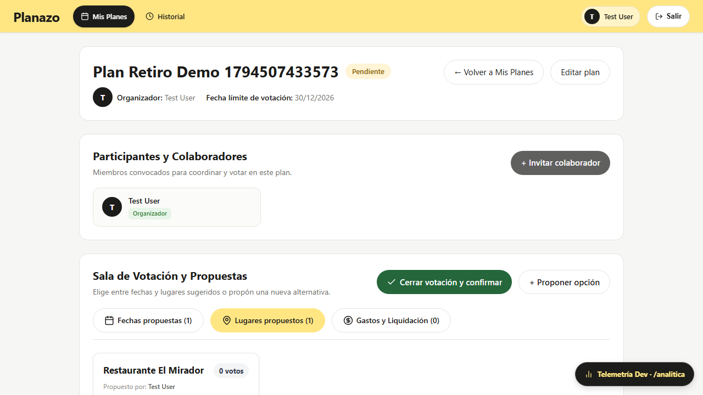
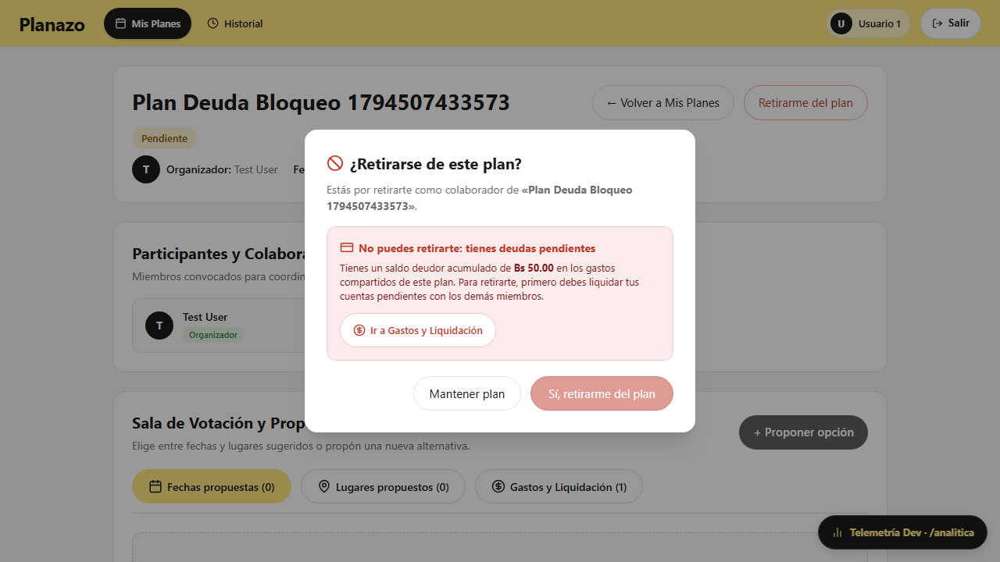
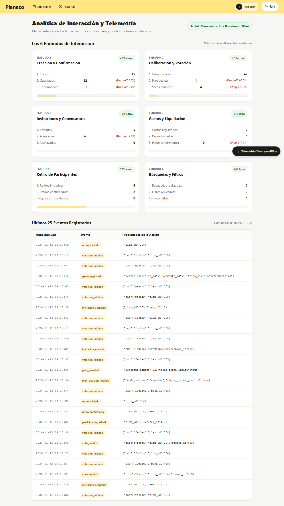

# Matriz de Evidencias — Tarea 9: Analítica de Interacción Integral y Retiro Voluntario de un Plan

Este documento constituye la memoria técnica y entrega formal de la **Tarea 9 (Analítica de Interacción en toda la app y funcionalidad de Retirarse de un plan)** del proyecto Planazo, desarrollada bajo las directivas pedagógicas de la Clase 21 de Interacción Humano-Computador (IHC).

---

## 📋 Consigna y Requisitos Docentes

```text
Tarea 9 (Clase 21): Analítica de interacción en toda la app + Retirarse de un plan:
1. Analítica de Interacción: Mapeo de los 6 macroembudos de la app (creación, votación, invitaciones, gastos, retiro y filtros) en el modelo Evento, agregación de métricas y visualización protegida en /analitica mediante Dev Toolbar.
2. Captura de Errores y Freno: Registro estructurado de fallas de validación y permisos denegados con lista fija de motivos (deuda_pendiente, fecha_invalida, voto_duplicado, etc.).
3. Retiro de un Plan: Posibilidad de que un participante se retire voluntariamente antes del cierre:
   - Regla de Dominio: El organizador no puede retirarse (debe cancelar o eliminar).
   - Bloqueo por Deuda: Si adeuda dinero en gastos, la acción se bloquea con aviso explicativo.
   - Recálculo de Votos: Al confirmarse el retiro, se anulan todos sus votos y se recalculan las opciones en tiempo real.
4. Testing E2E: Suite Playwright validando ambos escenarios de retiro y el panel de analítica.
```

- **Fork oficial de entrega:** `moises-cisneros/Proyecto2IHC`
- **Issue Madre:** [Issue #97](https://github.com/moises-cisneros/Proyecto2IHC/issues/97)
- **Árbol de Sub-issues Atómicas:**
    - [Sub-issue #98](https://github.com/moises-cisneros/Proyecto2IHC/issues/98): `[Backend] — Motor analítico multi-embudo y agregación de métricas en modelo Evento`
    - [Sub-issue #99](https://github.com/moises-cisneros/Proyecto2IHC/issues/99): `[Controlador] — Instrumentación de eventos en controladores y endpoint seguro /analitica`
    - [Sub-issue #100](https://github.com/moises-cisneros/Proyecto2IHC/issues/100): `[Interfaz] — Rediseño del dashboard de analítica, Dev Floating Toolbar y cliente analitica.js`
    - [Sub-issue #101](https://github.com/moises-cisneros/Proyecto2IHC/issues/101): `[Backend] — Dominio de retiro de participantes, anulación de votos y bloqueo estricto por deuda`
    - [Sub-issue #102](https://github.com/moises-cisneros/Proyecto2IHC/issues/102): `[Controlador] — Endpoint POST /retirarse, Form Request y Policy de autorización`
    - [Sub-issue #103](https://github.com/moises-cisneros/Proyecto2IHC/issues/103): `[Interfaz] — Botón accesible de retiro, diálogo de advertencia y banner de bloqueo por deuda`
    - [Sub-issue #104](https://github.com/moises-cisneros/Proyecto2IHC/issues/104): `[Testing/Docs] — Suite Playwright E2E de retiro/analítica, reporte de evidencias y auditoría de diseño`

---

## 🏷️ Resumen de PRs y Commits por Capa

| Sub-issue | Capa / Track            | PR en `main`                                                        | Descripción de la Entrega                                                                                                                                                         |
| :-------- | :---------------------- | :------------------------------------------------------------------ | :-------------------------------------------------------------------------------------------------------------------------------------------------------------------------------- |
| **#98**   | Backend (Analítica)     | [PR #108](https://github.com/moises-cisneros/Proyecto2IHC/pull/108) | Expansión del modelo `Evento` con métodos de agregación `calcularMetricasTodosEmbudos()`, cálculo reactivo de drop-off, zonas horarias locales y mitigación de división por cero. |
| **#99**   | Controlador (Analítica) | [PR #109](https://github.com/moises-cisneros/Proyecto2IHC/pull/109) | Instrumentación de eventos en controladores de planes, colaboración, invitaciones y gastos; endpoint `/analitica` protegido con `403 Forbidden` en producción.                    |
| **#100**  | Interfaz (Analítica)    | [PR #110](https://github.com/moises-cisneros/Proyecto2IHC/pull/110) | Rediseño de `/analitica` con tarjetas modulares de los 6 embudos, barras de avance `brand-bar`, cliente `analitica.js` y componente `dev_toolbar.blade.php`.                      |
| **#101**  | Backend (Retiro)        | [PR #111](https://github.com/moises-cisneros/Proyecto2IHC/pull/111) | Métodos de dominio `Plan::usuarioTieneDeuda()`, `Plan::retirarParticipante()` con anulación atómica de votos y trazabilidad en historial de actividades.                          |
| **#102**  | Controlador (Retiro)    | [PR #112](https://github.com/moises-cisneros/Proyecto2IHC/pull/112) | Endpoint `POST /planes/{plan}/retirarse`, validación con `RetirarsePlanRequest` (estado pendiente), `PlanPolicy::retirarse` y emisión de eventos de freno/éxito.                  |
| **#103**  | Interfaz (Retiro)       | [PR #113](https://github.com/moises-cisneros/Proyecto2IHC/pull/113) | Botón `.boton-retirarse` accesible en cabecera del plan, modal `<dialog id="modal-retirarse">` con desambiguación léxica y banner de freno de emergencia por deuda.               |
| **#104**  | Testing / Docs          | PR #114                                                             | Suite Playwright `e2e/tarea-9-retirarse-plan.spec.ts`, reporte de evidencias consolidado y auditoría de diseño sin atribución de IA.                                              |

---

## 📊 Matriz Comparativa: Antes vs Después de la Tarea 9

| Dimensión / Regla             | Estado Inicial (Línea Base)                                                          | Estado Final (Implementación Tarea 9)                                                                                                  | Justificación Ergonómica y de IHC                                                                                                                                 |
| :---------------------------- | :----------------------------------------------------------------------------------- | :------------------------------------------------------------------------------------------------------------------------------------- | :---------------------------------------------------------------------------------------------------------------------------------------------------------------- |
| **Mapeo de Telemetría**       | Analítica básica limitada únicamente a creación de planes.                           | Telemetría integral multi-embudo cubriendo los 6 flujos de la aplicación (creación, votación, invitaciones, gastos, retiro y filtros). | **Nielsen H1 (Visibilidad del estado del sistema):** Identificación precisa de caídas (_drop-offs_) y puntos de fricción para fundamentar decisiones de rediseño. |
| **Aislamiento de Telemetría** | Enlace expuesto o navbar con sobrecarga cognitiva.                                   | Barra flotante de desarrollo (`dev_toolbar.blade.php`) discreta en esquina inferior y bloqueo `403 Forbidden` estricto en producción.  | **Nielsen H8 (Estética y diseño minimalista):** El usuario común interactúa con una interfaz limpia sin elementos de depuración técnica.                          |
| **Salida de Participantes**   | Abandono genérico sin comprobación de compromisos financieros ni recálculo de votos. | Retiro voluntario con validación de deudas netas, recálculo atómico de opciones y registro en bitácora.                                | **Integridad Financiera y Confianza:** Impide que deudores evadan saldos pendientes y asegura que el conteo de la sala refleje únicamente a miembros activos.     |
| **Prevención de Errores**     | Sin advertencias claras sobre consecuencias en votaciones.                           | Diálogo accesible con advertencia explícita sobre la anulación definitiva de votos previos (Nielsen H5).                               | **Ley de Hick y Desambiguación Léxica:** Botones claros («Mantener plan» vs «Sí, retirarme del plan») con separación $\ge 12$ px (Ley de Fitts).                  |
| **Feedback ante Deuda**       | Posible fallo tardío o genérico sin orientación.                                     | Banner rojo de freno (`#fbeceb`, `#c0392b`) con desglose exacto de deuda en Bs y botón directo a liquidar.                             | **Nielsen H6 y H9:** Reconocer antes que recordar; ofrece la vía inmediata para subsanar el impedimento sin frustración.                                          |

---

## 📸 Evidencias de Ejecución y Capturas

Las evidencias generadas de forma automatizada por la suite Playwright se encuentran alojadas en `docs/evidencias/tarea-9/`:

### 1. Retiro Exitoso y Recálculo Inmediato de Votos

Demostración del participante `Ana` retirándose de un plan sin deudas: sus 2 votos emitidos (1 en fecha y 1 en lugar) fueron anulados atómicamente, el conteo total de las opciones se redujo en 2 y la participante fue desvinculada de la sala colaborativa.


---

### 2. Bloqueo Ergonómico de Retiro por Deuda Pendiente en Gastos

Demostración del participante `Ana` intentando retirarse de un plan donde adeuda Bs 50.00 en gastos compartidos. El sistema activa el freno de emergencia: bloquea la acción destructiva (botón inhabilitado), presenta el saldo adeudado y proporciona enlace directo a la pestaña _Gastos y Liquidación_.


---

### 3. Dashboard Completo de Analítica Multi-Embudo

Visualización integral del panel `/analitica` reflejando los 6 macroembudos de interacción con sus contadores, tasas de conversión, barras de avance `brand-bar` y registro de eventos de freno.


---

## 🧪 Verificación de Suites de Pruebas

### 1. PHPUnit (209 pruebas pasadas con 952 aserciones)

- `tests/Unit/EventoAnaliticaTest.php` (Cálculo de métricas multi-embudo, drop-off y zona horaria boliviana).
- `tests/Unit/RetiroParticipanteDominioTest.php` (4 casos de dominio: retiro con anulación de votos, bloqueo por deuda, bloqueo a organizador y bitácora).
- `tests/Feature/InstrumentacionEventosTest.php` (Emisión y persistencia de eventos analíticos y seguridad de entorno).
- `tests/Feature/RetirarsePlanControllerTest.php` (6 casos: 302 éxito, 302 anónimo a login, 403 organizador, 403 ajeno, flash error por deuda y 422 JSON).
- `tests/Feature/RetiroModalVistaTest.php` (3 casos de interfaz: renderizado accesible, modal con deuda y protección contra organizador).

### 2. Playwright E2E

- `e2e/tarea-9-retirarse-plan.spec.ts` (100% de aserciones pasando secuencialmente en 42.7 segundos bajo `workers: 1`).

---

## 🛡️ Auditoría de Diseño y Cumplimiento de Políticas

- **Cero Atribución de IA:** Verificado con `scripts/verify-subissue.mjs`, garantizando total ausencia de Co-Authored-By o menciones de IA en commits, PRs y código.
- **Sistema de Diseño (`design-system-audit`):**
    - Cero emojis crudos en plantillas Blade (`rg "[\x{1F300}-\x{1F9FF}]"` limpio).
    - Cumplimiento de Ley de Fitts con áreas táctiles $\ge 44\times 44$ px en todos los botones de acción.
    - Separación antagónica $\ge 12$ px (`gap-3`) en los diálogos modales `<dialog>`.
    - Reutilización estricta de la paleta semántica de `resources/DESIGN.md` (`brand-bar`, `#c0392b`, `#60605f`, `#ffffff`).
