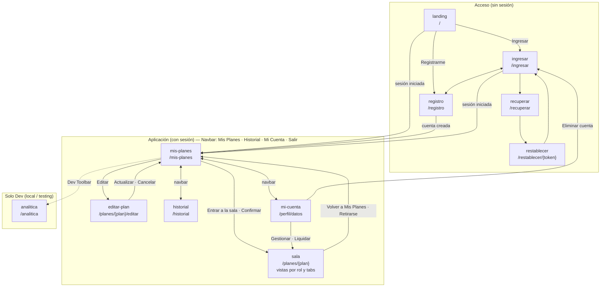
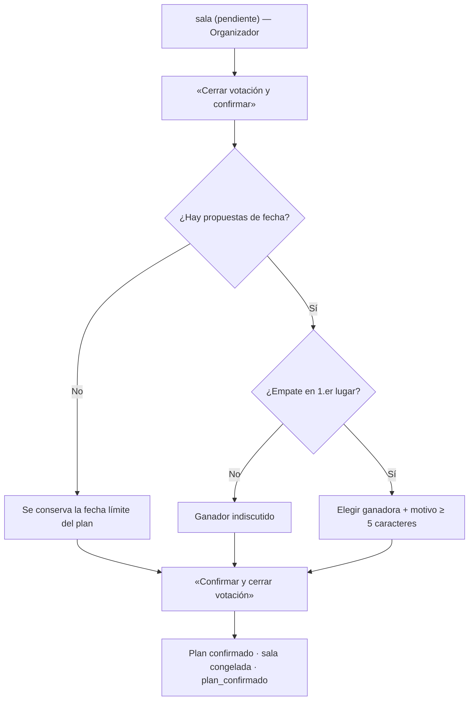
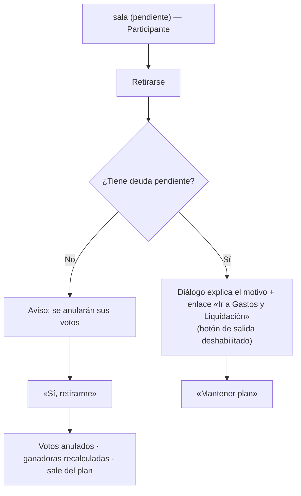
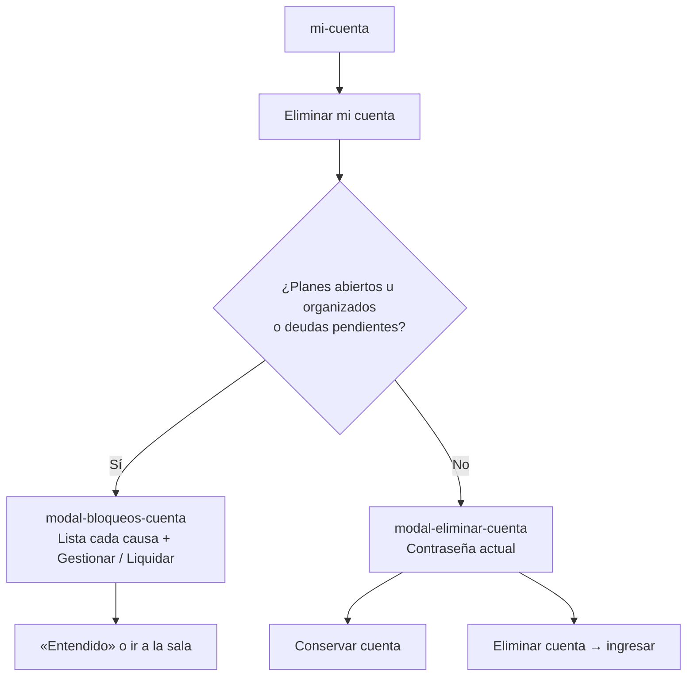

# FLOWS.md — App Map y Task Flows de Planazo

> **Contrato de pantallas y flujos.** Junto con [`DESIGN.md`](DESIGN.md) (tokens y componentes) forma el diseño intermedio del que parten **Figma** y el **código**: DESIGN.md define el _vocabulario_ (qué piezas existen) y FLOWS.md define la _gramática_ (qué pantallas hay, cómo se componen y cómo se recorren).
> **Regla de oro:** un cambio de pantalla, flujo, permiso o rótulo se escribe primero aquí y después se propaga a Figma y al código. El test [`tests/Unit/FlowsContractTest.php`](../tests/Unit/FlowsContractTest.php) falla si una ruta nombrada del código no figura en §9 (o al revés).

<!-- GUÍA DE CONSULTA RÁPIDA CON RIPGREP (rg) PARA AGENTES:
     - App Map (mapa y tabla de pantallas):   rg -A 40 "^## 2" resources/FLOWS.md
     - Composición de una pantalla:           rg -A 30 "^### 4\.[0-9]+ .*mis-planes" resources/FLOWS.md
     - Matriz de permisos de la sala:         rg -A 25 "^## 5" resources/FLOWS.md
     - Un Task Flow concreto:                 rg -A 25 "^### TF4" resources/FLOWS.md
     - Reglas transversales:                  rg -A 20 "^## 7" resources/FLOWS.md
     - Inventario de rutas (verificado):      rg -A 45 "^## 9" resources/FLOWS.md
-->

---

## 1. Convenciones

| Concepto                       | Valores                                                                                                                                                                                                                                                                                              |
| :----------------------------- | :--------------------------------------------------------------------------------------------------------------------------------------------------------------------------------------------------------------------------------------------------------------------------------------------------- |
| **Roles**                      | Invitado (sin sesión) · Organizador · Participante (invitación aceptada) · Invitado pendiente · Ajeno (sin relación con el plan → `403`) · Dev (solo local/testing)                                                                                                                                  |
| **Estados canónicos del plan** | `pendiente` → `confirmado` (inmutable) · `cancelado` (inmutable). Es un `enum` en BD; no existen otros.                                                                                                                                                                                              |
| **Estados de invitación**      | `pendiente` · `aceptada` · `rechazada`                                                                                                                                                                                                                                                               |
| **Estados de pago**            | `pendiente` → `confirmado` o `rechazado` (con motivo)                                                                                                                                                                                                                                                |
| **Id de pantalla**             | kebab-case, único: `landing`, `ingresar`, `registro`, `recuperar`, `restablecer`, `mis-planes`, `sala`, `editar-plan`, `historial`, `mi-cuenta`, `analitica`. **En Figma, cada frame se llama igual que su id.**                                                                                     |
| **Sub-frames de estado sala**  | `sala` (pestaña Fechas, por defecto), `sala-lugares`, `sala-gastos`, `sala-confirmada` (congelada)                                                                                                                                                                                                   |
| **Overlays de diálogo Figma**  | `modal-crear`, `modal-eliminar-plan-{id}`, `modal-invitar`, `modal-proponer-opcion`, `modal-confirmar-plan`, `modal-retirarse`, `modal-crear-gasto`, `modal-crear-pago`, `modal-comprobante-{id}`, `modal-rechazar-{id}`, `modal-configurar-cobro`, `modal-bloqueos-cuenta`, `modal-eliminar-cuenta` |
| **Parámetro de pestaña**       | `?tab=fechas\|lugares\|gastos` (única forma válida; `pestana` no existe)                                                                                                                                                                                                                             |
| **Componentes**                | Se citan por su nombre en `DESIGN.md` (`.tarjeta`, `.banner-*`, `.badge-estado-*`, `<dialog>`, `<x-icono>`…)                                                                                                                                                                                         |

---

## 2. App Map

### 2.1 Tabla de pantallas

| Id            | Ruta                        | Vista Blade                                                                                  | Acceso                                        | Propósito                                           | Diálogos propios                                                                                                                                                                                        | Salidas                               |
| :------------ | :-------------------------- | :------------------------------------------------------------------------------------------- | :-------------------------------------------- | :-------------------------------------------------- | :------------------------------------------------------------------------------------------------------------------------------------------------------------------------------------------------------ | :------------------------------------ |
| `landing`     | `GET /`                     | `landing`                                                                                    | sin sesión                                    | Presentación del producto, propuesta y accesos      | —                                                                                                                                                                                                       | `ingresar`, `registro`, `mis-planes`  |
| `ingresar`    | `GET /ingresar`             | `acceso/ingresar`                                                                            | sin sesión                                    | Entrar con correo y contraseña                      | —                                                                                                                                                                                                       | `registro`, `recuperar`, `mis-planes` |
| `registro`    | `GET /registro`             | `acceso/registro`                                                                            | sin sesión                                    | Crear cuenta                                        | —                                                                                                                                                                                                       | `ingresar`, `mis-planes`              |
| `recuperar`   | `GET /recuperar`            | `acceso/recuperar`                                                                           | sin sesión                                    | Pedir enlace de recuperación                        | —                                                                                                                                                                                                       | `ingresar`                            |
| `restablecer` | `GET /restablecer/{token}`  | `acceso/restablecer`                                                                         | sin sesión                                    | Fijar nueva contraseña                              | —                                                                                                                                                                                                       | `ingresar`                            |
| `mis-planes`  | `GET /mis-planes`           | `planes/listar` + `_tabla_seccion` + `_modal_crear`                                          | sesión                                        | Ver y gestionar mis planes y las invitaciones       | `modal-crear`, `modal-eliminar-plan-{id}`                                                                                                                                                               | `sala`, `editar-plan`                 |
| `sala`        | `GET /planes/{plan}`        | `planes/detalle` + `_cabecera` + `_participantes` + `_sala_votacion` + `_gastos_liquidacion` | organizador, participante, invitado pendiente | Deliberar, votar, confirmar y liquidar gastos       | `modal-retirarse`, `modal-invitar`, `modal-proponer-opcion`, `modal-confirmar-plan`, `modal-crear-gasto`, `modal-crear-pago`, `modal-rechazar-{id}`, `modal-comprobante-{id}`, `modal-configurar-cobro` | `mis-planes`, `editar-plan`           |
| `editar-plan` | `GET /planes/{plan}/editar` | `planes/editar`                                                                              | organizador, plan no cancelado                | Cambiar nombre y fecha límite                       | —                                                                                                                                                                                                       | `mis-planes`                          |
| `historial`   | `GET /historial`            | `planes/historial`                                                                           | sesión                                        | Bitácora de actividad propia                        | —                                                                                                                                                                                                       | `mis-planes`                          |
| `mi-cuenta`   | `GET /perfil/datos`         | `perfil/cuenta`                                                                              | sesión                                        | Datos, contraseña, cobro, descarga y baja de cuenta | `modal-bloqueos-cuenta`, `modal-eliminar-cuenta`                                                                                                                                                        | `sala`, `ingresar`                    |
| `analitica`   | `GET /analitica`            | `analitica/index`                                                                            | Dev                                           | Embudos y errores de interacción                    | —                                                                                                                                                                                                       | —                                     |
| _(global)_    | —                           | `layouts/app` + `nav` + `dev_toolbar` + `<x-toast-alerta />` + `<x-dialog-confirm />`        | sesión                                        | Marco común                                         | `dialog-confirm` (confirmación genérica)                                                                                                                                                                | —                                     |

---

## 3. Navegación global

### 3.1 Barra superior pública (`landing`)

| Elemento              | Destino       | Comportamiento en Prototipo Figma                    |
| :-------------------- | :------------ | :--------------------------------------------------- |
| Marca «Planazo»       | `landing`     | Clic recarga o mantiene en `landing`                 |
| Botón Tema (sol/luna) | Alternar modo | Swap a variante modo oscuro (`[data-tema="oscuro"]`) |
| **Ingresar**          | `ingresar`    | `Navigate to: ingresar` (Smart animate / Instant)    |
| **Registrarme**       | `registro`    | `Navigate to: registro` (Smart animate / Instant)    |

### 3.2 Barra superior de la aplicación (`layouts/app`)

| Elemento        | Destino                    | Comportamiento en Prototipo Figma                                 |
| :-------------- | :------------------------- | :---------------------------------------------------------------- |
| Marca «Planazo» | `mis-planes`               | `Navigate to: mis-planes`                                         |
| **Mis Planes**  | `mis-planes`               | `Navigate to: mis-planes` (activo en `planes.*` salvo `perfil.*`) |
| **Historial**   | `historial`                | `Navigate to: historial`                                          |
| **Mi Cuenta**   | `mi-cuenta`                | `Navigate to: mi-cuenta`                                          |
| Avatar + nombre | —                          | Decorativo; en móvil (≤ 720 px) solo avatar                       |
| **Salir**       | `POST /salir` → `ingresar` | `Navigate to: ingresar` (en móvil solo ícono con `aria-label`)    |
| Píldora Dev     | `analitica`                | Solo `local`/`testing`; abre `Navigate to: analitica`             |

---

## 4. Composición de pantallas

> Cada subsección define las **regiones**, **componentes** (de `DESIGN.md`), **estados** y la **especificación de Auto Layout para Figma** (dimensiones de frame, contenedor, paddings, gaps y resizing). Es la base técnica para generar frames exactos y responsivos.

### 4.0 `landing`

- **Regiones:** barra superior pública (`.landing-barra`) · Hero (titular, propuesta de valor, CTA dual) · Características (grilla de beneficios de coordinación y gastos) · Llamado a la acción final · Pie de página.
- **Acciones:** «Ingresar» → `ingresar` · «Registrarme» → `registro` · Selector de tema claro/oscuro.
- **Auto Layout Figma:**
    - **Frame base:** `1440 × 900 px` (desktop), Auto Layout Vertical, Gap `0`, Padding `0`, Fondo `--color-background` (`#f6f6f4`).
    - **Barra superior:** Ancho `Fill container`, Alto Fijo `60px` (`--nav-height`), Auto Layout Horizontal, Padding `0 24px`, Distribución `Space between`, Fondo `--color-secondary` (`#ffe683`), Borde inferior `1px solid var(--color-border)`.
    - **Hero Container:** Ancho Fijo `1024px` (`--container-page`), Centrado, Auto Layout Vertical, Padding `64px 24px`, Gap `32px`, Alineación `Center`.
    - **Botonera Hero:** Auto Layout Horizontal, Gap `16px`, Botones: Alto Fijo `44px` (`--touch-min`), Ancho `Hug contents`.
    - **Grilla de Beneficios:** Ancho Fijo `1024px`, Auto Layout Horizontal (Wrap, 3 columnas), Gap `24px`. Tarjetas: Ancho `Fill` (min `280px`), Auto Layout Vertical, Padding `24px`, Radio `16px` (`--radius-xl`), Fondo `--color-surface` (`#ffffff`), Borde `1px solid var(--color-border)`.

### 4.1 `ingresar`

- **Regiones:** encabezado (logo `<x-icono nombre="check">`, «Ingresar», «Entra para ver tus planes.») · formulario · pie.
- **Campos (`.campo`):** Correo electrónico · Contraseña (con enlace «¿La olvidaste?» → `recuperar`).
- **Acciones:** «Entrar» · «Regístrate» → `registro`.
- **Estados:** reposo · error de validación (`.campo-error`) · credenciales inválidas (mensaje genérico, sin revelar si el correo existe) · bloqueo por límite de intentos (5/min).
- **Auto Layout Figma:**
    - **Frame base:** `1440 × 900 px`, Auto Layout Vertical, Alineación Centrada (vertical y horizontal), Padding `40px 16px`, Fondo `--color-background`.
    - **Card de Acceso (`.tarjeta` / `.content-narrow`):** Ancho Fijo `400px` (`--content-narrow`), Alto `Hug contents`, Auto Layout Vertical, Padding `32px` (`--space-8`), Gap `20px` (`--space-5`), Radio `16px`, Fondo `--color-surface`, Sombra `--shadow-sm`.
    - **Campos:** Ancho `Fill container`, Auto Layout Vertical, Gap `4px` (`--space-1`), Inputs Alto Fijo `44px` (`--touch-min`), Radio `10px` (`--radius-md`).
    - **Botonera:** Ancho `Fill container`, Botón «Entrar»: Alto `44px`, Ancho `Fill container`.

### 4.2 `registro`

- **Campos:** Nombre · Correo electrónico · Contraseña (mín. 8) · Confirmar contraseña.
- **Acciones:** «Registrarme» · «Ingresa» → `ingresar`.
- **Estados:** reposo · error de validación · correo ya registrado.
- **Auto Layout Figma:**
    - **Frame base:** `1440 × 900 px`, Auto Layout Vertical, Centrado, Padding `40px 16px`, Fondo `--color-background`.
    - **Card Contenedor:** Ancho Fijo `400px` (`--content-narrow`), Alto `Hug contents`, Auto Layout Vertical, Padding `32px`, Gap `16px` (`--space-4`), Radio `16px`, Fondo `--color-surface`.
    - **Botonera:** Botón «Registrarme»: Ancho `Fill container`, Alto Fijo `44px`.

### 4.3 `recuperar` y `restablecer`

- **`recuperar`:** Correo electrónico → «Enviar enlace» · «← Volver a ingresar». **Respuesta única** exista o no el correo: «Si el correo ingresado está registrado, te enviamos un enlace de recuperación.»
- **`restablecer`:** Correo (precargado desde `?email=`) · Nueva contraseña · Confirmar contraseña → «Cambiar contraseña».
- **Estados de `restablecer`:** éxito → `ingresar` con «Contraseña cambiada. Ya puedes ingresar.» · enlace inválido o vencido → «El enlace no es válido o ya expiró. Pide uno nuevo.» · contraseñas distintas.
- **Auto Layout Figma:**
    - **Frame base:** `1440 × 900 px`, Auto Layout Vertical, Centrado, Fondo `--color-background`.
    - **Card Contenedor:** Ancho Fijo `400px` (`--content-narrow`), Alto `Hug contents`, Auto Layout Vertical, Padding `32px`, Gap `20px`, Radio `16px`, Fondo `--color-surface`.

### 4.4 `mis-planes`

- **Regiones:** pestañas por rol (`role="tablist"`) · barra de filtros · secciones cronológicas · tabla de planes · botón «+ Crear plan».
- **Pestañas:** **Mis planes creados** (`?seccion=creados`) · **Planes donde participo** (`?seccion=invitaciones`). Si el usuario no creó planes pero tiene invitaciones, abre en la segunda.
- **Filtros (≤ 4 controles):** búsqueda por nombre · estado (Todos, Pendiente, Confirmado, Cancelado) · fecha (Cualquier fecha, Próximos 7 días, Ya vencidos).
- **Secciones (LATCH tiempo):** **Hoy** · **Próximos** · **Vencidos**, cada una con contador y estado vacío propio.
- **Fila de plan:** nombre · organizador · fecha límite · chip de estado (`.estado-*`) · acciones.
- **Acciones por rol y estado:**

| Quién                                     | Estado del plan | Acciones visibles                                                                          |
| :---------------------------------------- | :-------------- | :----------------------------------------------------------------------------------------- |
| Organizador                               | `pendiente`     | Entrar a la sala · **Confirmar** (enlace a la sala) · Editar · Eliminar                    |
| Organizador                               | `confirmado`    | Entrar a la sala · **Cancelar** (diálogo destructivo, «Mantener plan») · Editar · Eliminar |
| Organizador                               | `cancelado`     | Entrar a la sala · Eliminar _(sin Confirmar ni Editar: el chip ya informa el estado)_      |
| Invitado pendiente                        | no cancelado    | **Aceptar invitación** y **Rechazar invitación** (simétricos)                              |
| Participante / invitado de plan cancelado | cualquiera      | Ver sala                                                                                   |

- **Estados:** lista con datos · vacío por sección («+ Crear mi primer plan») · vacío por bloque de tiempo · búsqueda sin resultados (se registra `busqueda_sin_resultados`).
- **Diálogos:** `modal-crear` (Nombre del plan, Fecha límite no pasada → «Guardar» / «Cancelar») · `modal-eliminar-plan-{id}` (Salida Honesta si hay bloqueos) · `dialog-confirm` (cancelar plan).
- **Auto Layout Figma:**
    - **Frame base:** `1440 × 900 px` (min-height), Auto Layout Vertical, Gap `0`, Padding `0`, Fondo `--color-background`.
    - **Navbar (`.barra`):** Ancho `Fill container`, Alto Fijo `60px`, Auto Layout Horizontal, Padding `0 24px`, Space between, Fondo `--color-secondary`.
    - **Contenedor Principal (`.contenedor`):** Ancho Fijo `1024px` (`--container-page`), Centrado (`margin: 0 auto`), Auto Layout Vertical, Padding `32px 16px 48px`, Gap `24px` (`--space-6`).
    - **Header de Página:** Auto Layout Horizontal, Ancho `Fill container`, Space between, Align Center. Tabs (`role="tablist"`): Horizontal, Gap `8px`. Botón «+ Crear plan»: Ancho `Hug contents`, Alto Fijo `44px`.
    - **Barra de Filtros (`.filtros`):** Ancho `Fill container`, Auto Layout Horizontal, Gap `12px`, Padding `16px`, Radio `16px`, Fondo `--color-surface`, Borde `1px solid var(--color-border)`.
    - **Bloques Cronológicos:** Auto Layout Vertical, Ancho `Fill container`, Gap `16px`. Encabezado de sección: Horizontal, Gap `8px`, Align Center.
    - **Tabla de Planes (`.tabla-contenedor`):** Ancho `Fill container`, Fondo `--color-surface`, Radio `12px` (`--radius-lg`), Borde `1px solid var(--color-border)`. Fila de datos: Alto Fijo `68px`, Auto Layout Horizontal, Padding `0 16px`, Align Center, Borde inferior `1px solid var(--color-border)`.

### 4.5 `sala`

- **Regiones:** `_cabecera` (volver, título, chip de estado, Editar plan, Retirarse, banners) · `_participantes` (organizador y participantes con badge de rol, invitaciones pendientes, «Invitar») · `_sala_votacion` (pestañas Fechas propuestas / Lugares propuestos / Gastos y Liquidación, tarjetas de opciones con votos, veredicto) · `_gastos_liquidacion` (resumen, mis deudas, mis cobros, pagos, gasto nuevo, método de cobro).
- **Banners (`.banner-*`):** invitación pendiente (advertencia) · plan cancelado (neutro, solo lectura) · plan confirmado («Votación finalizada…») · bloqueo de retiro por deuda (peligro). En Figma, invitación y plan cancelado son instancias de «Banner con acciones» (`Tipo`); los demás, de «Banner».
- **Piezas de Figma como instancias (página «App» sin componentes ni tokens propios):** votos = «Badge de votos» ligado por `visible` a las variables `voto/<frame>/<n>/estado-*`; pago = «Chip de estado de pago»; escaneo = «Badge de escaneo»; avatares = «Avatar»; historial = «Entrada de historial»; tema = «Botón de tema» (`Icono` Luna/Sol); chips informativos = «Chip de marca»; organizador de «Editar plan» = «Campo estático»; archivo de «Mi cuenta» = «Campo de archivo»; contraseña de acceso = «Campo de contraseña». Los títulos h1 usan el estilo `Heading/H1` (28 px, `--font-size-2xl`). Texto, espaciado y radio de la página «App» se ligan a `fontSize`/`fontWeight`/`itemSpacing`/padding/radio de «Tokens».
- **Vistas por rol:** ver la matriz de permisos en §5.
- **Estados de la votación:** sin propuestas · con propuestas · empate en 1.er lugar · ganador indiscutido · cerrada (plan confirmado) · fecha límite vencida (no se propone ni se vota).
- **Estados de gastos:** sin gastos · con saldos · pago `pendiente` / `confirmado` / `rechazado` (`.badge-estado-pago`, comprobante verificado o no).
- **Diálogos:** `modal-retirarse` · `modal-invitar` · `modal-proponer-opcion` · `modal-confirmar-plan` · `modal-crear-gasto` · `modal-crear-pago` · `modal-rechazar-{id}` · `modal-comprobante-{id}` · `modal-configurar-cobro`.
- **Auto Layout Figma:**
    - **Frame base:** `1440 × 900 px` (min-height), Auto Layout Vertical, Gap `0`, Padding `0`, Fondo `--color-background`.
    - **Contenedor Principal:** Ancho Fijo `1024px` (`--container-page`), Centrado, Auto Layout Vertical, Padding `32px 16px 48px`, Gap `24px`.
    - **Cabecera (`_cabecera`):** Ancho `Fill container`, Auto Layout Vertical, Gap `16px`. Fila título: Horizontal, Space between. Banners contextuales: Ancho `Fill container`, Padding `16px`, Radio `12px`.
    - **Participantes (`_participantes`):** Ancho `Fill container`, Auto Layout Vertical, Padding `20px` (`--space-5`), Radio `16px`, Fondo `--color-surface`, Borde `1px solid var(--color-border)`. Grilla avatares: Horizontal Wrap, Gap `12px`.
    - **Navegación por Pestañas:** Auto Layout Horizontal, Gap `8px`, Ancho `Fill container`. Pestañas en píldora (`--radius-pill`), Alto Fijo `44px`.
    - **Sub-frames / Variantes en Figma:**
        - `sala` (pestaña Fechas, `?tab=fechas`, la predeterminada; no existe un frame `sala-fechas` aparte): Veredicto en tarjeta destacada + grilla de opciones (Auto Layout Vertical, Gap `16px`). Tarjeta de opción con barra de votos, contador y botón «Votar por esta opción».
        - `sala-lugares`: Tarjetas de opciones de lugar con votos acumulados y botón proponer lugar.
        - `sala-gastos`: Métricas en grilla (`repeat(auto-fit, minmax(110px, 1fr))`, Gap `12px`) + Resumen de balance neto + Lista de deudas/cobros + Botones «Registrar gasto» y «Registrar pago».
        - `sala-confirmada`: Votación congelada (sala con chip confirmado verde, inputs inhabilitados y banner de sala cerrada).

**Inventario de frames Figma de `sala`.** Cada frame es una combinación única rol × estado × pestaña:

| Familia                     | Frames                                                                                                   |
| :-------------------------- | :------------------------------------------------------------------------------------------------------- |
| Organizador, plan pendiente | `sala` (Fechas), `sala-lugares`, `sala-gastos`, `sala-empate`, `sala-sin-propuestas`                     |
| Participante                | `sala-participante` (Fechas), `sala-participante-lugares`, `sala-participante-gastos`                    |
| Invitado pendiente          | `sala-invitacion-pendiente`, `sala-invitacion-pendiente-lugares`, `sala-invitacion-pendiente-gastos`     |
| Plan confirmado             | `sala-confirmada`, `sala-confirmada-lugares`, `sala-confirmada-gastos`, `sala-confirmada-sin-propuestas` |
| Plan cancelado              | `sala-cancelada`, `sala-cancelada-lugares`, `sala-cancelada-gastos`                                      |
| Fecha límite vencida        | `sala-vencida`, `sala-vencida-lugares`, `sala-vencida-gastos`                                            |

Otras variantes de estado: `landing-oscuro` (tema), `mis-planes-invitaciones` · `mis-planes-vacio` · `mis-planes-sin-resultados`, `historial-estados` · `historial-creaciones` · `historial-participacion` · `historial-gastos`, `toast-alerta`.

### 4.6 `editar-plan`

- **Campos:** Nombre del plan · Organizador (solo lectura) · Fecha límite.
- **Acciones:** «Actualizar» · «Cancelar» (vuelve a `mis-planes` sin guardar).
- **Estados:** reposo · error de validación (fecha pasada) · `403` si el plan está cancelado o no eres el organizador.
- **Auto Layout Figma:**
    - **Frame base:** `1440 × 900 px`, Auto Layout Vertical, Centrado, Fondo `--color-background`.
    - **Card Contenedor:** Ancho Fijo `400px` (`--content-narrow`), Alto `Hug contents`, Auto Layout Vertical, Padding `32px`, Gap `20px`, Radio `16px`, Fondo `--color-surface`.
    - **Botonera:** Auto Layout Horizontal, Gap `12px`, Ancho `Fill container`. Botones «Actualizar» (`.boton`) y «Cancelar» (`.boton-claro`): Ancho `Fill container`, Alto Fijo `44px` (Simetría Fitts).

### 4.7 `historial`

- **Regiones:** encabezado («Historial de actividad») · «Volver a Mis Planes» · chips de categoría · lista de actividades (`<x-activity-card />`).
- **Chips (4 categorías + reset):** Todos · Estados · Creaciones · Participación · Gastos. El activo se anuncia con `aria-current="page"`.
- **Alcance:** actividades donde el usuario es autor o destinatario.
- **Estados:** lista · vacío («Sin actividades registradas», con acción hacia `mis-planes`).
- **Auto Layout Figma:**
    - **Frame base:** `1440 × 900 px`, Auto Layout Vertical, Gap `0`, Padding `0`, Fondo `--color-background`.
    - **Contenedor Principal:** Ancho Fijo `1024px` (`--container-page`), Centrado, Auto Layout Vertical, Padding `32px 16px 48px`, Gap `24px`.
    - **Filtros de Categoría:** Auto Layout Horizontal, Gap `8px`, Ancho `Fill container`. Chips de filtro: Alto `36px`, Radio `50px` (`--radius-pill`), Padding `6px 14px`.
    - **Lista de Actividad:** Auto Layout Vertical, Gap `12px`, Ancho `Fill container`. Tarjeta `<x-activity-card />`: Ancho `Fill container`, Auto Layout Horizontal, Padding `16px 20px`, Radio `16px`, Fondo `--color-surface`, Borde `1px solid var(--color-border)`.

### 4.8 `mi-cuenta`

- **Encabezado:** «Mi Cuenta y Privacidad» · tarjeta de perfil (avatar, nombre, correo).
- **Tarjetas:** Datos personales · Seguridad y contraseña · Métodos de cobro (alias y QR; badge «Configurado» / «Sin configurar») · Actividad y participación (métricas) · Descarga de datos (JSON y CSV) · Eliminación de cuenta (`.tarjeta-peligro`).
- **Eliminar cuenta:**
    - **Con bloqueos** → `modal-bloqueos-cuenta`: lista cada causa (plan abierto → «Gestionar»; deuda → «Liquidar», ambos enlazan a `sala` con `?tab=gastos` para deudas) + «Entendido».
    - **Sin bloqueos** → `modal-eliminar-cuenta`: contraseña actual + botonera simétrica (Conservar / Eliminar).
- **Estados:** reposo · error de validación por formulario · éxito (toast).
- **Auto Layout Figma:**
    - **Frame base:** `1440 × 900 px`, Auto Layout Vertical, Gap `0`, Padding `0`, Fondo `--color-background`.
    - **Contenedor Principal (`.cuenta-contenedor`):** Ancho Fijo `920px` (`--container-md`), Centrado, Auto Layout Vertical, Padding `32px 16px 48px`, Gap `24px`.
    - **Tarjeta Identidad (`.cuenta-perfil`):** Ancho `Fill container`, Auto Layout Horizontal, Padding `24px`, Gap `20px`, Align Center, Radio `16px`, Fondo `--color-surface`. Avatar: Fijo `56 × 56 px` (`--avatar-lg`), Radio circular `50%`.
    - **Columnas de Secciones (`.cuenta-columnas`):** Auto Layout Horizontal, Gap `24px`, Ancho `Fill container`. Dos columnas `minmax(0, 1fr)` con Auto Layout Vertical, Gap `24px`.
    - **Tarjeta de Peligro (`.tarjeta-peligro`):** Ancho `Fill container`, Borde `1px solid var(--color-destructive-border)`, Fondo `--color-surface`. Botón «Eliminar mi cuenta»: `.boton-rojo`, Alto Fijo `44px`.

### 4.9 `analitica` (Dev)

- 6 embudos (creación, votación, invitaciones, gastos, retiro, filtros) con barra de avance, tasa y _drop-off_ · errores frecuentes · tabla de eventos recientes.
- **Auto Layout Figma:**
    - **Frame base:** `1440 × 900 px`, Auto Layout Vertical, Gap `0`, Padding `0`, Fondo `--color-background`.
    - **Contenedor Principal:** Ancho Fijo `1024px`, Centrado, Auto Layout Vertical, Padding `32px 16px 48px`, Gap `24px`.
    - **Grilla de Embudos:** Auto Layout Horizontal (Wrap, 2 columnas de ancho mínimo `340px`), Gap `20px`, Ancho `Fill container`. Tarjeta de embudo: Auto Layout Vertical, Padding `20px`, Radio `12px`, Fondo `--color-surface`.

---

## 5. Matriz de permisos de la sala

Fuente: `app/Policies/PlanPolicy.php`, `GastoPolicy.php`, `PagoPolicy.php`. ✔ permitido · ✖ no · `403` acceso denegado.

| Acción (ability)              |          Organizador          |     Participante     | Invitado pendiente | Ajeno | Condición de estado                                     |
| :---------------------------- | :---------------------------: | :------------------: | :----------------: | :---: | :------------------------------------------------------ |
| Ver sala (`view`)             |               ✔               |          ✔           |         ✔          | `403` | cualquiera                                              |
| Aceptar / rechazar invitación |               ✖               |          ✖           |         ✔          | `403` | plan ≠ `cancelado`                                      |
| Proponer opción (`proponer`)  |               ✔               |          ✔           |         ✖          | `403` | `pendiente` **y** fecha límite no vencida               |
| Votar (`votar`)               |               ✔               |          ✔           |         ✖          | `403` | `pendiente` **y** fecha límite no vencida               |
| Invitar (`invitar`)           |               ✔               |          ✖           |         ✖          | `403` | plan ≠ `cancelado`                                      |
| Editar (`update`)             |               ✔               |          ✖           |         ✖          | `403` | plan ≠ `cancelado`                                      |
| **Confirmar** (`confirmar`)   |               ✔               |          ✖           |         ✖          | `403` | `pendiente`                                             |
| Cancelar (`cambiarEstado`)    |               ✔               |          ✖           |         ✖          | `403` | cualquiera (solo acepta `cancelado`)                    |
| Eliminar (`delete`)           |               ✔               |          ✖           |         ✖          | `403` | bloqueado por dominio si está `confirmado` o hay deudas |
| **Retirarse** (`retirarse`)   |               ✖               |          ✔           |         ✖          | `403` | `pendiente`; bloqueado si hay deuda                     |
| Registrar gasto / pago        |               ✔               |          ✔           |         ✖          | `403` | plan ≠ `cancelado`                                      |
| Confirmar / rechazar un pago  | solo el **receptor** acreedor | solo el **receptor** |         ✖          | `403` | pago `pendiente`                                        |

---

## 6. Task Flows

> Un flujo = **una tarea** del usuario. Cada uno indica trigger, rol, ramas, resultado, telemetría y verificación. Las pruebas E2E están en `e2e/`; las de backend en `tests/`.
>
> **App Map ≠ Task Flows.** El _App Map_ (§2) responde «¿qué pantallas existen y cómo se llega a ellas?». Un _Task Flow_ responde «¿qué pasos sigue una persona para completar **una tarea**, y qué ramas tiene según su rol y el estado del plan?». Una misma pantalla (por ejemplo `sala`) aparece en varios flujos. **En Figma, cada Task Flow es un _Flow_ del prototipo** con el nombre `TFn — <tarea>`; la numeración `TFn` es la única válida (no existen «Flujo 1/Flujo 2»).

### Qué es un flujo (criterio)

Se llama **flujo** a lo que cumple las cinco condiciones. Si falla alguna, es una pantalla o una funcionalidad, no un flujo.

1. **Un objetivo de una persona:** «quiero X» (crear un plan, pagar una deuda, eliminar mi cuenta).
2. **Un disparador y un final:** parte de una acción concreta y termina en un resultado observable, normalmente un cambio persistido (`POST`/`PUT`/`DELETE` en §9).
3. **Varios pasos:** cruza dos o más pantallas, modales o interacciones.
4. **Alguna decisión o rama:** según el rol, el estado del plan o una validación (con deuda / sin deuda, empate / ganador, bloqueado / permitido).
5. **Entrega valor por sí mismo:** no es navegación pura ni una herramienta interna de desarrollo.

Un flujo puede cruzar dos actores solo cuando el propio producto lo mide como un único embudo (por ejemplo, invitar y responder la invitación) y puede tener ramas por rol cuando el objetivo es el mismo (salir de un plan: participante o organizador).

**Fuera de los flujos (siguen siendo pantallas del App Map):** `historial` (consulta de una pantalla, sin pasos ni resultado), `editar-plan` (formulario simple), `analitica` (herramienta Dev) y la búsqueda y filtros de `mis-planes` y las ediciones de `mi-cuenta` (datos, contraseña, cobro). Ver «Pantallas que no son flujos» al final de esta sección.

### Catálogo de flujos

Son **8 flujos**, cada uno con un objetivo de usuario. Figma admite **un solo flow por frame inicial**, por eso cada flujo arranca en un frame distinto. «Frames del recorrido» indica el orden en que se capturan para la documentación (`→` navega, `⇢` abre un overlay).

| Flujo | Tarea                                                         | Rol                        | Frame inicial (Figma)      | Frames del recorrido (happy path primero)                                                                                                                                                                                                                                                                  |
| :---- | :------------------------------------------------------------ | :------------------------- | :------------------------- | :--------------------------------------------------------------------------------------------------------------------------------------------------------------------------------------------------------------------------------------------------------------------------------------------------------- |
| TF1   | Acceso y recuperar la contraseña (Tarea 1)                    | Sin sesión                 | `landing`                  | `landing` → `ingresar` → `mis-planes` · alta: `landing` → `registro` → `mis-planes-vacio` · recuperar: `ingresar` → `recuperar` → `restablecer` → `ingresar` → `mis-planes`                                                                                                                                |
| TF2   | Crear un plan y confirmarlo (Clase 13, Tareas 2 y 7)          | Organizador                | `mis-planes-vacio`         | `mis-planes-vacio` ⇢ `modal-crear` → `mis-planes` → `sala` ⇢ `modal-confirmar-plan` → `sala-confirmada` · empate: `sala-empate` ⇢ `modal-confirmar-plan-sin-empate` → `sala-confirmada` · sin propuestas: `sala-sin-propuestas` ⇢ `modal-confirmar-plan-sin-propuestas` → `sala-confirmada-sin-propuestas` |
| TF3   | Invitar y responder una invitación (Tarea 5)                  | Organizador · invitado     | `sala-sin-propuestas`      | Organizador: `sala-sin-propuestas` ⇢ `modal-invitar` ⇢ `toast-alerta` · Invitado: `mis-planes-invitaciones` → `sala-invitacion-pendiente` → Aceptar `sala-participante` / Rechazar `mis-planes`                                                                                                            |
| TF4   | Proponer y votar (Tareas 5 y 6)                               | Organizador · participante | `sala`                     | `sala` ⇢ `modal-proponer-opcion` ⇢ `toast-alerta` · voto (badge) en `sala` · `sala-lugares` ⇢ `modal-proponer-lugar`                                                                                                                                                                                       |
| TF5   | Registrar un gasto (Tarea 8)                                  | Organizador · participante | `sala-gastos`              | `sala-gastos` ⇢ `modal-crear-gasto` ⇢ `toast-alerta` · participante: `sala-participante-gastos` ⇢ `modal-crear-gasto`                                                                                                                                                                                      |
| TF6   | Saldar una deuda con el perfil de pago (Tarea 8)              | Deudor · acreedor          | `sala-participante-gastos` | Deudor: `sala-participante-gastos` ⇢ `modal-crear-pago-participante` → `modal-crear-pago-totalidad-participante` / `modal-crear-pago-parcial-participante` ⇢ `toast-alerta` · Acreedor: `sala-gastos` ⇢ `modal-configurar-cobro` · `modal-comprobante-1` ⇢ `modal-rechazar-1`                              |
| TF7   | Salir de un plan (Tarea 9, Clase 14, Tarea 10)                | Participante · organizador | `sala-participante`        | Participante sin deuda: `sala-participante` ⇢ `modal-retirarse-sin-deuda` → `mis-planes` · con deuda: `sala-participante-gastos` ⇢ `modal-retirarse` → `sala-gastos` · Organizador: `dialog-confirm` (cancelar) → `mis-planes` ⇢ `modal-eliminar-plan-1…3`                                                 |
| TF8   | Eliminar mi cuenta o descargar mis datos (Clase 22, Tarea 10) | Todos                      | `mi-cuenta`                | Descarga: `mi-cuenta` ⇢ `toast-alerta` · Baja con bloqueos: `mi-cuenta` ⇢ `modal-bloqueos-cuenta` → `sala` · sin bloqueos: `mi-cuenta` ⇢ `modal-eliminar-cuenta` → `ingresar`                                                                                                                              |

Cada flujo se documenta igual: **Pantallas en secuencia** (frames del happy path), **Happy path** (lo que se demuestra en Play), **Ramas y validación** (lo que cambia según rol, estado o dato inválido), telemetría y verificación.

### TF1 — Acceso y recuperar la contraseña

- **Rol:** sin sesión · **Trigger:** abrir `/` (muestra `landing`; si hay sesión activa redirige directo a `mis-planes`).
- **Pantallas en secuencia:** `landing` → `ingresar` → `mis-planes`.
- **Fin del flujo:** `mis-planes` (cuenta nueva: `mis-planes-vacio`). Desde ahí la persona ya está dentro de la app y empiezan los demás flujos.
- **Happy path:** «Ingresar» → correo y contraseña válidos → «Entrar» → `mis-planes` con los planes del usuario.
- **Ramas y validación:**
    - **Registrarse:** «Registrarme» → `registro` → cuenta creada: el sistema inicia sesión y redirige a `mis-planes-vacio` (cuenta nueva, sin planes). Confirmación de contraseña distinta o correo ya registrado → no se crea la cuenta.
    - **Credenciales inválidas:** mensaje genérico que no revela si el correo existe · más de 5 intentos/min → bloqueo.
    - **Recuperar contraseña:** «¿La olvidaste?» → `recuperar` → correo → respuesta única (idéntica exista o no la cuenta) → enlace por correo → `restablecer` → nueva contraseña → `ingresar` («Contraseña cambiada. Ya puedes ingresar.») → «Entrar» → `mis-planes` (fin del flujo). Enlace vencido → «El enlace no es válido o ya expiró. Pide uno nuevo.»
- **Telemetría:** — (acceso y recuperación: sin telemetría de embudo).
- **Verificación:** `e2e/acceso-recuperar-contrasena.spec.ts`, `AutentificacionTest`, `HardeningAutenticacionTest`.

### TF2 — Crear un plan y confirmarlo _(única vía de confirmación: la sala)_

- **Rol:** organizador · **Precondición:** sesión.
- **Pantallas en secuencia:** `mis-planes-vacio` ⇢ `modal-crear` → `mis-planes` → `sala` ⇢ `modal-confirmar-plan` → `sala-confirmada`.
- **Fin del flujo:** `sala-confirmada` (plan `confirmado`, sala congelada).
- **Happy path:** «+ Crear mi primer plan» → nombre + fecha límite vigente → «Guardar» → plan `pendiente` con el organizador de la sesión (`plan_guardado`, «¡Plan creado!»). Desde el listado, «Confirmar» lleva a la sala → «Cerrar votación y confirmar» → «Confirmar y cerrar votación» → plan `confirmado` (`plan_confirmado`).
- **Ramas y validación** (ver diagrama al final):
    - **Crear:** nombre vacío → error en el campo · fecha límite pasada → error y el plan no se crea · «Cancelar» cierra el diálogo sin guardar.
    - **Confirmar:** hay un ganador indiscutido, o **empate** en primer lugar (`sala-empate`: hay que elegir ganadora y un motivo de al menos 5 caracteres), o **no hay propuestas de fecha** (`sala-sin-propuestas`: se conserva la fecha límite del plan).
    - Desde `mis-planes`, «Confirmar» solo **enlaza a la sala**; no confirma. (`PUT /planes/{plan}/estado` solo acepta `cancelado`.)
    - Un plan `confirmado` es inmutable: proponer y votar devuelven `403`.
- **Telemetría:** `plan_creacion_iniciada` (cliente), `plan_guardado`, `plan_confirmado`.
- **Verificación:** `e2e/crear-plan.spec.ts`, `e2e/feedback-2-fechas-pasadas.spec.ts`, `e2e/tarea-7-confirmacion-desempate.spec.ts`, `CreacionPlanTest`, `ValidacionFechasPlanTest`, `ConfirmarPlanTest`, `ConfirmacionPlanUnicaViaTest`.

### TF3 — Invitar y responder una invitación

- **Roles:** organizador (invita) e invitado (responde). Se mide como un único embudo.
- **Pantallas en secuencia:** `sala-sin-propuestas` ⇢ `modal-invitar` · `mis-planes-invitaciones` → `sala-invitacion-pendiente` → `sala-participante`.
- **Happy path:** el organizador pulsa «Invitar», escribe el correo y envía (`invitacion_enviada`). El invitado ve el plan en «Planes donde participo», entra a la sala y pulsa **Aceptar invitación** (`invitacion_aceptada`): pasa a participante.
- **Ramas y validación:** correo inválido → error en el campo · **Rechazar invitación** (`invitacion_rechazada`) → la invitación queda `rechazada` y el invitado vuelve a `mis-planes` · plan cancelado → no se invita ni se responde · Aceptar y Rechazar están en `mis-planes` y en `sala`, con la misma altura y separación ≥ 12 px.
- **Telemetría:** `invitacion_enviada`, `invitacion_aceptada`, `invitacion_rechazada`.
- **Verificación:** `SimetriaInvitacionListadoTest`, `SalidaHonestaVistaTest`, `e2e/tarea-10-datos-salida-honesta.spec.ts` (flujo 4).

### TF4 — Proponer y votar

- **Roles:** organizador y participante · **Precondición:** plan `pendiente` y fecha límite vigente.
- **Pantallas en secuencia:** `sala` ⇢ `modal-proponer-opcion` → `sala` (voto) → `sala-lugares` ⇢ `modal-proponer-lugar`.
- **Happy path:** «Proponer opción» → fecha o lugar → guardar (`propuesta_creada`) → «Votar por esta opción» (`voto_emitido`) → el contador y la barra de votos se actualizan.
- **Ramas y validación:** se puede «Retirar voto» («Votado (clic para retirar)») · varios votos por persona (aprobación) · fecha límite vencida o plan confirmado → «Votación cerrada»: proponer y votar devuelven `403` · invitado pendiente y ajenos no pueden proponer ni votar.
- **Telemetría:** `votacion_iniciada`, `propuesta_creada`, `voto_emitido`.
- **Verificación:** `e2e/tarea-6-varios-votos.spec.ts`, `ColaboracionEndpointsTest`, `ReglasColaboracionCierreTest`.

### TF5 — Registrar un gasto

- **Roles:** organizador y participante · **Precondición:** plan no cancelado.
- **Pantallas en secuencia:** `sala-gastos` ⇢ `modal-crear-gasto` → `sala-gastos` (saldos recalculados).
- **Happy path:** «Registrar gasto» → concepto + monto + tipo de división → **marcar conscientemente a los participantes** (ninguno preseleccionado) → partes iguales o cuotas personalizadas → «Guardar» → saldos netos recalculados (`gasto_registrado`).
- **Ramas y validación:** monto inválido o sin participantes marcados → error en el campo · plan cancelado → solo lectura · el participante registra desde `sala-participante-gastos`.
- **Telemetría:** `gasto_registrado`.
- **Verificación:** `e2e/tarea-8-gastos-liquidacion.spec.ts`, `EticaGastosPatronOscuroTest`, `GastosControllerTest`, `GastosModalErgonomiaTest`.

### TF6 — Saldar una deuda con el perfil de pago

- **Roles:** deudor (paga) y acreedor (recibe y concilia) · **Precondición:** deuda pendiente en un plan no cancelado.
- **Pantallas en secuencia:** `sala-participante-gastos` ⇢ `modal-crear-pago-participante` → `modal-crear-pago-totalidad-participante` ⇢ `toast-alerta` · `sala-gastos` ⇢ `modal-comprobante-1`.
- **Perfil de pago:** el acreedor configura su método de cobro (alias y QR) en `modal-configurar-cobro`, también editable desde `mi-cuenta`; el deudor lo ve al pagar.
- **Happy path:** el deudor pulsa «Registrar pago» → elige receptor y **modalidad** («Pagar totalidad» o «Pago parcial»; ninguna preseleccionada, el monto se desbloquea al elegir) → adjunta comprobante opcional → pago `pendiente` (`pago_iniciado`). El acreedor abre el comprobante y pulsa **Confirmar** (`pago_confirmado`).
- **Ramas y validación:** el acreedor puede **Rechazar con motivo obligatorio** (`pago_rechazado`) · monto mayor a la deuda → error · sin perfil de pago configurado, el acreedor ve «Sin configurar» y debe completarlo · plan cancelado → solo lectura.
- **Telemetría:** `pago_iniciado`, `pago_confirmado`, `pago_rechazado`.
- **Verificación:** `e2e/tarea-8-gastos-liquidacion.spec.ts`, `EticaGastosPatronOscuroTest`, `GastosControllerTest`.

### TF7 — Salir de un plan _(única vía de salida)_

- **Roles:** participante (se retira) · organizador (cancela o elimina) · **Precondición:** plan `pendiente` para retirarse.
- **Pantallas en secuencia:** `sala-participante` ⇢ `modal-retirarse-sin-deuda` → `mis-planes`.
- **Happy path:** el participante sin deuda pulsa «Retirarse» → aviso «se anularán sus votos» → «Sí, retirarme» → votos anulados, ganadoras recalculadas y vuelve a `mis-planes` (`participante_retirado`).
- **Ramas y validación** (ver diagrama al final):
    - **Con deuda:** `sala-participante-gastos` ⇢ `modal-retirarse` → `sala-gastos` para liquidar primero (`retiro_bloqueado_deuda` + `error_freno_tarea`).
    - **Organizador:** no puede retirarse. **Cancelar:** plan `confirmado` → «Cancelar» → diálogo destructivo («Sí, cancelar» / «Mantener plan») → `cancelado` (irreversible). **Eliminar:** `modal-eliminar-plan-{id}`; con bloqueos (plan `confirmado` o deudas) → **Salida Honesta** («1. ¿Por qué no puedes…?» + «2. ¿Qué debes hacer…?» con acción «Cancelar plan formalmente» / «Ir a saldar gastos») · `plan_eliminacion_bloqueada`; sin bloqueos → confirmación simétrica → `plan_eliminado`.
- **Telemetría:** `retiro_iniciado`, `retiro_bloqueado_deuda`, `error_freno_tarea`, `participante_retirado`, `retiro_confirmado`, `plan_eliminacion_bloqueada`, `plan_eliminado`.
- **Verificación:** `e2e/tarea-9-retirarse-plan.spec.ts`, `RetirarsePlanControllerTest`, `RetiroModalVistaTest`, `RetiroParticipanteDominioTest`, `SalidaHonestaControllerTest`, `SalidaHonestaTest`, `IntegridadPlanesTest`, `EnlacesLiquidarDeudaTest`.

### TF8 — Eliminar mi cuenta o descargar mis datos

- **Rol:** todos · **Precondición:** sesión.
- **Pantallas en secuencia:** `mi-cuenta` ⇢ `modal-eliminar-cuenta` → `ingresar`.
- **Happy path (baja):** «Eliminar mi cuenta» sin bloqueos → `modal-eliminar-cuenta` → contraseña actual → «Eliminar cuenta» → sesión cerrada y `ingresar` (`cuenta_eliminada`, sin datos personales).
- **Ramas y validación** (ver diagrama al final):
    - **Con bloqueos:** `modal-bloqueos-cuenta` → «Gestionar» (plan abierto) o «Liquidar» (deuda) → `sala` (`cuenta_eliminacion_bloqueada`).
    - **Contraseña incorrecta** → error y la cuenta se conserva.
    - **Descargar mis datos:** tarjeta «Descarga de datos» → JSON o CSV (`GET /perfil/datos/exportar`) → aviso de descarga (`toast-alerta`). Es la alternativa a eliminar: el usuario se lleva sus datos antes o en lugar de borrar.
- **Verificación:** `e2e/tarea-10-datos-salida-honesta.spec.ts`, `PerfilGestionTest`, `SalidaHonestaVistaTest`.

### Pantallas que no son flujos

Existen en el App Map y tienen su verificación, pero no cumplen el criterio de flujo (sin pasos con ramas ni resultado propio).

| Pantalla / función                       | Por qué no es flujo                                                                                                                                                                  | Verificación                                                                   |
| :--------------------------------------- | :----------------------------------------------------------------------------------------------------------------------------------------------------------------------------------- | :----------------------------------------------------------------------------- |
| `historial` (Tarea 4)                    | Consulta de solo lectura en una pantalla; filtra por categoría (Todos · Estados · Creaciones · Participación · Gastos); sin datos → estado vacío                                     | `e2e/historial-filtros.spec.ts`, `HistorialConsultaTest`, `HistorialVistaTest` |
| `mis-planes`: buscar y filtrar (Tarea 3) | Herramienta de la pantalla: acota las secciones sin crear ni cambiar nada; sin filtros → estado vacío «Ningún plan coincide con los filtros aplicados» (`mis-planes-sin-resultados`) | `FiltradoPlanesTest`, `ArquitecturaInformacionVistaTest`                       |
| `editar-plan`                            | Formulario simple: «Actualizar» (no disponible si el plan está cancelado)                                                                                                            | `e2e/planes-editar.spec.ts`                                                    |
| `analitica` (Dev)                        | Herramienta interna: píldora flotante → panel con 6 embudos, abandono y errores de freno                                                                                             | `e2e/clase-21-analitica.spec.ts`, `AnaliticaBackendTest`                       |
| `mi-cuenta`: datos, contraseña, cobro    | Formularios sin ramas; la contraseña actual es requisito para cambiarla (la descarga de datos y la baja sí son el flujo TF8)                                                         | `PerfilGestionTest`                                                            |

---

## 7. Reglas transversales

1. **Salida Honesta (anti _roach motel_):** todo bloqueo explica **por qué** y ofrece **qué hacer**; ningún control queda `disabled` solo con `title`.
2. **Prueba de simetría:** toda entrada tiene su salida con los mismos pasos, misma altura (≥ 44 px) y separación ≥ 12 px entre acciones antagónicas.
3. **Sin preselección:** opciones que comprometen dinero, datos o participación nacen sin marcar, ni en HTML ni por JavaScript.
4. **Una acción de negocio, una ruta:** confirmar = `planes.confirmar`; salir = `planes.retirarse`. Prohibidos atajos paralelos.
5. **Estados inmutables:** `confirmado` y `cancelado` no se reactivan; la sala `confirmada` se congela (`403` a votos y propuestas).
6. **Confirmación destructiva:** `data-type="danger"` en el disparador → aceptar en `.boton-rojo`, cancelar en `.boton-claro`.
7. **Aislamiento multiusuario:** todo recurso se filtra por membresía/autoría; acceso ajeno → `403`; sin sesión → `302` a `ingresar`.

---

## 8. Trazabilidad

| Flujo | Eventos de telemetría (`Evento::registrar` / cliente)                                                                                                          |
| :---- | :------------------------------------------------------------------------------------------------------------------------------------------------------------- |
| TF1   | — (acceso y recuperación: sin telemetría de embudo)                                                                                                            |
| TF2   | `plan_creacion_iniciada`, `plan_guardado`, `plan_confirmado`                                                                                                   |
| TF3   | `invitacion_enviada`, `invitacion_aceptada`, `invitacion_rechazada`                                                                                            |
| TF4   | `votacion_iniciada`, `propuesta_creada`, `voto_emitido`                                                                                                        |
| TF5   | `gasto_registrado`                                                                                                                                             |
| TF6   | `pago_iniciado`, `pago_confirmado`, `pago_rechazado`                                                                                                           |
| TF7   | `retiro_iniciado`, `retiro_bloqueado_deuda`, `error_freno_tarea`, `participante_retirado`, `retiro_confirmado`, `plan_eliminacion_bloqueada`, `plan_eliminado` |
| TF8   | `cuenta_eliminacion_bloqueada`, `cuenta_eliminada`                                                                                                             |

> `historial`, `analitica` y la búsqueda de `mis-planes` (`busqueda_realizada`, `filtro_aplicado`, `busqueda_sin_resultados`) no son flujos: `analitica` es el panel que consume la telemetría de todos los demás.

---

## 9. Inventario de rutas

> Generado desde `php artisan route:list`. **No editar a mano las columnas de ruta**: si el código cambia, el test de contrato falla hasta actualizarlo.

| Ruta (nombre)                  | Método | URI                                  | Acción                               |     Guard      | Pantalla         |     Flujo     |
| :----------------------------- | :----: | :----------------------------------- | :----------------------------------- | :------------: | :--------------- | :-----------: |
| `landing`                      |  GET   | `/`                                  | `Landing@inicio`                     |   sin sesión   | landing          |      TF1      |
| `analitica.index`              |  GET   | `/analitica`                         | `Eventos@analitica`                  |     sesión     | analitica        |       —       |
| `eventos.guardar`              |  POST  | `/eventos`                           | `Eventos@guardar`                    |     sesión     | (global)         |       —       |
| `historial.index`              |  GET   | `/historial`                         | `Historial@index`                    |     sesión     | historial        |       —       |
| `login`                        |  GET   | `/ingresar`                          | `Autentificacion@mostrarIngreso`     |   sin sesión   | ingresar         |      TF1      |
| `ingresar`                     |  POST  | `/ingresar`                          | `Autentificacion@ingresar`           | sin sesión · 1 | ingresar         |      TF1      |
| `planes.listar`                |  GET   | `/mis-planes`                        | `Planes@listar`                      |     sesión     | mis-planes       | TF2, TF3, TF7 |
| `opciones.votar`               |  POST  | `/opciones/{opcion}/votar`           | `Colaboracion@votar`                 |     sesión     | sala             |      TF4      |
| `pagos.confirmar`              |  POST  | `/pagos/{pago}/confirmar`            | `Gastos@confirmarPago`               |     sesión     | sala             |      TF6      |
| `pagos.rechazar`               |  POST  | `/pagos/{pago}/rechazar`             | `Gastos@rechazarPago`                |     sesión     | sala             |      TF6      |
| `perfil.contrasena.actualizar` |  PUT   | `/perfil/contrasena`                 | `Cuenta@actualizarContrasena`        |     sesión     | mi-cuenta        |       —       |
| `perfil.datos`                 |  GET   | `/perfil/datos`                      | `Cuenta@datos`                       |     sesión     | mi-cuenta        |      TF8      |
| `perfil.actualizar`            |  PUT   | `/perfil/datos`                      | `Cuenta@actualizarPerfil`            |     sesión     | mi-cuenta        |       —       |
| `perfil.cobro.actualizar`      |  PUT   | `/perfil/datos-cobro`                | `PerfilCobro@update`                 |     sesión     | mi-cuenta, sala  |      TF6      |
| `perfil.datos.exportar`        |  GET   | `/perfil/datos/exportar`             | `Cuenta@exportar`                    |     sesión     | mi-cuenta        |      TF8      |
| `perfil.eliminar-cuenta`       |  POST  | `/perfil/eliminar-cuenta`            | `Cuenta@eliminarCuenta`              |     sesión     | mi-cuenta        |      TF8      |
| `planes.guardar`               |  POST  | `/planes`                            | `Planes@guardar`                     |     sesión     | mis-planes       |      TF2      |
| `planes.detalle`               |  GET   | `/planes/{plan}`                     | `Colaboracion@detalle`               |     sesión     | sala             |    TF2–TF7    |
| `planes.actualizar`            |  PUT   | `/planes/{plan}`                     | `Planes@actualizar`                  |     sesión     | editar-plan      |       —       |
| `planes.eliminar`              | DELETE | `/planes/{plan}`                     | `Planes@eliminar`                    |     sesión     | mis-planes       |      TF7      |
| `planes.aceptar`               |  POST  | `/planes/{plan}/aceptar`             | `Colaboracion@aceptar`               |     sesión     | sala, mis-planes |      TF3      |
| `planes.confirmar`             |  POST  | `/planes/{plan}/confirmar`           | `Planes@confirmar`                   |     sesión     | sala             |      TF2      |
| `planes.editar`                |  GET   | `/planes/{plan}/editar`              | `Planes@editar`                      |     sesión     | editar-plan      |       —       |
| `planes.estado`                |  PUT   | `/planes/{plan}/estado`              | `Planes@cambiarEstado`               |     sesión     | mis-planes       |      TF7      |
| `planes.gastos.guardar`        |  POST  | `/planes/{plan}/gastos`              | `Gastos@guardarGasto`                |     sesión     | sala             |      TF5      |
| `planes.invitar`               |  POST  | `/planes/{plan}/invitar`             | `Colaboracion@invitar`               |     sesión     | sala             |      TF3      |
| `planes.opciones.guardar`      |  POST  | `/planes/{plan}/opciones`            | `Colaboracion@guardarOpcion`         |     sesión     | sala             |      TF4      |
| `planes.pagos.guardar`         |  POST  | `/planes/{plan}/pagos`               | `Gastos@guardarPago`                 |     sesión     | sala             |      TF6      |
| `planes.rechazar-invitacion`   |  POST  | `/planes/{plan}/rechazar-invitacion` | `Colaboracion@rechazar`              |     sesión     | sala, mis-planes |      TF3      |
| `planes.retirarse`             |  POST  | `/planes/{plan}/retirarse`           | `Planes@retirarse`                   |     sesión     | sala             |      TF7      |
| `recuperar`                    |  GET   | `/recuperar`                         | `Autentificacion@mostrarRecuperar`   |   sin sesión   | recuperar        |      TF1      |
| `enviar.correo`                |  POST  | `/recuperar`                         | `Autentificacion@enviarCorreo`       | sin sesión · 1 | recuperar        |      TF1      |
| `registro`                     |  GET   | `/registro`                          | `Autentificacion@mostrarRegistro`    |   sin sesión   | registro         |      TF1      |
| `registrar`                    |  POST  | `/registro`                          | `Autentificacion@registrar`          |   sin sesión   | registro         |      TF1      |
| `restablecer`                  |  POST  | `/restablecer`                       | `Autentificacion@restablecer`        |   sin sesión   | restablecer      |      TF1      |
| `password.reset`               |  GET   | `/restablecer/{token}`               | `Autentificacion@mostrarRestablecer` |   sin sesión   | restablecer      |      TF1      |
| `salir`                        |  POST  | `/salir`                             | `Autentificacion@salir`              |     sesión     | (global)         |      TF1      |

---

## 10. Cómo mantener este contrato

1. **Contract-first:** edita este archivo (y `DESIGN.md` si cambian piezas) **antes** de tocar Figma o el código.
2. **Figma:** el frame de cada pantalla se llama como su id (§1); la variante de cada componente sigue el nombre de `DESIGN.md`.
3. **Código:** ruta nueva → fila en §9 + pantalla en §2.1 si aplica; permiso nuevo → fila en §5; flujo nuevo → `TFn` en §6 con su verificación.
4. **Verificación automática:** `php artisan test --filter FlowsContractTest` (rutas ↔ inventario, vistas ↔ pantallas, pantallas ↔ Task Flows).
5. Si cambia un frame de «App» o un recorrido, regenera la página «Flujos» (§11.6).
6. Las skills `information-architecture`, `heuristic-evaluation`, `e2e-testing` y `dark-patterns` leen este archivo como fuente del App Map.

---

## 11. Matriz de Prototipado Interactivo y Conexiones Figma (Play Mode)

> **Contrato de interacciones para prototipado en Figma.**  
> Esta matriz define con exactitud cómo conectar nodos en modo _Prototype_ para que al dar a **Play** en Figma los botones naveguen, abran modales o cierren overlays según el comportamiento real del sistema.

### 11.1 Puntos de inicio de flujo (_Flow Starting Points_)

Un _Flow_ de Figma por cada Task Flow de §6 (mismo número y nombre). Cada frame inicial es único: Figma no admite dos flows sobre el mismo frame.

| Nombre del Flow en Figma                           | Frame inicial              |
| :------------------------------------------------- | :------------------------- |
| **TF1 — Acceso y recuperar la contraseña**         | `landing`                  |
| **TF2 — Crear un plan y confirmarlo**              | `mis-planes-vacio`         |
| **TF3 — Invitar y responder una invitación**       | `sala-sin-propuestas`      |
| **TF4 — Proponer y votar**                         | `sala`                     |
| **TF5 — Registrar un gasto**                       | `sala-gastos`              |
| **TF6 — Saldar una deuda con el perfil de pago**   | `sala-participante-gastos` |
| **TF7 — Salir de un plan**                         | `sala-participante`        |
| **TF8 — Eliminar mi cuenta o descargar mis datos** | `mi-cuenta`                |

El recorrido de cada flow (frames en orden de captura) está en el «Catálogo de flujos» de §6.

**Puntos de entrada de ramas por rol.** Algunas ramas no se alcanzan desde el frame inicial porque la app no enlaza esos frames entre sí (por ejemplo, un invitado no llega a su bandeja desde la sala del organizador). En la página «Flujos» cada una tiene su propio punto de inicio, con el prefijo del flujo y `·`:

| Entrada adicional en Figma (página «Flujos») | Frame inicial              | Rama que prueba                                |
| :------------------------------------------- | :------------------------- | :--------------------------------------------- |
| **TF3 · Responder (invitado)**               | `mis-planes-invitaciones`  | Aceptar o rechazar la invitación               |
| **TF5 · Registrar gasto (participante)**     | `sala-participante-gastos` | Registrar un gasto como participante           |
| **TF6 · Conciliar (acreedor)**               | `sala-gastos`              | Configurar cobro, confirmar o rechazar el pago |

### 11.2 Grafo de Conexiones de Navegación y Modales

| Frame / Capa Origen                                  | Elemento / Capa Clickeable                                                 | Disparador |      Acción Figma      | Frame / Overlay Destino                                                                                                                      | Configuración de Overlay / Animación                                                             |
| :--------------------------------------------------- | :------------------------------------------------------------------------- | :--------: | :--------------------: | :------------------------------------------------------------------------------------------------------------------------------------------- | :----------------------------------------------------------------------------------------------- |
| **Navegación Global (`layouts/app`)**                |                                                                            |            |                        |                                                                                                                                              |                                                                                                  |
| _Cualquier frame con navbar_                         | Marca `Planazo`                                                            | `On click` |     `Navigate to`      | `mis-planes`                                                                                                                                 | Instant                                                                                          |
| _Cualquier frame con navbar_                         | Menú `Mis Planes`                                                          | `On click` |     `Navigate to`      | `mis-planes`                                                                                                                                 | Instant                                                                                          |
| _Cualquier frame con navbar_                         | Menú `Historial`                                                           | `On click` |     `Navigate to`      | `historial`                                                                                                                                  | Instant                                                                                          |
| _Cualquier frame con navbar_                         | Menú `Mi Cuenta`                                                           | `On click` |     `Navigate to`      | `mi-cuenta`                                                                                                                                  | Instant                                                                                          |
| _Cualquier frame con navbar_                         | Botón `Salir`                                                              | `On click` |     `Navigate to`      | `ingresar`                                                                                                                                   | Dissolve 150ms                                                                                   |
| _Cualquier frame con toolbar dev_                    | Píldora `Telemetría Dev`                                                   | `On click` |     `Navigate to`      | `analitica`                                                                                                                                  | Instant                                                                                          |
| **`landing`**                                        |                                                                            |            |                        |                                                                                                                                              |                                                                                                  |
| `landing`                                            | Botón `Ingresar` (navbar y hero)                                           | `On click` |     `Navigate to`      | `ingresar`                                                                                                                                   | Instant                                                                                          |
| `landing`                                            | Botón `Registrarme` (navbar y hero)                                        | `On click` |     `Navigate to`      | `registro`                                                                                                                                   | Instant                                                                                          |
| `landing`                                            | Botón de tema (sol / luna)                                                 | `On click` |     `Navigate to`      | `landing-oscuro`                                                                                                                             | Instant                                                                                          |
| `landing-oscuro`                                     | Botón de tema (sol / luna)                                                 | `On click` |     `Navigate to`      | `landing`                                                                                                                                    | Instant                                                                                          |
| **`ingresar`**                                       |                                                                            |            |                        |                                                                                                                                              |                                                                                                  |
| `ingresar`                                           | Botón `Entrar`                                                             | `On click` |     `Navigate to`      | `mis-planes`                                                                                                                                 | Smart animate 200ms                                                                              |
| `ingresar`                                           | Enlace `¿La olvidaste?`                                                    | `On click` |     `Navigate to`      | `recuperar`                                                                                                                                  | Instant                                                                                          |
| `ingresar`                                           | Botón `Regístrate`                                                         | `On click` |     `Navigate to`      | `registro`                                                                                                                                   | Instant                                                                                          |
| **`registro`**                                       |                                                                            |            |                        |                                                                                                                                              |                                                                                                  |
| `registro`                                           | Botón `Registrarme`                                                        | `On click` |     `Navigate to`      | `mis-planes-vacio`                                                                                                                           | Instant (el código inicia sesión y redirige a `planes.listar`; una cuenta nueva no tiene planes) |
| `registro`                                           | Enlace `Ingresa`                                                           | `On click` |     `Navigate to`      | `ingresar`                                                                                                                                   | Instant                                                                                          |
| **`recuperar` / `restablecer`**                      |                                                                            |            |                        |                                                                                                                                              |                                                                                                  |
| `recuperar`                                          | Botón `Enviar enlace`                                                      | `On click` |     `Navigate to`      | `restablecer`                                                                                                                                | Instant (simula llegada de correo)                                                               |
| `recuperar`                                          | Enlace `← Volver a ingresar`                                               | `On click` |     `Navigate to`      | `ingresar`                                                                                                                                   | Instant                                                                                          |
| `restablecer`                                        | Botón `Cambiar contraseña`                                                 | `On click` |     `Navigate to`      | `ingresar`                                                                                                                                   | Instant                                                                                          |
| **`mis-planes`**                                     |                                                                            |            |                        |                                                                                                                                              |                                                                                                  |
| `mis-planes`                                         | Botón `+ Crear plan`                                                       | `On click` |     `Open overlay`     | `modal-crear`                                                                                                                                | Centered · Backdrop 40% · Close on click outside                                                 |
| `mis-planes`                                         | Tab `Planes donde participo`                                               | `On click` | `Swap overlay / state` | `mis-planes-invitaciones`                                                                                                                    | Instant                                                                                          |
| `mis-planes`                                         | Fila Plan: Botón `Entrar a la sala` / `Ver sala`                           | `On click` |     `Navigate to`      | `sala`                                                                                                                                       | Instant                                                                                          |
| `mis-planes`                                         | Fila Plan: Botón `Editar`                                                  | `On click` |     `Navigate to`      | `editar-plan`                                                                                                                                | Instant                                                                                          |
| `mis-planes`                                         | Botón `Filtrar`                                                            | `On click` |     `Navigate to`      | `mis-planes-sin-resultados`                                                                                                                  | Instant (simula filtro sin coincidencias)                                                        |
| `mis-planes`                                         | Fila Plan: Botón `Confirmar`                                               | `On click` |     `Navigate to`      | `sala` (plan 1) · `sala-empate` (plan 2)                                                                                                     | Instant                                                                                          |
| `mis-planes`                                         | Fila Plan: ícono Entrar (grupo)                                            | `On click` |     `Navigate to`      | `sala` · `sala-sin-propuestas` · `sala-empate` · `sala-confirmada` · `sala-cancelada` · `sala-vencida` (según el estado del plan de la fila) | Instant                                                                                          |
| `mis-planes-invitaciones`                            | Fila de invitación pendiente (fila completa)                               | `On click` |     `Navigate to`      | `sala-invitacion-pendiente`                                                                                                                  | Instant                                                                                          |
| `mis-planes`                                         | Fila Plan: Botón `Eliminar`                                                | `On click` |     `Open overlay`     | `modal-eliminar-plan-{id}`                                                                                                                   | Centered · Backdrop 40% · Close on click outside                                                 |
| `mis-planes`                                         | Fila Invitación: Botón `Aceptar invitación`                                | `On click` |     `Navigate to`      | `sala`                                                                                                                                       | Instant                                                                                          |
| `mis-planes`                                         | Fila Invitación: Botón `Rechazar invitación`                               | `On click` |     `Navigate to`      | `mis-planes`                                                                                                                                 | Instant (actualiza lista)                                                                        |
| **`sala`**                                           |                                                                            |            |                        |                                                                                                                                              |                                                                                                  |
| `sala`                                               | Enlace `← Volver a Mis Planes`                                             | `On click` |     `Navigate to`      | `mis-planes`                                                                                                                                 | Instant                                                                                          |
| `sala`                                               | Botón `Editar plan`                                                        | `On click` |     `Navigate to`      | `editar-plan`                                                                                                                                | Instant                                                                                          |
| `sala`                                               | Botón `Retirarse`                                                          | `On click` |     `Open overlay`     | `modal-retirarse`                                                                                                                            | Centered · Backdrop 40% · Close on click outside                                                 |
| `sala-participante` · `sala-participante-lugares`    | Botón `Retirarse` (sin saldo pendiente)                                    | `On click` |     `Open overlay`     | `modal-retirarse-sin-deuda`                                                                                                                  | Centered · Backdrop 40% · Close on click outside                                                 |
| `sala-participante-gastos`                           | Botón `Retirarse` (con saldo pendiente)                                    | `On click` |     `Open overlay`     | `modal-retirarse`                                                                                                                            | Centered · Backdrop 40% · Close on click outside                                                 |
| `sala`                                               | Botón `Invitar`                                                            | `On click` |     `Open overlay`     | `modal-invitar`                                                                                                                              | Centered · Backdrop 40% · Close on click outside                                                 |
| `sala`                                               | Tab `Fechas propuestas`                                                    | `On click` |  `Navigate to / Swap`  | `sala`                                                                                                                                       | Instant                                                                                          |
| `sala`                                               | Tab `Lugares propuestos`                                                   | `On click` |  `Navigate to / Swap`  | `sala-lugares`                                                                                                                               | Instant                                                                                          |
| `sala`                                               | Tab `Gastos y Liquidación`                                                 | `On click` |  `Navigate to / Swap`  | `sala-gastos`                                                                                                                                | Instant                                                                                          |
| `sala`                                               | Botón `Proponer opción`                                                    | `On click` |     `Open overlay`     | `modal-proponer-opcion`                                                                                                                      | Centered · Backdrop 40% · Close on click outside                                                 |
| `sala`                                               | Botón `Cerrar votación y confirmar`                                        | `On click` |     `Open overlay`     | `modal-confirmar-plan`                                                                                                                       | Centered · Backdrop 40% · Close on click outside                                                 |
| `sala-gastos`                                        | Botón `Registrar gasto`                                                    | `On click` |     `Open overlay`     | `modal-crear-gasto`                                                                                                                          | Centered · Backdrop 40% · Close on click outside                                                 |
| `sala-gastos`                                        | Botón `Registrar pago`                                                     | `On click` |     `Open overlay`     | `modal-crear-pago`                                                                                                                           | Centered · Backdrop 40% · Close on click outside                                                 |
| `sala-gastos`                                        | Fila pago: Botón `Ver comprobante`                                         | `On click` |     `Open overlay`     | `modal-comprobante-{id}`                                                                                                                     | Centered · Backdrop 40% · Close on click outside                                                 |
| `sala-gastos`                                        | Fila pago: Botón `Rechazar`                                                | `On click` |     `Open overlay`     | `modal-rechazar-{id}`                                                                                                                        | Centered · Backdrop 40% · Close on click outside                                                 |
| `sala-gastos`                                        | Botón `Configurar cobro`                                                   | `On click` |     `Open overlay`     | `modal-configurar-cobro`                                                                                                                     | Centered · Backdrop 40% · Close on click outside                                                 |
| **`editar-plan`**                                    |                                                                            |            |                        |                                                                                                                                              |                                                                                                  |
| `editar-plan`                                        | Botón `Actualizar`                                                         | `On click` |     `Navigate to`      | `mis-planes`                                                                                                                                 | Smart animate 200ms                                                                              |
| `editar-plan`                                        | Botón `Cancelar`                                                           | `On click` |     `Navigate to`      | `mis-planes`                                                                                                                                 | Instant                                                                                          |
| **`historial`**                                      |                                                                            |            |                        |                                                                                                                                              |                                                                                                  |
| `historial`                                          | Enlace `Volver a Mis Planes`                                               | `On click` |     `Navigate to`      | `mis-planes`                                                                                                                                 | Instant                                                                                          |
| `historial`                                          | Chips de categoría (`Estados`, `Gastos`, etc.)                             | `On click` | `Swap overlay / state` | `historial-{categoria}`                                                                                                                      | Instant                                                                                          |
| **`mi-cuenta`**                                      |                                                                            |            |                        |                                                                                                                                              |                                                                                                  |
| `mi-cuenta`                                          | Botón `Eliminar mi cuenta` (con bloqueos)                                  | `On click` |     `Open overlay`     | `modal-bloqueos-cuenta`                                                                                                                      | Centered · Backdrop 40% · Close on click outside                                                 |
| `mi-cuenta`                                          | Encabezado «Eliminación de cuenta» (atajo de prototipo, caso sin bloqueos) | `On click` |     `Open overlay`     | `modal-eliminar-cuenta`                                                                                                                      | Centered · Backdrop 40% · Close on click outside                                                 |
| **Diálogos / Overlays (Botones de Cierre y Acción)** |                                                                            |            |                        |                                                                                                                                              |                                                                                                  |
| _Cualquier diálogo modal_                            | Botón `Cancelar` / `Mantener plan` / `Conservar cuenta` / `Entendido`      | `On click` |    `Close overlay`     | —                                                                                                                                            | Instant                                                                                          |
| `modal-crear`                                        | Botón `Guardar`                                                            | `On click` |     `Navigate to`      | `mis-planes`                                                                                                                                 | Smart animate 200ms                                                                              |
| `modal-confirmar-plan`                               | Botón `Confirmar y cerrar votación`                                        | `On click` |     `Navigate to`      | `sala-confirmada`                                                                                                                            | Instant (muestra sala congelada)                                                                 |
| `modal-retirarse`                                    | Botón `Sí, retirarme`                                                      | `On click` |     `Navigate to`      | `mis-planes`                                                                                                                                 | Instant (retorno a listado)                                                                      |
| `modal-bloqueos-cuenta`                              | Botón `Gestionar` (plan abierto)                                           | `On click` |     `Navigate to`      | `sala`                                                                                                                                       | Instant                                                                                          |
| `modal-bloqueos-cuenta`                              | Botón `Liquidar` (deuda pendiente)                                         | `On click` |     `Navigate to`      | `sala` (con tab gastos)                                                                                                                      | Instant                                                                                          |
| `modal-eliminar-cuenta`                              | Botón `Eliminar cuenta definitivamente`                                    | `On click` |     `Navigate to`      | `ingresar`                                                                                                                                   | Dissolve 200ms                                                                                   |

### 11.3 Especificación Geométrica de Overlays en Figma

Todos los diálogos modales en Figma se modelan como frames independientes con las siguientes propiedades fijas:

- **Contenedor exterior de Overlay:** Frame de `1440 × 900 px`, Auto Layout Centrado, Fondo `#000000` con `40%` de opacidad (`--color-overlay`).
- **Caja de Diálogo interior (`<dialog>`):**
    - **`Small` (`modal-crear`):** Ancho Fijo `400px` (`--dialog-sm`), Padding `24px`, Radio `16px` (`--radius-xl`), Fondo `--color-surface`.
    - **`Medium` (`modal-invitar`, `modal-retirarse`, `modal-proponer-opcion`, `modal-crear-pago`, `modal-rechazar`, `modal-configurar-cobro`, `modal-bloqueos-cuenta`, `modal-eliminar-cuenta`, `modal-eliminar-plan`):** Ancho Fijo `480px` (`--dialog-md`), Padding `24px`, Radio `16px`.
    - **`Large` (`modal-confirmar-plan`, `modal-crear-gasto`):** Ancho Fijo `520px` (`--dialog-lg`), Padding `24px`, Radio `16px`.
- **Botoneras:** Auto Layout Horizontal con Gap `12px` (`--space-3`), alineada a la derecha (`.dialogo-botones-derecha`), con altura simétrica de botones $\ge 44$ px (Fitts).

### 11.4 Notas de implementación del prototipo en Figma

- **Auto-enlaces omitidos.** Figma no permite navegar al propio frame; una pestaña, chip o enlace de navbar que apunta a la pantalla actual no lleva reacción.
- **Familias de sala.** Cada familia (`sala`, `sala-participante`, `sala-invitacion-pendiente`, `sala-confirmada`, `sala-cancelada`, `sala-vencida`) enlaza sus tres pestañas entre sí (`…`, `…-lugares`, `…-gastos`). En `sala-cancelada` y `sala-vencida` no hay «Cerrar votación y confirmar».
- **Variantes por rol.** En frames de participante e invitado, «Registrar pago» abre `modal-crear-pago-participante` y «Ver comprobante» abre `modal-comprobante-1-solo-lectura`; el organizador usa `modal-crear-pago` y `modal-comprobante-1`. «Cerrar votación y confirmar» abre `modal-confirmar-lugar` desde `sala-lugares`, `modal-confirmar-plan-sin-empate` desde `sala-empate` y `modal-confirmar-plan-sin-propuestas` desde `sala-sin-propuestas`.
- **`mi-cuenta`.** «Eliminar mi cuenta» abre `modal-bloqueos-cuenta` porque la cuenta demo organiza un plan pendiente; el caso sin bloqueos (`modal-eliminar-cuenta`) se abre con el atajo de prototipo del encabezado «Eliminación de cuenta».
- **Frames de estado sin entrada propia.** `mis-planes-vacio` se alcanza desde `registro` (cuenta nueva). `toast-alerta` es un estado del componente y se inspecciona directamente.
- **Overlays.** Cada modal es un overlay de `1440 × 900` con su propio fondo («Fondo · cerrar diálogo») que cierra al hacer clic fuera; los cierres usan `Close overlay` y los cambios entre variantes de pago o comprobante usan `Swap overlay`.
- **Modales rehechos desde el Blade.** Títulos, etiquetas, ayudas y botones de cada `<dialog>` repiten el texto real de las vistas (`_modal_crear`, `_participantes`, `_sala_votacion`, `_gastos_liquidacion`, `_tabla_seccion`, `_cabecera`, `perfil/cuenta`). Si un texto cambia en el Blade, se cambia aquí y en Figma.
- **Eliminar plan por plan.** `modal-eliminar-plan-1` (Cena de reencuentro: bloqueado por deudas pendientes) · `-2` (Escapada al lago: eliminable) · `-3` (Ruta al atardecer: confirmado y con deudas, ofrece «Cancelar plan formalmente») · `-4` (Noche de cine, cancelado: eliminable) · `-5` (Karaoke del viernes, vencido y pendiente: eliminable). Cada ícono de papelera de `mis-planes` abre la variante de su fila.
- **Pagos.** El organizador no tiene deudas en el plan de ejemplo, por eso solo existe `modal-crear-pago` (sin destinatario elegido, «Pagar totalidad (Bs 0.00)»). Las variantes `-participante`, `-parcial-participante` y `-totalidad-participante` muestran a Carlos pagando 20 Bs a Ana; las dos radios intercambian el overlay (`Swap overlay`).
- **Comprobante.** `modal-comprobante-1` (receptor: «Cerrar» y «Confirmar pago en 1 clic») y `modal-comprobante-1-solo-lectura` (solo «Cerrar»). El rechazo se abre desde la fila del pago (`modal-rechazar-1`), no desde el comprobante.
- **`sala-confirmada-sin-propuestas`.** Es `sala-confirmada` con «Fechas propuestas (0)» y «Se conserva la fecha límite del plan»; se alcanza desde `modal-confirmar-plan-sin-propuestas`.
- **Interacciones de estado en el prototipo.** «Votar por esta opción» y «Votado (clic para retirar)» alternan entre sí y actualizan el contador (variables booleanas `voto/{frame}/{n}/…` en la colección «Planazo · Estado del prototipo»); se permite más de una opción votada por persona. Aplica a `sala`, `sala-lugares`, `sala-participante`, `sala-participante-lugares` y `sala-empate`.
- **Avisos (toast).** `toast-alerta` se abre como overlay y se cierra solo a los 3 s (o con su botón de cierre). Lo disparan los guardados: invitar, proponer, registrar gasto, registrar pago, configurar cobro, rechazar o confirmar pago, y los botones de guardar y descargar de `mi-cuenta`. En los modales la acción es «cerrar overlay» + «abrir toast».
- **Confirmar plan.** `modal-confirmar-plan`, `-sin-empate` y `-sin-propuestas` navegan a la sala congelada correspondiente; `modal-confirmar-lugar` a `sala-confirmada-lugares`. En `sala-vencida*`, «Cerrar votación y confirmar» abre `modal-confirmar-plan`.
- **Estados de lista.** «Filtrar» lleva a `mis-planes-sin-resultados`; «Limpiar» vuelve a `mis-planes`; «+ Crear mi primer plan» (`mis-planes-vacio`) abre `modal-crear`; «Rechazar invitación» vuelve a `mis-planes`.

### 11.5 Guía de prueba en Play por flujo

Se prueba en la página **«Flujos»** (§11.6): selecciona el flow en el menú de Play y recorre los pasos; cada fila es lo que debe ocurrir al hacer clic. En esa página cada flujo solo tiene las conexiones de su recorrido: lo que no pertenece al flujo (navbar hacia otras pantallas, otros flujos) no responde, y el flujo termina en su frame final. La página «App» sigue siendo el prototipo completo y navegable.

| Flujo | Empieza en                 | Happy path (clic → resultado)                                                                                                                                                     | Ramas a probar                                                                                                                                                                                                                                                                            |
| :---- | :------------------------- | :-------------------------------------------------------------------------------------------------------------------------------------------------------------------------------- | :---------------------------------------------------------------------------------------------------------------------------------------------------------------------------------------------------------------------------------------------------------------------------------------- |
| TF1   | `landing`                  | «Ingresar» → `ingresar` → «Entrar» → `mis-planes` (**fin**)                                                                                                                       | «Registrarme» → `registro` → `mis-planes-vacio` (**fin**) · `ingresar` «¿La olvidaste?» → `recuperar` → «Enviar enlace» → `restablecer` → «Cambiar contraseña» → `ingresar` → «Entrar» → `mis-planes` (**fin**)                                                                           |
| TF2   | `mis-planes-vacio`         | «+ Crear mi primer plan» → `modal-crear` → «Guardar» → `mis-planes` → «Confirmar» → `sala` → «Cerrar votación y confirmar» → `modal-confirmar-plan` → `sala-confirmada` (**fin**) | Empate: «Confirmar» de la fila con empate → `sala-empate` → `modal-confirmar-plan-sin-empate` → `sala-confirmada` · sin propuestas: ícono de entrada → `sala-sin-propuestas` → `modal-confirmar-plan-sin-propuestas` → `sala-confirmada-sin-propuestas` · «Cancelar» cierra `modal-crear` |
| TF3   | `sala-sin-propuestas`      | «Invitar» → `modal-invitar` → «Enviar invitación» → toast                                                                                                                         | Invitado (entrada **TF3 · Responder (invitado)**): `mis-planes-invitaciones` → fila → `sala-invitacion-pendiente` → «Aceptar invitación» → `sala-participante` (**fin**) · «Rechazar invitación» → `mis-planes` (**fin**)                                                                 |
| TF4   | `sala`                     | «Proponer opción» → `modal-proponer-opcion` → guardar → toast · «Votar por esta opción» alterna el voto                                                                           | Pestaña Lugares → `sala-lugares` → «Proponer lugar» → `modal-proponer-lugar` · «Votado (clic para retirar)» retira el voto                                                                                                                                                                |
| TF5   | `sala-gastos`              | «Registrar gasto» → `modal-crear-gasto` → «Guardar» → toast                                                                                                                       | Participante (entrada **TF5 · Registrar gasto (participante)**): `sala-participante-gastos` → «Registrar gasto» → `modal-crear-gasto`                                                                                                                                                     |
| TF6   | `sala-participante-gastos` | Deudor: «Registrar pago» → `modal-crear-pago-participante` → radios «Pagar totalidad» / «Pago parcial» → guardar → toast                                                          | Acreedor (entrada **TF6 · Conciliar (acreedor)**): `sala-gastos` → «Configurar cobro» → `modal-configurar-cobro` · «Ver comprobante» → `modal-comprobante-1` → «Confirmar pago» · «Rechazar» → `modal-rechazar-1`                                                                         |
| TF7   | `sala-participante`        | «Retirarse» → `modal-retirarse-sin-deuda` → «Sí, retirarme» → `mis-planes`                                                                                                        | Con deuda: `sala-participante-gastos` → «Retirarse» → `modal-retirarse` → `sala-gastos` · organizador: `dialog-confirm` «Sí, cancelar» → `mis-planes` · papelera de cada fila → `modal-eliminar-plan-1…3`                                                                                 |
| TF8   | `mi-cuenta`                | «Eliminar mi cuenta» → `modal-bloqueos-cuenta` → «Gestionar» → `sala` (**fin**)                                                                                                   | Descargar JSON/CSV → toast · encabezado «Eliminación de cuenta» → `modal-eliminar-cuenta` → «Eliminar cuenta definitivamente» → `ingresar` (**fin**)                                                                                                                                      |

**Capturas para la entrega:** en la página «Flujos», selecciona la sección `TFn` (sus frames están en fila, de izquierda a derecha, en el orden del recorrido) y exporta; añade una captura de las conexiones con el frame inicial seleccionado en la pestaña Prototype.

### 11.6 Página «Flujos» (generada)

La página **«Flujos»** del archivo de Figma agrupa cada Task Flow en una _Section_ `TFn — <tarea>` con **copias** de sus frames en fila (orden del recorrido, happy path primero y ramas después). Sirve para dos cosas: probar el flujo en Play sin que la app entera esté conectada, y sacar las capturas de la entrega seleccionando una sola sección.

- **Qué conserva cada copia:** solo las conexiones cuyo destino es otro frame del mismo flujo. Se eliminan la navbar hacia otras pantallas y los saltos a otros flujos. Los estados hover de los componentes no se tocan.
- **Dónde termina cada flujo:** los frames _terminales_ (`terminal` en el script) pierden toda navegación saliente: `mis-planes` y `mis-planes-vacio` en TF1, `sala-confirmada` y `sala-confirmada-sin-propuestas` en TF2, `sala-participante` y `mis-planes` en TF3, `sala` e `ingresar` en TF8.
- **Ramas por rol:** las entradas adicionales de §11.1 existen porque esos frames no son alcanzables desde el inicio del flujo.
- **No se edita a mano.** La página se regenera desde «App»: cualquier ajuste va en «App» (o en la configuración del script) y se vuelve a generar.

**Cómo regenerarla** (cuando cambie un frame de «App», un recorrido de §6 o un frame inicial de §11.1):

1. Actualiza §6 y §11.1 (contract-first) y, si cambia la lista de frames o los finales, el arreglo `FLOWS` de [`scripts/figma/regenerar-flujos.js`](../scripts/figma/regenerar-flujos.js).
2. Ejecuta el contenido de ese script con la herramienta `use_figma` del MCP de Figma sobre el archivo `<FIGMA_FILE_KEY>`. Para regenerar solo algunos flujos, pon sus ids en la constante `ONLY` (por ejemplo `['TF4']`); vacía regenera todos. Si el script tarda demasiado, regenera por tandas.
3. Revisa lo que devuelve: `strayLinks` debe ser `0` (ninguna navegación apunta fuera del flujo) y `unreachableFromStart` lista los frames que solo sirven como captura o se prueban desde una entrada adicional.
